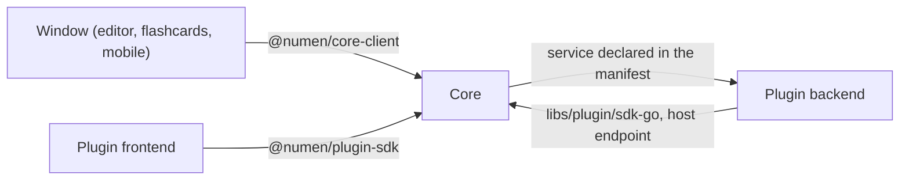

# Architecture & Repository Guidelines

This file describes the architecture of numen. It states where each part is located and which direction each dependency points. When this file and the code disagree, fix this file.

---

## 1. Monorepo organization

```text
numen/
├── Makefile                      # every gate and build; `make help` lists them
├── go.work                       # the Go modules below, used together in development
├── tests/                        # the one committed fixture vault, read-only and deliberately irregular; end-to-end suites
├── tools/                        # checks (registry, structural, style and documentation checks), lint-layers (ESLint and stylelint rules), lint-quality (knip), CI scripts
├── libs/
│   ├── core/
│   │   ├── kernel/               # Go: the hexagon
│   │   │   ├── domain/<area>/    # small packages of the core's own concepts (settings, theme, connections, the index, search sources, plugin information); no plugin and not the SDK imports them
│   │   │   ├── port/             # interfaces the use cases require
│   │   │   ├── usecase/          # one business scenario each, orchestrating ports
│   │   │   ├── adapter/          # cli, index, settings, window: the adapters the core exposes
│   │   │   ├── container/        # the composition root
│   │   │   └── internal/         # packages that nothing outside the kernel may import; adapter/plugin is the plugin adapter
│   │   ├── client/               # TypeScript: the client of the core for the windows and the plugin loader; private
│   │   └── protocol/             # the schema, and the Go and TypeScript generated from it
│   ├── note/                     # Go: what a note is and how it is written; plugins use it through the plugin SDK
│   │   ├── domain/               # entities, value objects, identifiers, invariants
│   │   ├── markdown/             # reading and editing a note's file
│   │   ├── textfile/             # the format of a text version's file
│   │   └── ulid/                 # the identifiers of notes
│   ├── plugin/
│   │   ├── sdk-go/               # Go: what a native plugin backend is built from; contracts/ holds the operation shapes (llm, acp)
│   │   ├── sdk-ts/               # TypeScript: what a plugin frontend is built from; src/contracts/ holds the same shapes
│   │   ├── loader/               # TypeScript: the loader of plugin frontends
│   │   ├── manager/              # Vue: the plugin list and the plugin page, data in by props and results out by events
│   │   └── catalog/              # Go: the plugin catalog, its manifests and their sources
│   └── ui/                       # Vue 3: `components` holds components that do not use the domain, `workbench` the window chrome
├── plugins/                      # one folder per plugin: manifest.json, backend/ (Go), frontend/ (Vue)
└── apps/
    ├── desktop/                  # the windows: Go host in cmd/ and internal/, pages in editor/ and flashcards/
    ├── mobile/                   # the phone build
    ├── landing/                  # the product's web page
    └── docs/                     # the published documentation site
```

`go.work` joins the Go modules for development. Each Go module is built and tested from its own directory, which is what the Makefile targets do.

---

## 2. Dependency flow

- **Libraries never depend on applications.** `libs/*` is what `apps/*` is built from, never the reverse and never sideways.
- **`core` points inward.** `domain/`, `port/` and `usecase/` import nothing from `adapter/`, and nothing that is a driver, a framework or a transport. The violation is always visible in an import block.
- **`ui` does not depend on the domain.** No component, story or fixture in `libs/ui/components` imports `@numen/protocol`, a wire type, a domain type, or anything under `apps/**`. A fixture taken from the domain brings the dependency back through test code.
- **`core-client` is the first-party client of the core.** `libs/core/client` (`@numen/core-client`, private, never published) holds the service clients, the transport, the enum codes, the error words, the manifest reader and the plugin catalog client that applications and the plugin host use to talk to the core. It depends on `@numen/protocol` and re-exports the generated types applications name. No plugin imports it (`tools/lint-layers`, `package-matrix`, `core-client-private` and `dependency-graph`).
- **`plugin-loader` depends on Vue, the plugin SDK and the core client.** `libs/plugin/loader` (`@numen/plugin-loader`) is the loader of plugin frontends and the build of the host modules an application serves them; it implements the plugin contract over the core client (the connections, the text links, the texts of a plugin) and reads a manifest through it. Each application that loads plugins implements its `LoaderHost`. It imports nothing of `@numen/ui`, `@numen/workbench`, `@numen/protocol` or an application, and no plugin imports it (`tools/lint-layers`, `dependency-graph`).
- **`plugin-manager` is a component library.** `libs/plugin/manager` (`@numen/plugin-manager`) draws the plugin list, the plugin page and the filters over view-model types it defines (`PluginInfo`, `PluginListing`, `ManagedPlugin`) and emits events; it imports `@numen/ui` and nothing else. The application reads the catalog through `@numen/core-client` and maps the entries to those types (`tools/lint-layers`, `package-matrix`).
- **`protocol` is generated, not written.** The data exchanged between the Go host and a window has the shape of the schema; `make generate-check` fails when what is committed is out of date.
- **An application connects the two sides.** `apps/desktop` translates the domain into the drawing vocabulary a component takes, and translates the identifier a component emits back.

## 3. Ports and adapters

Where a piece of Go code goes and how a port, a use case and an adapter are shaped: [`nm-place-core`](../skills/nm-place-core/SKILL.md).

- A **port is named after the need**, an **adapter after the technology**. The core requires a place to read a vault from. That the place is a filesystem and that the index is SQLite is known only in `adapter/` and `container/`.
- **The consumer of an interface declares it.** The implementation never names the interface. An adapter that imports the port package to declare that it satisfies the port adds nothing.
- **Driving and driven adapters are both adapters.** A CLI, a window and an MCP server drive the core; a database, a filesystem and a clock are driven by it. The core must not depend on which kind of adapter is used.
- **The plugin adapter (`libs/core/kernel/internal/adapter/plugin`) has two kinds of package, distinguished by name.** A package ending in `bridge` calls a plugin for the core (`commandbridge`, `providerbridge`, `sourcebridge`, `toolbridge`); a package starting with `host` handles the calls a plugin makes to the core (`hostendpoint`, `hosttext`, `hostvault`). `bridge`, `transport` and `manifestfile` are shared. The use case `pluginmanifest` lists what the manifests declare without calling a plugin, and the driving host packages live under `adapter/plugin`, so the plugin adapter imports none of them: the container gives it the endpoint through the port `HostEndpoint`. Neither side imports the other, bridges import no other bridge, no package below `internal/adapter/plugin` imports the root `plugin` package, and nothing in `internal/adapter/plugin` imports a sibling adapter. `.golangci.yml` (`plugin-*` depguard rules) and `the check `go/plugin-adapter-layers`` enforce this.
- **A use case is one business scenario**, and it defines the boundary of one unit of work, which is the transaction boundary.
- **Use cases are isolated.** No use case imports another, and each package below `usecase/`, nested ones included, is a use case of its own. What two share is a rule in the domain or a port both consume.
- **A port has at most five methods** (the lint limit) and three where practical. A port with one consumer is declared in that use case's package; `libs/core/kernel/port/<name>port` keeps the interfaces several use cases share.
- **A `domain/<area>` package of the core imports the standard library, `libs/note/domain`, `libs/plugin/catalog/manifest` and other domain packages**, and no other layer of the core and no third-party code. The manifest is a library of the plugin contract that never imports the kernel.
- **The window adapter is cut by wire service.** One adapter type per RPC service, each built from the use cases it calls; no object holds every use case or every service, and no struct holds more than five use cases.
- **A repository is a collection**: put an aggregate in, take one out, remove one. Searches and counts are separate queries, not methods on the repository.
- **Entities contain rules only.** No I/O, no clock, no framework tags, no knowledge of how they are stored.

## 4. The interface hexagon & Feature-Sliced Design (FSD)

The window frontends (`apps/desktop/editor`, `apps/desktop/flashcards`) are structured into **five FSD layers**. There is no `widgets` layer; a part that two pages use is a feature or an entity. Where each kind of window code goes and how a slice is shaped: [`nm-place-window`](../skills/nm-place-window/SKILL.md).

$$\text{shared (0)} \longrightarrow \text{entities (1)} \longrightarrow \text{features (2)} \longrightarrow \text{pages (3)} \longrightarrow \text{app (4)}$$

- **Directionality**: A module may only import from lower architectural layers and never from higher layers (ESLint `boundaries/dependencies` through `createLayerPolicies`, in the lint of the editor, the flashcards window and mobile, which CI runs as `npm run lint`).
- **Slice isolation**: A slice does not import from a sibling slice on the same layer. Shared code is in a lower layer. There is no `@x` cross-import; `dependency-graph` fails on one. A slice is imported from a higher layer only through its `index.ts`.
- **Import aliasing**: Imports crossing slice boundaries use the `@/` alias (e.g. `@/entities/note`), while intra-slice imports remain relative (`./model`, `./types`).
- **Segments**: Inside a slice the direction is `ui` → `model` → `api` → `lib`.
- **Calls to the core**: The `model` of a slice imports its own `api` directly. A component takes props only and emits events.
- **Commands**: A command is declared in the `model/commands.ts` of the feature that owns it; `entities/command` holds the `Command` type and `shared/model/command` the palette engine (registry, steps, values, keys, icons).

Component architecture enforces separation of concerns:

- **Pure logic**: Pure functions compute rendering data (coordinates, states, flags) with no dependencies on DOM, Vue, clock, randomness, or text measurement.
- **Presentational views**: Views receive precomputed data and render elements without executing business calculations in templates.
- **Platform capabilities as ports**: Clocks, `requestAnimationFrame`, viewport geometry, and media preferences are taken as parameters (§5), with browser defaults supplied by the caller.
- **Design tokens**: Styling is exclusively driven by design tokens defined in `src/tokens/`.
- **Lengths**: A length is a `rem` or `em` literal on the property or a token; a local custom property is optional. `px` only for a 1px hairline border.

## 5. Determinism

In anything pure — `domain/`, the model and arithmetic modules beside a component, the text cutting and chunking:

- **The machine clock is a port (Go).** `time.Now`, `time.Since` and `time.Until` appear only in the body of a clock port implementation, so a test controls the time. Timers (`time.After`, `time.NewTimer`, `time.Ticker`, `time.AfterFunc`) and randomness are not restricted in Go.
  - The Go rule is structural. the check `go/clock-port` (`tools/checks/structure/go/clock-port`) loads every module of `go.work` with go/packages, tests included, and fails on any reference to `time.Now`, `time.Since` or `time.Until` outside the body of a method `Now() time.Time` whose receiver implements a clock port (an interface declared in non-test code whose only method is `Now() time.Time`). Generated files are skipped. No path, file or name is listed, forbidigo has no time pattern, and the test asserts that it finds the real clock implementations. It runs with `make checks ONLY=go/clock-port`, which CI's Go job runs.
- **A pure segment holds no clock, no timer, no randomness and no measuring (TypeScript).** The reason is that `lib/` is pure: its output is a function of its arguments. `Date.now()`, `new Date()` with no arguments and `performance.now()` are banned in every package by `no-restricted-syntax` (`createClockSelectors` in `tools/lint-layers/base-eslint.mjs`), except inside the declaration of `getNow` in `libs/ui/components/src/shared/api/dom.ts` and of `getMonotonicNow` in `libs/ui/components/src/shared/api/clock.ts`. In every `lib/` and `domain/` segment `createPureSegmentConfig` also bans `setTimeout`, `setInterval` and `Math.random`; `Math.random` stays banned in every non-test file. A stateful `model/` module that debounces or polls is not a pure segment and may schedule through an injected clock. Other code takes the time from `getNow` (exported by `@numen/ui`) or from an injected clock, and tests control it with fake timers. `tools/lint-layers/clock.test.mjs` proves a stray `Date.now()` fails and `getNow` passes.
- **The same input gives the same output** on any machine on any day. A chunk identified by its text is the same identifier on either platform.
- **No error is swallowed.** An empty `catch {}`, a discarded `_ = fn()` and a floating `void promise` are all forbidden. An error is handled, returned or wrapped.

## 6. One name for one thing

A concept is named with the standard term of its field.

## 7. Everything exists because a decision requires it

For every field parsed, column stored, syntax accepted or option offered there is a decision that requires it. A parsing rule nobody specified was invented by whoever wrote it, and once a vault is full of what it accepts, the guess is permanent. This applies most to things that look free: a tag, an extra frontmatter key, a convenience flag.

Equally: do not abstract before there is a second case, and do not leave a genuinely needed seam missing.

## 8. Size and complexity limits

Cyclomatic complexity, nesting depth and function length are rules. Go, TypeScript and Vue take one set of limits:

| Limit                               | Maximum | Go (`.golangci-structure.yml`) | TypeScript and Vue (`tools/lint-layers/base-eslint.mjs`) |
| ----------------------------------- | ------- | ------------------------------ | -------------------------------------------------------- |
| Cyclomatic complexity of a function | 12      | `cyclop` `max-complexity`      | `complexity` (10)                                        |
| Nesting depth of control blocks     | 3       | revive `max-control-nesting`   | `max-depth`                                              |
| Function length in lines            | 80      | `funlen` `lines`               | `max-lines-per-function`                                 |
| Function length in statements       | 50      | `funlen` `statements`          | `max-statements`                                         |
| Parameters of a function            | 6       | revive `argument-limit`        | `max-params`                                             |

A configuration may set a lower value than the table and never a higher one. The TypeScript configuration sets complexity 10 in every package, parameters 4, and a file at most 350 lines of code (`max-lines`, comments and blank lines aside) in a window, a plugin and a library, 250 in the mobile window; the Go configuration also runs `gocognit` (15), `nestif` (3) and `maintidx`. A Vue file also has limits for its blocks: the script block 100 lines, the template 140 lines, template depth 4, 6 inline props, 3 statements in a `computed`, and 8 properties a composable (`use...`) or a factory (`create...`) returns, counted in an object literal, through a returned variable, and in the type of a returned call result or annotated value; a returned object has no spread, no group of one key and no group named for what it wraps (`base`, `parts`, `services`, `frame`, `helpers`, `utils`, `deps`), no group that only re-exposes three members of the parts the function calls (`numen/max-composable-return-properties`, tested in `tools/lint-layers/composable.test.mjs`). Test files (`_test.go`, `*.test.ts`, `*.stories.ts`) are outside these limits. A function over a limit is split by responsibility.

A structure is judged by what one object does, not by the interfaces it is cut into.

- **A struct is bounded.** An adapter or container struct has at most 20 methods and 15 fields, a use case at most 12 methods and 12 fields. A struct that grows past it is cut by responsibility into several objects, each with its own state.
- **A file and a package are bounded.** A source file has at most 500 lines. A package in the Go core has at most 3000 lines. An import count has no limit. A file is split when it holds a second responsibility: a section with its own state, a part rendered on its own elsewhere, a concern that can be exercised separately. A folder that collects a kind rather than a thing is a finding: every entity in one file, every use case in one package, readable at five and unreadable at fifty.

### What each object does

- **An adapter owns one technology and holds no business rule.** It stores, reads, translates and routes; a decision about a note, a vault or a card is a use case or the domain.
- **Scenario logic lives in a use case.** A handler, a command or a window service decodes, calls one use case and encodes.
- **Shared code is a domain, a port, a use case or a named helper with a reason.** It is never a folder collected for reuse that no check walks.
- **Driving adapters live under `adapter/`:** `adapter/cli`, `adapter/window/<service>` (one folder per wire service) and `adapter/plugin/<host endpoint>`.
- **The plugin backend's `service` package is the composition root and the wire.** It builds the adapters and use cases and holds one handler per method; the rules of the plugin are in its domain and use case packages.
- **A plugin frontend is a set of slices.** Another part of the plugin imports a slice through its `index.ts` only.
- **A permission guard is a table that denies by default.** Each method or call has a row naming the permission it needs; a method with no row is refused.
- **An unknown type appears only at a declared parse boundary.** Past it, the value has a named type.
- **One host concern has one runtime port.** The clock, the filesystem, the environment and the process each reach the code through a single interface.
- **A `catch` handles the failure.** It recovers, reports it to the person or returns a typed error; it does not discard it.
- **Production code is written for its callers.** A test uses the real object or a fake at the outer edge; a seam, a field or a method that exists only so a test can substitute it is removed.

## 9. Zero exceptions

A rule has no exception. There is no `nolint`, `eslint-disable`, `@ts-ignore`, `@ts-expect-error` or `@ts-nocheck` comment, no `exclusions` or `exclude-functions` in a linter configuration, no file named in an `ignores` or `files` entry, and no list of files in a check. What a rule rejects is fixed. A scope that differs is stated by a shared property: `_test.go` files are in scope, and generated code is found by its `Code generated ... DO NOT EDIT` header. `no-suppressions` in `tools/lint-layers` fails on each marker.

## 10. Rules that enforce the boundaries

A check decides by structure. Where an off-the-shelf tool exists, the check is that tool with a configuration: dependency-cruiser for package boundaries and import cycles, depguard and gomodguard for Go imports and `go.mod` requires, golangci-lint linters, stylelint for style sheets. A hand-written check works only on syntax trees, import graphs and type information. A check does not match a word, a regular expression or a list of names against code or comments.

`tools/checks` states each rule once, over a capture or a set derived from the repository, and declares a minimum of what it examines, so a check over nothing fails. Each rule has its own folder with a planted-violation test (`check.test.mjs` or `check_test.go`) and is listed in `tools/checks/rules.json` with the files it reads and its tags. `make checks LIST=1` prints the registry and `make checks TAGS=?` the tags; `make checks CHANGED=1` runs the checks whose files a change touches. The rules:

- `make checks TAGS=go,structure` (the Go module `tools/checks/structure/go`, one folder per check, shared loading in `load/`): the layers of the core, the machine clock, the plugin dependency rule of §11 and the encapsulation of the protocol by the Go SDK. It also holds that no core package declares an alias of another core package's type (`go/core-reexport`), that an adapter is driving or driven and not both and a driving adapter references nothing declared under `port/` (`go/adapter-role`), that an interface stays within the `interfacebloat` maximum counting embedded methods (`go/interface-size`, counted in the kernel, the notes library, the SDK, the applications and the plugins), that no function of a port calls a method of an interface value (`go/port-calls`), and that `container` is the one composition-root package with none below it (`go/composition-root`), that no struct holds more than five use cases (`go/struct-use-cases`), and that no package outside `container` and the application roots imports both a use case and a driven adapter (`go/wiring-package`).
- `make checks ONLY=go/note-library`: the layer and purity rules of `libs/note`; a package of `libs/note` that the check does not list fails.
- `golangci-lint` (CI job `core-lint`): `.golangci.yml` depguard rules for the domain and use cases of `libs/core/kernel`.
- `golangci-lint` in `libs/note`: depguard rules of `libs/note`, which depends on nothing of this repository.
- `sdk-isolation`: the Go SDK imports no core and no application.
- `sdk-ts-encapsulates-protocol`: no exported declaration of an entry in the `exports` of `@numen/plugin-sdk` reaches a declaration of `libs/core/protocol`.
- `go/dead-exports`: every RPC of a service of `libs/core/protocol` and every export of `libs/plugin/sdk-go` and `libs/plugin/sdk-ts` has a consumer outside tests; the files generated from a contract (`*.pb.go`, `*_pb.ts` under `contracts`) hold no item; the check keeps no list of allowed items (§11 (l)).
- `ts/contracts-imports`: no file under `libs/` outside `libs/plugin/sdk-go/contracts` and `libs/plugin/sdk-ts/src/contracts` imports a contract; only plugins and applications do (§11 (l)).
- `ts/duplication`: no block of code repeats across files. It reads code only: declarations (`*.yml`, `*.yaml`, `go.mod`, `go.sum`, `Makefile` and plugin `manifest.json`) repeat by nature, since every plugin declares its own types, fields and settings, and are out of its scope (AGENTS.md §15 rule 16).
- `ts/plugins`: a plugin file names only the main entry of `@numen/plugin-sdk` and `@numen/ui`, the test entry, a stylesheet, and `./contracts` of `@numen/plugin-sdk`. The golangci configuration of `libs/plugin/sdk-go` equals the root one except `depguard` and `importas`, which hold the import rules of the SDK's own packages.
- `library-matrix`: every `go.mod` under `libs/` depends only on the families its row allows.
- `package-matrix`: every `package.json` under `libs/` declares only the libraries its row allows.
- `protocol-declared-only-by-clients`: only `@numen/plugin-sdk` and `@numen/core-client` declare `@numen/protocol`.
- `core-client-private`: `@numen/core-client` is private and no plugin relies on it.
- `dependency-graph`: dependency-cruiser decides package boundaries, segment direction and import cycles for libraries, applications and plugin frontends.
- `styles-use-tokens`: stylelint allows no colour literal, no `--numen-` declaration outside token and theme files, no `var()` fallback and no undeclared token. Its rule `numen/no-bare-length` (`tools/lint-layers/stylelint-plugin.mjs`), on in `libs/ui`, `libs/plugin/manager`, `apps/desktop` and `plugins/*/frontend`, also fails any `px` except a 1px border width, a unit other than `rem` and `em` and `px` in a custom property; a `rem` or `em` literal may stand on a property (`padding: 0.3rem`) or in any custom property (`--max-width: 40rem`). Zero, percentages and viewport units pass; token and theme files are exempt. `tools/checks/structure/ts/styles/check.test.mjs` lints a planted component that must fail.
- `numen/no-style-declaration-read`: an ESLint rule of `tools/lint-layers/base-eslint.mjs`, so in the lint of every package built from `createBaseConfig`. It fails any read of a value of type `CSSStyleDeclaration` (`getComputedStyle(...)`, `element.style`, a parameter of that type) in `*.test.ts`, `*.stories.ts`, `fixtures/` and `testing/`; writes (`style.left = ...`, `setProperty`, `removeProperty`) pass. It decides by type with typescript-eslint, so no list of property names. `tools/lint-layers/styleDeclaration.test.mjs` lints a planted file against the DOM library.
- `all-ts-packages-eslint`: every TypeScript package has ESLint configured.
- `npm run lint` passes in `libs/ui/components`, `libs/ui/workbench` and `libs/plugin/loader` (CI jobs `ui` and `frontend`).
- `strict-lint-rules`: every package resolves `no-void`, `no-empty`, `no-empty-function`, `no-floating-promises` and `no-misused-promises`. A package is a directory with an ESLint config or a `package.json`; none is left out.
- `typecheck-covers-sources`: no `exclude` entry of a `tsconfig*.json` names a tracked file. Only build output, which is not tracked, is excluded.
- `no-suppressions`: §9.
- `every-path-has-a-layer`: fails on a module that is in no layer.
- `workspace-lists-every-module`: `go.work` lists every `go.mod`.
- `json-keys-camelcase`: every JSON key in a plugin manifest, API fixture and TypeScript JSON type is `camelCase`.
- `plugin-config-golden-parity`: plugin lint configurations match `plugins/.example/` and the root `.golangci.yml`; `eslint.config.js` and `numen-rules.mjs` are byte-identical copies of the golden files.
- `plugins-frontend` with the golden `eslint.config.js`: a file of a `lib` segment imports no `ui`, `model` or `api` segment at any depth and no `.vue` file (`no-restricted-imports`), and every component passes `numen/max-inline-props`, `numen/vue-script-sections` and `numen/max-script-lines` from `numen-rules.mjs`. `tools/checks/structure/ts/plugins/golden-config.test.mjs` lints planted files in a copy of the template.
- `plugin-backend-layers`: the layers inside a plugin backend point inward.
- `go/plugin-boundary` and `go/plugin-isolation-packages` (`make checks TAGS=plugin,go`): apply the dependency rule of §11 to the type-checked import graph on 14 platform targets.
- `plugins-leakage`: manifest schema and static non-leakage.
- `plugins-use-main-entry`: the SDK and the UI library are imported through their declared entries.
- `plugins-frontend`: no `@/**` and no `@plugins/**` in a plugin frontend.
- `plugins-isolation-capture`: a file under `plugins/(X)/` references no other plugin.
- `plugins-hold-no-schema`: no `.proto` file under `plugins/(*)/`.
- `no-component-below-ui`: no `.vue` file of a library, a window or a plugin frontend lies in a `lib`, `api` or `model` segment.
- `public-component-has-story`: every component exported from the public entry of `@numen/ui` or `@numen/workbench` is drawn by a story file of its library. A story file draws a component when it imports it, directly or through a folder `index.ts`, and uses it as the `component:` of a story or of the default export, or as its render target; a mention in a type or a list is no use. An exported story that draws no component fails.
- `emitting-component-has-play-story`: every public component whose script calls `defineEmits` or `defineModel` has a story that draws it whose `play` function, its own or the default export's, asserts with `expect(` on a spy or an emitted payload; an empty play or one that asserts only the page fails.
- `story-files-lint-storybook-recommended`: a story file of `@numen/ui` and `@numen/workbench` resolves every rule of the recommended config of `eslint-plugin-storybook` at the severity the plugin gives it, and `storybook/csf-component` is off.
- `core-client-only-in-api`: a window imports `@numen/core-client` only from an `api` segment and from its entry `src/main.ts`.
- `shared-serves-several-slices`: a shipped file of a window's `shared` layer is imported, directly or through other shared files, from more than one slice; a file one slice uses belongs in that slice.
- `app-is-composition`: a shipped file of a window's `app` layer is at most 300 lines, is not named `use<Name>` and exports no `use<Name>` composable, starts no watcher, listener or timer, holds no `switch` and takes at most one decision (`if`, `?:`, `&&`, `||`, `??`, an array method with a callback, loop, `catch`) in a function and three in a file; state and behavior belong to a slice, `app` creates, connects and orders.
- `app-takes-concrete-inputs`: a function of a window's `app` layer takes at most eight inputs, its parameters or the members of the object it takes, and none narrows the result of another function of `app` with `Pick`, `Omit`, `Partial`, `Required` or `Readonly`; each stage names what it uses.
- `npm run lint` in `apps/desktop/editor`, `apps/desktop/flashcards` and `apps/mobile`: the FSD layer hierarchy (§4): no import of a higher layer, no import of a sibling slice, a slice reached only through its `index.ts`. `tools/lint-layers/layers.test.mjs` proves the policies on planted files.

Outside `tools/checks`, `host_permission_test.go` contains the permission rule: the core refuses a call whose permission the plugin's manifest does not declare, for any client of the host endpoint.

## 11. Plugin model

Where a plugin's code goes and how a plugin is cut: [`nm-place-plugin`](../skills/nm-place-plugin/SKILL.md). Which library shared code belongs to: [`nm-place-library`](../skills/nm-place-library/SKILL.md).

These rules apply to every change to `libs/plugin/sdk-go`, `libs/plugin/sdk-ts`, `libs/core/client`, `libs/ui`, `libs/plugin/loader`, `libs/plugin/manager`, `libs/core/kernel`, `apps/*` and `plugins/`.

**(a) The core routes every call.**



- A window of the application (editor, flashcards, mobile) calls the core only through `@numen/core-client`.
- A plugin's frontend is part of the plugin. It calls the core only through `@numen/plugin-sdk`.
- A plugin's backend is a process the core starts. It calls the core only through `libs/plugin/sdk-go`.
- A window or a plugin frontend calls a plugin's service through the core. The core forwards the call to the backend whose manifest declares the service.
- A backend calls the host endpoint of the core. The core checks the call against the permissions of the plugin's manifest.
- Windows and plugins never call each other directly.
- A plugin's own service is named after its plugin id. The protocol services a plugin implements are generic: `numen.v1.ProviderService` (connection operations), `numen.v1.SearchSourceService` (a search participant) and `numen.v1.PluginToolService` (tools). A plugin reports its health through `numen.v1.PluginHealthService`, which the core serves.
- Plugins are trusted code. The core runs no plugin in an iframe or a sandbox and gives a frontend no capability token. The token the core gives a backend process identifies to the core which plugin makes the call; it is not a sandbox.

**(b) A plugin depends on the SDK only.** A plugin depends on the plugin SDK (Go: `libs/plugin/sdk-go`; TypeScript: `@numen/plugin-sdk`) and on third-party code. Its frontend also depends on `@numen/ui`. A plugin never imports or requires `libs/note`, `libs/core/protocol`, `@numen/core-client`, `@connectrpc` or another library of this repository. The rule is about direct requires and imports: an `// indirect` line for `libs/note`, `libs/atomicfile` or `libs/core/protocol` in a plugin's `go.mod` comes from Go, because the SDK depends on them.

**(c) The SDK contains what plugins use.** The shared SDK holds only code that plugins of more than one family import: host calls, the server lifecycle, the generic connection, search source, health and tool clients, and a testing harness. The shapes of operations are contracts in `libs/plugin/sdk-go/contracts/<name>` and `libs/plugin/sdk-ts/src/contracts/<name>` (§11 (l)). The SDK holds no concrete agent, engine or runtime (for example ONNX), and no application-side API: the catalog client, the manifest parser, the transport and the raw core clients that only windows use are in `@numen/core-client`. A type of the SDK may be an alias of a `libs/note` type. Each type has one name in the SDK; there is no second set of names for the same types.

**(d) No protocol inside a plugin.** A plugin has no `.proto` file and no protobuf code. Its backend serves its own frontend through JSON methods (`server.Handle` and `server.Stream` of the Go SDK, `createApi` of `@numen/plugin-sdk`).

**(e) Code may be duplicated between plugins.** Code that several plugins use may be copied into each of them. No check pushes code into the SDK or `@numen/ui`; a check that does so is wrong and is corrected.

**(f) Who may use `@numen/protocol` and `@numen/core-client`.** Plugins rely on the SDK and `@numen/ui`. `@numen/core-client` and the protocol are for the windows and the SDK:

- Only `@numen/plugin-sdk` and `@numen/core-client` import or declare `@numen/protocol`. The package matrix gives `@numen/core-client` the row `[@numen/protocol]` and `@numen/plugin-loader` the row `[@numen/plugin-sdk, @numen/core-client]`.
- `@numen/core-client` is private. Applications (`apps/*`) and the plugin host (`libs/plugin/loader`) use it; no plugin does.
- `libs/plugin/manager` is a component library. It depends on `@numen/ui` only, takes data by props and emits events. It contains the view-model logic (filters, query parsing, states) and declares a port interface for the gateway; the application implements the gateway.

**(g) The core knows no plugin by name.** Plugins are discovered through their manifests. A manifest declares what it contributes (`contributes`: `tabKinds`, `settingsViews`, `slots`, `themes`, `readers`, and the rest listed in `docs/plugins/README.md`). A plugin id appears nowhere in `libs/core/kernel`, `apps/*` or `libs/ui`. The plugin index is generated from the manifests at build time.

**(h) The kernel contains defaults only.** The kernel contains the default theme, the effective search floor and its default value. Calibration, update checks and preset themes are plugins.

**(i) Time is a port.** Logic that depends on time takes a clock as a port, so a test controls the time. In Go a plugin takes the clock of the SDK package `clock` or declares its own; the check in §5 accepts a read of the machine clock inside any method `Now() time.Time` that implements a declared clock port. In TypeScript the time comes from `getNow()` of `@numen/ui` or from an injected clock.

**(j) The SDK and `@numen/ui` are published.** `libs/plugin/sdk-go`, `@numen/plugin-sdk` and `@numen/ui` are packages with a versioned public contract that plugin authors and other consumers depend on, so an exported name, a type and a behavior are a contract: a change that breaks one raises the major version. `libs/note` is built inside this repository and reached by plugins only through the SDK. A plugin imports only the SDK and builds outside this repository only after the SDK is published (`go/plugin-boundary`, `go/plugin-isolation-packages` and `dependency-graph`). `@numen/core-client` stays private. Iframe isolation of plugin frontends comes later.

**(k) Plugin kinds and storage.** A plugin has a backend kind, and the kind decides who runs it.

- `process` is the kind today: the core starts the backend as an operating-system process (`backend.type` in the manifest).
- `wasm` is a later kind: the plugin is a WebAssembly module that the core runs in its own runtime, with one compilation cache for the host, keyed by the hash of the module, that plugins neither see nor write. The manifest does not change for it yet and the core builds no support for it; `libs/plugin/sdk-go/wasm` contains the cache that a plugin embedding a WebAssembly module of its own (PDFium) stores in its granted directory.
- Directories are granted by the host, four of them. Two are private to a plugin: a cache directory and a data directory, created before the plugin starts, readable by the user alone and never shared between plugins, at `<cache root>/plugins/<plugin id>` and `<data root>/plugins/<plugin id>`. Two are shared by every plugin: `<cache root>/shared` for what can be computed again, and `<data root>/shared` for what is downloaded or made and cannot be computed again. The application chooses the two roots from the platform's own folders.
- A plugin reads `NUMEN_PLUGIN_CACHE_DIR`, `NUMEN_PLUGIN_DATA_DIR`, `NUMEN_SHARED_CACHE_DIR` and `NUMEN_SHARED_DATA_DIR` (`cache.GetPluginDir`, `cache.GetDataDir`, `cache.GetSharedDir`, `cache.GetSharedDataDir` of the SDK; `cache.GetSharedDirOrPluginDir` and `cache.GetSharedDataDirOrPluginDataDir` fall back to the private directory when an older host grants no shared one) and never computes a platform path. A plugin that gets no directory keeps its cache in memory.
- The private cache directory holds what the plugin can compute again; the core removes it when the plugin is uninstalled or its version changes. The private data directory holds what the plugin cannot compute again and stays across updates.
- The shared directories exist so that one model is one copy on the machine, however many plugins run it. Models are in the data side, since the operating system may purge a cache and a model is gigabytes (`<data root>/shared/models`, which `NUMEN_MODELS_DIR` set by the user moves, and which the host passes to every plugin as `NUMEN_MODELS_DIR`); compiled CoreML models are in the cache side (`coreml/<model digest>/`). Entries are named by their digest. A writer puts the content in a temporary file in the same directory, checks its digest and only then renames it into place; it does not check a file again on every load. Two writers of one entry take the lock `shared.Lock` of `libs/plugin/sdk-go/shared`. A plugin never deletes what is in a shared directory and the core never deletes one on a version change; a size limit and eviction are the core's, later. The models the core provisions (`NUMEN_DEPENDENCY_*`) are stored there too. The core reads no earlier location: nothing is migrated.

**(l) The core is a microkernel.** The core, the core protocol (`libs/core/protocol`) and the shared SDK know no plugin domain: no agent, no model, no engine and no single plugin. The core holds notes, vaults, the index and its storage, search, text versions, windows, settings, the plugin host and the generic connection mechanism.

- A connection operation is opaque to the core. The core knows its name (`llm.chat`, `acp.task`), the rows of the calling plugin in order, the priority (interactive or background), the queue of each connection, cancellation, the outcome (try the next row or stop, with a reason from a fixed list) and the stream of frames. The payload and the frames are bytes. A model list or a reasoning level reaches the settings page as generic options through an `optionsFrom` operation ([`docs/plugins/providers.md`](../../docs/plugins/providers.md), [`docs/plugins/connection-rows.md`](../../docs/plugins/connection-rows.md)).
- The shape of an operation is a contract: protobuf messages with a typed client and a typed provider adapter in `libs/plugin/sdk-go/contracts/<name>` and `libs/plugin/sdk-ts/src/contracts/<name>`. `llm` holds `llm.complete`, `llm.chat`, `llm.embed`, `llm.rerank`, `llm.profile`, `llm.models` and `llm.reasoning`; `acp` holds `acp.task`. Only plugins and applications import a contract; the core, the core protocol and the rest of the SDK never do (`ts/contracts-imports`).
- The core owns all index storage. Search is one participant protocol: the core hands each participant the texts to index and the place in the index database for its data, asks every participant the same query and merges the rankings by one method. The words and the section names are participants built into the core. A plugin with the capability `search.source` adds one through `numen.v1.SearchSourceService` and describes it by an opaque recipe, a vector width and a chunk size, never by a model ([`docs/architecture/search-participants.md`](../../docs/architecture/search-participants.md)).
- A plugin reports its health through `numen.v1.PluginHealthService` (`Report` and `Clear` of a `health.Client` from `health.NewClientFromEnv` or `health.NewClientFromVars` in Go, `context.health` in TypeScript). An item has a key, a severity, a text and an optional command action. The core adds its own items for a failed start, a failed `Configure` and a search source. A lasting failure is a health item; a task reports progress only.
- An agent is a provider of `acp.task`: agents-claude, agents-codex and agents-antigravity for the CLIs of Claude Code, Codex and Antigravity, agents-acp for ACP programs, agents-numen for its own loop over `llm.chat`. A plugin that runs an agent calls `acp.task` on the connection rows of its settings. The core starts no agent program and keeps no agent setting.
- A protocol RPC or an export of the shared SDK serves plugins of more than one family. What one plugin or one family uses lives in that plugin or in a contract. What nothing outside tests uses is deleted (`go/dead-exports`).
- Every new package, type, RPC or export of the core, the core protocol or the shared SDK answers one question: which product domain does it know, and why is it not in a plugin or a contract? The answer "none" is the only one that keeps it there.

### Comparison with established architectures

- **Clean Architecture dependency rule.** Source code dependencies point inward. Here the plugins are the outermost ring. The SDK is the interface between the core and the plugins. The core loads plugins by manifest and never imports them. Composition roots (`libs/core/kernel/container`, the application entry points) wire the concrete parts together.
- **VS Code extension API.** VS Code exposes a curated API surface and runs extensions in a separate extension host process. New API is added through a deliberate review. The equivalent rule here: every SDK export needs a plugin that uses it, and each plugin backend runs as its own process.

The VS Code points come from its public documentation, and the Clean Architecture points from the book and its commentary. Both are secondary sources for this repository; the rules above are binding, the comparison is context.

### Why duplication

A shared implementation library couples the plugins that use it: a change for one plugin forces a rebuild and a re-test of every other plugin that imports it. A copy changes with its plugin only. The cost of a copy is bounded by the plugin; the cost of shared-code coupling grows with every plugin added.
