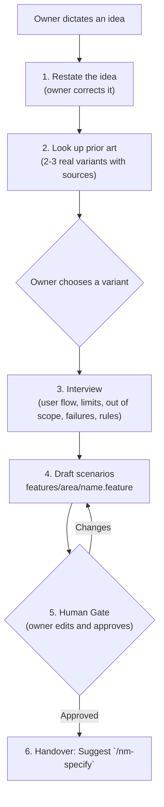

# Feature Skill (`/nm-feature`)

The `/nm-feature` skill turns the owner's idea into scenarios in `features/<area>/<part-of-the-feature>.feature`. The scenarios are the lasting record of the intended behaviour. The format is in [`.agents/rules/gherkin.md`](../../rules/gherkin.md). The owner approves the feature file; no one else edits the scenarios.

---

## No Technical Details

The feature file and the interview talk about what the person sees and does, in domain words. No file names, tables, code symbols, routes or UI controls (button, field, panel, palette, menu). Technical decisions belong to `/nm-specify`.

---

## Step 1: Restate the Idea

Write the idea back in a few sentences: who, what, why. Ask the owner to correct it. Resolve a slug (`feat-deck-export`) for the local task folder `.agents/tasks/<slug>/` (not committed), and the area and file name for the feature file. Look in `features/` first: extend an existing file when the behaviour belongs to it.

## Step 2: Look Up Prior Art

Before proposing any scenario, search the web and the products people know (Obsidian, Notion, VS Code, JetBrains, Apple and Google apps, whatever fits) for how the same behaviour is done. Show 2 or 3 real variants, each with its source link and what it means for the person using it. Let the owner choose or combine. Ask how the behaviour looks from the person's side, step by step.

## Step 3: Interview

Ask in batches of a few focused questions. The five lenses help:

| Lens                      | What to clarify                                                              |
| :------------------------ | :--------------------------------------------------------------------------- |
| User flow                 | What problem does this solve? What does the person do, step by step?         |
| Limits and edge cases     | Empty input, large data, interruptions, boundaries.                          |
| Out of scope              | Which related behaviours are not part of this?                               |
| What can fail             | What goes wrong, and how does the person find out and recover?               |
| Rules that never break    | Data, permission and security rules the feature must keep.                   |

## Step 4: Draft the Scenarios

Write the scenarios in plain English of level A1 to A2 and with neutral, short data, as `.agents/rules/gherkin.md` section 4 says: no stories, no scenery, no adverbs of time or manner in titles, steps of at most 8 words outside the quoted values.

Write `features/<area>/<part-of-the-feature>.feature` following [`gherkin.md`](../../rules/gherkin.md). A limit, a failure and a rule that must hold each become a scenario. Out-of-scope items and limits that no scenario can show go to `.agents/tasks/<slug>/scope.md`, a short local list that `/nm-specify` and the reviewer read.

## Step 5: Human Gate

Show the file and ask the owner to edit it. Revise until the owner approves.

## Step 6: Handover

> **Feature saved in `features/<area>/<name>.feature`.**
> _Next step:_ Run `/nm-specify` to map the scenarios to contracts, layers and tests.
