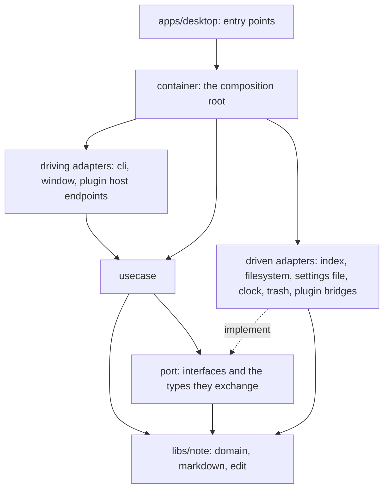

# Placing code in the Go core

This guide says which layer a piece of Go code belongs to and what shape it takes there. The architecture is pure hexagonal: the core points inward, a use case orchestrates ports, an adapter holds technology and no domain rule, and an application is a thin shell. The structural checks refuse the wrong placements they can see; this guide covers the choices a check cannot make. Read neighbouring code for its vocabulary, but take the placement from this guide: where a package in main differs from it, this guide is the target.

The rules this guide serves are in `AGENTS.md`, `.agents/rules/architecture.md`, `.agents/rules/coding-style-backend.md` and `libs/core/kernel/AGENTS.md`. Depth is in the sibling files: [layout.md](layout.md) holds the folder tree, [examples.md](examples.md) holds worked examples, [judgement.md](judgement.md) holds the calls no check decides, [plugins-and-apps.md](plugins-and-apps.md) holds the plugin adapter and the applications.

## The shape

Dependencies point from the outside inward: `libs/note/domain` imports nothing of this repository, `libs/core/kernel/domain/<area>` imports only the standard library, `libs/note/domain` and itself, `port` and `usecase` import the domain and never an adapter, an adapter imports the core and never another adapter, and only `container` names a driven adapter next to the port it satisfies.

- A domain type is a fact about notes, vaults, links or cards, with the rules that follow from the values alone, and it lives in `libs/note/domain`.
- A concept of the core that is not about notes (settings, theme, connections, the index, search sources, plugin information) is a small package `libs/core/kernel/domain/<area>`. Ports and use cases import it; a plugin and the SDK never do. The sentinel errors of an area are declared in its package. A use case may call `crypto/rand` and timers; only the machine clock stays behind a clock port.
- A port is an interface a use case requires from the world outside the core, named after the need and declared by the code that calls it.
- A use case is one business scenario: it takes ports and domain values, orchestrates them and returns a result, and it is the unit of work and of the transaction.
- A driving adapter receives a request from a person or a program (CLI, window, a plugin calling the host), turns it into the arguments of a use case, calls the use case and turns the result back.
- A driven adapter implements a port with a technology (SQLite, the filesystem, the OS trash, a plugin process, the machine clock) and decides nothing about notes.
- The composition root (`libs/core/kernel/container`) is the one package that selects which concrete adapter satisfies which port, creates every use case with its ports, and hands the use cases to the driving adapters.
- An application (`apps/desktop`) parses its flags, builds the `container.Config`, starts the toolkit and routes; it holds no scenario and no rule about notes.

An adapter is driving or driven, never both. A package that would be both is split into two packages whose names say which each is.

## What each layer holds

- `libs/note/domain` holds entities, value objects, identifiers (`NoteID`, `VaultID`, `CardFaceID`), the errors that name a refusal, and the rules that need only those values. It does no I/O, reads no clock, and knows no storage and no wire format.
- `libs/note/markdown`, `edit`, `textfile` and `ulid` hold the format of a note's file and the identifier scheme. They are pure and take time and entropy as arguments.
- `libs/core/kernel/port/<name>port` holds the interfaces that several use cases share, at most five methods each and three where practical; the types they exchange and the sentinel errors a caller tests with `errors.Is` are in `domain/<area>` or `libs/note/domain`. It holds no function that calls a method of an interface value, no default behaviour and no policy.
- `libs/core/kernel/domain/<area>` holds the core's own concepts that are not about notes, as small packages, with the errors of the area. It does no I/O and reads no clock.
- `libs/core/kernel/usecase/<name>` holds the use cases of one bounded context, one per file, each isolated from the others, with its request and result types, the small interfaces only that use case consumes, and the policy of the scenario (order of steps, what is reported). It holds no `os`, no SQL, and no clock read.
- `libs/core/kernel/adapter/*` and `libs/core/kernel/internal/adapter/*` hold technology: the settings file, SQL, directory watching, process management, toolkit calls. They hold no rule about what a note is.
- `libs/core/kernel/container` holds wiring only: constructors called in order, ports bound to adapters, use cases created and passed on.

## I am adding X

| I am adding | It goes in | Who calls it |
| --- | --- | --- |
| A capability a person triggers (rename a folder, export a note) | A use case in `usecase/<noun>`, one file, an `Execute` method | A driving adapter method, to which `container` hands the created use case |
| A fact or rule about notes, links, cards or vaults that follows from the values (what makes a connection valid, which role is the inverse of which) | A method or function in `libs/note/domain`, or in `markdown` when it is about the file's text | The use cases that need it |
| A rule that also needs stored data (a connection must not make a cycle in the stored hierarchy) | The deciding part in the domain with the data as a function parameter; the use case reads the data through a port and passes it | The use case |
| A new storage (a table, a file, a cache) | A driven adapter implementing a port the use case declares; schema, SQL and file layout stay inside the adapter | `container` binds it; the use case calls the port |
| What to store, when to read it again, which of two values wins | The use case; the adapter stores and reads exactly what it is told | The driving adapter, through the use case |
| A new RPC or CLI command | A method on the driving adapter that parses the request, calls one use case and maps the result; the schema change goes through `libs/core/protocol` | The window or the CLI |
| A new setting | The value and its constraints as a domain value or a settings declaration; reading, writing and applying through the settings use cases; the file layout in `adapter/settings`; a consumer is handed the value by `container` | The consumer, which never opens the settings file |
| A new plugin host call (something a plugin asks of the core) | A method on a `host*` driving package of the plugin adapter that maps the call and calls a use case; the permission check of the host endpoint stays where it is | The plugin, through the SDK |
| A new call from the core to a plugin | A port the use case declares, implemented by a `*bridge` driven package | The use case |
| The current time | `machineport.Clock`; the use case calls `Now()` and passes the instant on | The use case; the domain receives the instant as an argument |
| A new identifier | The use case calls `ulid` with `crypto/rand` and the instant from the clock port; the domain receives the identifier | The use case |
| A new content type or reader | A row a plugin contributes to the content type table (`contenttypeport`); the core names no plugin | The existing file use cases |
| A new window or entry point | A package in `apps/<app>/cmd` and `app` that calls `container`; its only logic is options and the toolkit | The user's launcher |
| A result type that a use case and an adapter both name | A type in the use case package, or in `domain` when it is a fact about notes | Both import it from there |

## How a port is cut

- The use case that needs a thing declares the interface: in the use case package when one use case package consumes it, in `port/<name>port` when several do. The adapter that satisfies it never names it, and no `var _ port.X = ...` line appears in an adapter.
- The name states the need: `VaultReaders`, `Clock`, `Trash`, `FloorStore`. The technology (`SQLite`, `Fs`, `Os`) appears only in the adapter's package and type names.
- A port has at most five methods (the lint limit) and three where practical. When a use case needs seven operations, it needs two or three ports of that size, and each use case takes the ones it calls. A longer method list is cut along the question each caller asks. A port with one consumer lives in that use case's package; `port/<name>port/` keeps the interfaces several use cases share.
- Every method is called from a use case. A method that only an adapter calls does not belong to the port.
- Reading and writing are separate ports. A repository is a collection of aggregates (put one in, take one out, remove one); a question that spans many (matches, counts, summaries) is a query port.
- A port names the core's own types: `domain` types and the core's identifiers, never a type of `internal/`, a wire message or a driver.
- A port package declares types and interfaces. A helper that calls port methods in order is a use case.
- An instant is a `time.Time`, a duration a `time.Duration`, and a context is the first parameter of anything that blocks.
- A policy is not a port. How many items a batch holds and where progress goes are fields set on the created value, with a default.
- A dependency that may be absent is decided by the composition root, which hands the use case another value or does not create the use case; the use case holds no nil to check.

## How a use case is shaped

- One scenario per type, one file named after the scenario, the type named with a base-form verb phrase: `CreateFolder`, `GetFolderEntries`, `FindNote`, `ParseAddress`.
- Verbs: `Get` returns one result or many; `Find` is a lookup that may miss and says so in a boolean or a sentinel; `Create` builds; `Parse` turns text into a value; a change keeps its own verb (`Add`, `Edit`, `Remove`, `Write`). A predicate starts with `Is`, `Has` or `Can`.
- The constructor `NewX(collaborators...)` takes its collaborators, stores them in unexported fields and returns the concrete type `*X`. It does not validate them and returns no error. A dependency that may be absent is an optional field or a separate type. No `With*` method changes a use case after construction. The method is `Execute(ctx, ...)`.
- At most two return values (a result and an error). A larger result is a small struct named with a plain noun, declared in the use case package only when no domain or port type holds it.
- A use case is created once, in `container`, not inside `Execute`, and a zero value is never used.
- A use case calls a rule of the domain for a decision and a port for data; it holds the order of the steps and the failure handling.
- Use cases are isolated: no use case imports another, and every package below `usecase/`, nested ones included, is a use case of its own, so a package imports neither its parent nor its child nor its sibling. A use case receives a collaborator as a port it declares itself, never as the type of another use case, and a scenario bag only groups use cases the container built. Logic two use cases share goes into the domain when it follows from values, and behind a port both consume when it needs data; the container binds the port to the other scenario.
- A driving adapter takes the use cases it calls as separate fields of one RPC service. No struct holds more than five use cases, and no object holds every service of the window.
- Errors are wrapped with `%w` and the context that locates them. Nothing is logged; a background failure goes to `window.ErrorHandler`.

## How an adapter is shaped

- A driven adapter is named after the technology and lives in `adapter/<tech>` or `internal/adapter/<tech>`. It exposes a constructor and the methods of the port it implements, plus the sentinel errors the port declares. It imports no other adapter.
- A driven adapter stores, reads and translates. Cutting a document into chunks, choosing a floor, ranking and deciding what is stale are use case or domain work, and the adapter receives the result.
- A driving adapter holds parsing, mapping and routing. The window adapter is cut by wire service: one adapter type per RPC service (notes, files, vaults, settings, and so on), each built by the container from the use cases it calls, and no type holds them all. It calls use cases through the values `container` hands it, references no type declared under `port/` and constructs no use case.
- A platform difference (`_linux.go`, `_windows.go`) stays in the driven adapter that needs it.

## Size and role

A structure is judged by what one object does, not by the interfaces it is cut into. [`architecture.md`](../../rules/architecture.md) §8 gives the bounds; the placement follows from them.

- An adapter or container struct has at most 20 methods and 15 fields, a use case at most 12 and 12. A struct that needs more is cut by responsibility into objects with their own state, each built by the container.
- A file has at most 500 lines and a package in the core at most 3000. A package that grows toward the limit is cut by what it computes.
- An adapter owns one technology and holds no business rule; a scenario is a use case. A window or CLI handler decodes, calls one use case and encodes.
- Code that several adapters or use cases share is a domain, a port, a use case or a named helper in `internal/adapterlib` or a package named after what it computes, with the reason in the package comment. It is never a folder that collects reuse.
- Driving adapters live under `adapter/`: `cli`, `window/<service>` and `plugin/<host endpoint>`.
- A permission guard in the plugin host is a table with a row per method and a deny for a method without a row.
- An unknown type (`any`, `interface{}`, raw JSON) appears only in the function that parses it at the boundary and returns a named type.
- One host concern has one runtime port: a clock, a filesystem or a process reaches the core through one interface.
- A `recover` or an error branch handles the failure: it returns, wraps or reports it.
- Production code does not carry a field, a hook or an interface that only a test substitutes; the test uses the real object.

## Which domain does it know

Ask of every new package, type, RPC or export of the core, the core protocol (`libs/core/protocol`) or the shared SDK (`libs/plugin/sdk-go`, `libs/plugin/sdk-ts` outside `contracts/`): "Which product domain does this know, and why is it not in a plugin or a contract?" The core holds notes, vaults, the index and its storage, search, text versions, windows, settings, the plugin host and the generic connection mechanism; an agent, a model, an engine or the feature of one plugin is a plugin or a contract ([`architecture.md`](../../rules/architecture.md) §11 (l)). Examples from the microkernel change:

- The list of agent programs was cached in the settings adapter of the core. An agent program is a connection type of agents-acp that serves `acp.task`; the core keeps the connection rows only.
- The core held the model fields of a search source (pooling, handling, the model it came from, the token limit). A source now describes itself by an opaque recipe, a vector width and a chunk size; the model stays in engines-embeddings.
- The shared command catalog `libs/core/protocol/commands.json` held the `app:link.*` commands of the media importer. They are commands of that plugin's manifest now.

`go/single-consumer` fails on an RPC or an SDK export that one plugin or one family uses, and `ts/contracts-imports` fails on a library outside `contracts/` that imports a contract.

## What the checks enforce

The structural checks live in `tools/checks/structure/go` (one folder per check), `tools/checks/structure/ts`; `make checks TAGS=core` runs the ones for the kernel. Each walks the type-checked tree and fails when it reads nothing; a planted tree is read by the same walk. They forbid:

- a package importing from a layer above it, and any package the core is compiled from importing an adapter;
- `domain`, `port` and `usecase` using `os`, the filesystem, the network, the machine clock (`time.Now`, `Since`, `Until`) outside a method of a clock port, or a logging library; timers and randomness are not checked;
- a use case importing another use case;
- an adapter naming the port it satisfies, and the composition root returning an adapter type;
- a port, a port type or a port method that nothing outside `port/` uses;
- a function in `port/` that calls a method of an interface value;
- an interface whose full method set, embedded methods included, passes the limit;
- a port naming a type of `internal/`;
- an identity or an instant spelled with something other than the core's own term or `time.Time`;
- an adapter that is both driving and driven;
- a driving adapter that references anything declared under `port/`;
- a package declaring an alias of another package's type, and a package below the composition root;
- a use case exposing a collaborator in an exported field;
- a function over the cyclomatic, nesting, length or parameter limits, and any `nolint` or exclusion.

A red check is fixed in the code, not by changing the check or moving code out of its sight.

## What no check decides

[judgement.md](judgement.md) states how to decide: whether a rule is domain or use case, whether a port is one need or two, where a shared type lives, whether a helper belongs to a use case or an adapter, where a setting's logic lives, and what an application may keep. In short: a rule that needs only its values is domain; a rule that needs data from a port is a use case that passes the data to the domain; a detail of a technology is an adapter.

## Naming and text

Function and method names are imperative verb phrases (`getX`, `findX`, `createX`, `parseX`) or predicates (`isX`, `hasX`, `canX`). A package says what it holds (`sqlwrite`, `chunking`) and a type does not repeat its package name. A comment states a fact the code cannot show (an invariant, a constraint from outside); the code carries the rest. Write short plain technical English and take no wording from neighbouring comments or test names.
