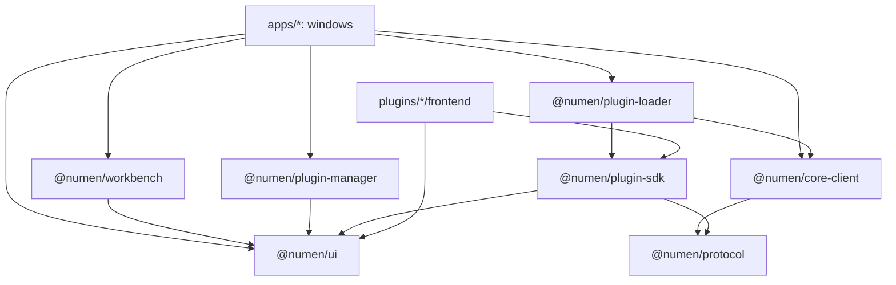

# Placing code in a library (`/nm-place-library`)

This skill answers one question: which library owns a piece of shared frontend or protocol code, and what shape does the code take there. Checks forbid the imports that cross a boundary; they cannot tell which side of the boundary a new piece of code belongs on. This skill does.

The rules it rests on are in `AGENTS.md`, `.agents/rules/architecture.md` (sections 2, 4, 5, 10 and 11) and `.agents/rules/coding-style-frontend.md`. The user's recorded decisions are stated here as targets. The code in `main` is not the model: where it differs from a target, the target governs. [`examples.md`](examples.md) names code that follows the target and lists the places where `main` differs.

Files in this skill: [`libraries.md`](libraries.md) holds each library in detail, [`examples.md`](examples.md) holds worked examples, [`checks.md`](checks.md) lists what the checks enforce.

## The libraries in one picture



An arrow is a permitted import; the package matrix (`packages` in `tools/checks/structure/ts/libraries/library-matrix.json`) and `dependency-graph` hold it. Libraries never import an application, and a window imports every library except `@numen/plugin-sdk` and `@numen/protocol`.

| Library | Holds |
| --- | --- |
| `@numen/ui` (`libs/ui/components`) | Pure components of general purpose, the design tokens, and the helpers beneath them (clock types, geometry, text, and the browser access in `shared/api`). No domain, no wire types, no application code. |
| `@numen/workbench` (`libs/ui/workbench`) | The chrome every desktop window shares: the panes and tabs, the command palette, the notices, the window frame. Built from `@numen/ui` alone; it may hold domain words that every desktop window shares (the welcome page and its vault rows), and the Wails runtime stays in each window: the frame takes a loader of the runtime as a parameter. |
| `@numen/core-client` (`libs/core/client`) | The first-party client of the core: service clients, transport, enum codes, error words, the manifest reader, the catalog client. Private. |
| `@numen/protocol` (`libs/core/protocol`) | The `.proto` schema, and the Go and TypeScript generated from it. |
| `@numen/plugin-manager` (`libs/plugin/manager`) | The plugin list and the plugin page, over view-model types it defines; data in by props, answers out by events. |
| `@numen/plugin-loader` (`libs/plugin/loader`) | The loader of plugin frontends and the host side of the plugin contract, over the core client. |
| `@numen/plugin-sdk` (`libs/plugin/sdk-ts`) | What a plugin frontend is built from. Holds only what at least one plugin imports. |

A plugin imports `@numen/plugin-sdk` and `@numen/ui` and nothing else of this repository. A window talks to the core through `@numen/core-client`; a plugin frontend through `@numen/plugin-sdk`.

## Deciding where code goes

Ask in this order. The first question answered yes names the home.

- Does it describe data that crosses the wire between Go and TypeScript? It is a message in a `.proto` file of `libs/core/protocol`, generated, never written by hand.
- Does it call the core, or read what the core returns (service client, enum code, error sentence, manifest, catalog)? It belongs to `@numen/core-client`.
- Is it drawn, and could any application draw it without knowing a domain term or a wire type? It belongs to `@numen/ui`.
- Is it window chrome that every desktop window draws the same way? It belongs to `@numen/workbench`.
- Between the two UI libraries: what plugins need goes into `@numen/ui`; what only applications need goes into `@numen/workbench`, which no plugin imports.
- Is it the plugin list or the plugin page? It belongs to `@numen/plugin-manager`.
- Does it load, start or host plugin frontends? It belongs to `@numen/plugin-loader`.
- Does a plugin author call it? It belongs to `@numen/plugin-sdk`, and only when a plugin already imports it.
- Otherwise it stays in the window or the plugin that needs it.

| I am adding | It goes in |
| --- | --- |
| A general component (switch, slider, menu, tree, dialog, list) | `@numen/ui`, `shared/ui/<name>/`; a component with its own model and several parts is a slice in `features/<name>/` |
| A component that names a domain term (note, vault, card, plugin) | Not `@numen/ui`. Its general part takes a drawing vocabulary of general words in `@numen/ui`, and the window maps its domain onto that; the domain-named screen stays in the window or its plugin |
| A style token (colour, size, space, motion) | `@numen/ui`, `shared/tokens/tokens.css`, with the Tailwind name in `theme.css`; the window frame's own sizes are in `@numen/workbench` `features/window-frame/tokens/` |
| A wire type or an enum of the protocol | `libs/core/protocol/proto/`, then generate; a window names it through `@numen/core-client` |
| A service client, a transport, an error sentence | `@numen/core-client` |
| A mapping from a wire message to a type a component takes | The window, in its `api` segment or `shared` layer; the component library never sees the message |
| A view-model for the plugin list (filter, query, state) | `@numen/plugin-manager` |
| A view-model for any other domain list | The window slice that draws it |
| A helper two windows use | The library its content names (decision list above); with no library that fits, each window keeps its own copy |
| A helper two plugins use | Each plugin keeps its own copy; the SDK gains it only when a plugin needs the host to provide it |
| A pure function over time, geometry or text | `@numen/ui`, `shared/lib/<topic>/` |
| A read of the browser (window, document, clock, timers, observers, the runtime) | `@numen/ui`, `shared/api/`; the composable that follows it is in `shared/model/` |
| A composable with Vue state and no domain | `@numen/ui`, the `model` segment of its slice, named `use<Feature>` |
| A composable that calls a client | The `api` segment of the window slice that uses it |
| A window-chrome behavior (tab arrangement, palette keys, notice queue) | `@numen/workbench`, a slice in `features/` |
| A story fixture | The `fixtures/` folder beside the component, with invented content |
| A new `libs/*` frontend package | Ask first; the package matrix needs a row before the package exists |

## The folder shape of a library

`@numen/ui` and `@numen/workbench` use Feature-Sliced Design with three layers, lowest first: `shared`, `features`, `screens`. A layer imports the layers below it and nothing above; a slice of `features` imports no other slice and is reached from above through its `index.ts` alone; `src/index.ts` is the one entry an application imports.

```text
libs/ui/components/src/
  index.ts                 the public surface
  shared/
    ui/<component>/        Component.vue, Component.types.ts, index.ts, Component.test.ts, Component.stories.ts
    lib/<topic>/           pure functions and types: time, math, text, format, dom geometry; no Vue, DOM, clock or timers
    api/                   browser access: window, document, clock, viewport observers, links, the runtime
    model/                 shared composables over api (viewport) and refs
    tokens/                tokens.css, theme.css, window.css, classes.css
    fixtures/              invented content for stories
  features/<slice>/
    index.ts               the slice's public surface
    ui/                    components of the slice, one folder per part with its own state
    model/                 state and the meaning of each gesture or key
    lib/                   pure functions of the slice
    fixtures/
```

`screens` holds assembled pages that stories show, built from the layers below.

Inside a slice the direction is `ui` to `model` to `lib`. A `lib` segment is pure: no clock, no timers, no randomness, no measuring. A `model` module holds state and may schedule through an injected clock. A component lives in `ui` and nowhere below it.

The other libraries are flat packages with one `src/index.ts`: `@numen/core-client` groups by subject (`errors/`, `services/`, `settings/`, `testing/`), `@numen/plugin-loader` by concern (`hosting/`, `loading/`, `slots/`, `keybindings/`, `when/`), and `@numen/plugin-manager` by component and model file. A library that consumers test against exposes a `testing` entry for its doubles. Each folder holds one thing, never one kind of thing.

The windows (`apps/desktop/editor`, `flashcards`) use five FSD layers: `shared`, `entities`, `features`, `pages`, `app`. Their rules are in `architecture.md` section 4.

## How a component in `@numen/ui` is built

The component is a function from props to a drawing, plus events out.

- Props are the contract. A component defines the prop types it takes, in `Component.types.ts` beside it, in a drawing vocabulary: `rows`, `items`, `at`, `isOpen`, `isDisabled`. Identifiers it receives are opaque strings or numbers, and it returns them as given in its events (`choose` with the item `id`).
- It imports nothing of the domain: no `@numen/protocol`, no wire type, no other first-party package, no path under `apps` or `libs`. The same holds for stories, fixtures and tests.
- Events out are typed (`defineEmits` or an events interface) and named for what happened: `choose`, `dismiss`, `open`, `close`, `move`. A value the caller can bind is `defineModel`.
- The clock, the viewport and the schedule are parameters with browser defaults: a `clock` prop whose default calls `getNow()` or `browserClock`, a `viewport` prop whose default reads the window. A test passes its own.
- A boolean prop is `isX` or `hasX`. A handler is `onX`. A composable is `useX`. A function is a base-form verb phrase or a predicate.
- The `<script setup>` block follows the section order Props, Events, State, Hooks, Handlers, Helpers, under 80-character banners. Logic beyond wiring is a function in a `lib` or `model` file beside the component; a `.vue` file holds none.
- Lengths: a length is a `rem` or `em` literal on the property (`padding: 0.375rem`) or a token; a local custom property is optional (`--row: 1.5rem`) for a dimension that several properties of one component share; `px` only for a 1px hairline border.
- A component styles itself with token classes (`bg-surface`, `var(--numen-surface)`), declares no colour, takes its theme from `color-scheme`, and writes no `dark:` class. SVG painted with attributes uses scoped CSS over the same tokens. The root element carries the class `numen`.
- The public surface is exported in `src/index.ts` through the folder's `index.ts`.

Each component has a story file (`Component.stories.ts`, title `<Group>/<Name>`) that shows the states a caller can reach, and a test file beside it.

### Tests

Tests exercise behavior: open, close, flip, move, reorder, write, what is emitted, what state is drawn. A test holds no CSS text, no pixel size, no gap, no contrast ratio and no theme snapshot. A test of a seam uses the real pieces and spies on the outer edge only.

| Project | Engine | What it runs |
| --- | --- | --- |
| `unit` | jsdom | `*.test.ts`: pure functions, models, and component behavior mounted with `@vue/test-utils` |
| `stories (chromium)` | Playwright Chromium | every story with its `play` function: layout, focus, pointer and keyboard in a real engine |
| `stories (webkit)` | Playwright WebKit | the same stories; the desktop window is WebKit on macOS and Linux |

Behavior that depends on layout, paint order, focus-visible or pointer geometry is proven in a story in both engines. SVG geometry is written in attributes, and HTML inside an SVG `foreignObject` stays in plain flow. Run one project at a time: `npm run test:unit`, `vitest run --project 'stories (chromium)'`, `vitest run --project 'stories (webkit)'`. Heavy runs happen on the verification machine, not while editing.

## The other libraries in short

- `@numen/core-client` builds each client from a transport it takes as a parameter, exposes enum codes and error sentences as data, and re-exports the generated types applications name. Outside the SDK it is the one place that imports `@numen/protocol`. Components, composables outside an `api` segment and plugins never import it.
- `@numen/protocol` is edited in `.proto` files and generated with `buf generate`; one service per subject; a served negative result is an `ErrorCode` field and not a status code; a list that grows with time is paged.
- `@numen/plugin-manager` defines `PluginInfo`, `PluginListing` and `ManagedPlugin`, draws them, and emits events. The window reads the catalog through `@numen/core-client` and maps entries to those types.
- `@numen/plugin-loader` implements the plugin contract over `@numen/core-client`; each application implements the `LoaderHost` it declares. It imports no UI library.
- `@numen/plugin-sdk` adds a call or field to the Go SDK and the TypeScript SDK together, exposes no `@numen/protocol` declaration, and holds no concrete engine.

[`libraries.md`](libraries.md) gives, for each, what it may import, who may import it, and the test for "does this belong here".

## Size and role

A structure is judged by what one object does, not by the interfaces it is cut into.

- A library exposes one role: `@numen/ui` draws, `@numen/core-client` calls the core, `@numen/workbench` holds window chrome. An object that does two of these is split.
- A source file has at most 500 lines. A package of a Go library is bounded by the same sizes as the core: structs by methods and fields, files by lines.
- Shared code is a domain, a port, a use case or a named helper with a reason. A library is created for a role that two applications use, never for a helper.
- A slice of a library is imported through its `index.ts` only.
- A value of unknown type is parsed at one declared boundary (`@numen/core-client` for the wire) into a named type.
- A `catch` handles the failure; a fallible operation returns `Result`.
- Time, randomness, the viewport and storage each enter through one parameter; production code adds no seam for a test double.

## What the checks enforce

[`checks.md`](checks.md) lists each structural check and lint rule by what it forbids. In short: imports follow the package matrix and the layer order; `@numen/ui` and `@numen/workbench` import no domain or wire package; time, randomness and measuring enter as parameters; styles use tokens; no suppression comment exists; functions and Vue blocks stay under the shared limits.

A red check is fixed in the code, not by changing the check or moving code out of its sight.

## What no check decides

These are judgement calls; make them with the test given.

- Is a component general enough for `@numen/ui`? Describe it without a domain word. If one sentence says what it draws and takes ("one search line over a list of rows") and a second application could use it unchanged, it belongs. If the sentence needs a note, a vault, a card or a plugin, it stays with its window or plugin, or its general part is extracted and the domain part stays.
- Does a helper two windows share go to a library or get copied? Place it by what it is, using the decision list. Pure drawing or pure arithmetic goes to `@numen/ui`; a call to the core goes to `@numen/core-client`; shared window chrome goes to `@numen/workbench`. If no library's definition fits, each window keeps a copy. A library is never created to hold a helper.
- Does a helper two plugins share go to the SDK? Each plugin keeps its own copy. The SDK gains code only when a plugin needs the host to provide it.
- Is a wire shape worth a hand-written window type? A window type that mirrors a message is written by hand and mapped field by field; a structural match by field names alone breaks on a rename.
- Does a domain screen deserve its own library? Only when two applications draw it. Until then it is a slice of the window.
- Does a new export belong in `src/index.ts`? Export what an application outside the library needs; keep the rest inside the slice.
