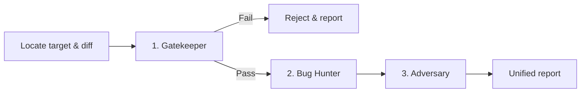

# Unified 3-Stage Code Review Pipeline (`/nm-review`)

This skill orchestrates the sequential review pipeline for the numen repository. It locates the changed files, audits them against `AGENTS.md` and the rules in `.agents/rules/`, hunts for semantic defects across the blast radius, and proves or disproves each hypothesis with a test that runs.

One pipeline covers both sides of the product: the Go core and its adapters, and the Vue windows and the component library beneath them. The stage guides say what differs.



---

## Where the rules are

**The architecture is documented in files, not kept in memory.** `AGENTS.md` at the root and in the touched module contains the naming and placement conventions, and the summarized rules are in [`../../rules/`](../../rules/). If a rule matters, it is written in one of them; if it is not written there it is not yet a rule. When a change appears to contradict one, quote it.

If a change is right and the rule is wrong, say so. The finding is then "this contradicts `<file>`, and the rule looks outdated" — not silence.

The distilled rules:

- [`rules/architecture.md`](../../rules/architecture.md) — the layout, the dependency arrows, determinism, one name per concept.
- [`rules/coding-style-backend.md`](../../rules/coding-style-backend.md) — Go style, idioms, and naming.
- [`rules/coding-style-frontend.md`](../../rules/coding-style-frontend.md) — Vue and TypeScript style and naming.
- [`rules/process.md`](../../rules/process.md) — TDD red-first, role boundaries, human gates.

**Length is never a finding.** A file is split when it holds a second responsibility. Do not report a line count, an import count, or a block size.

---

## Target & repository auto-detection protocol

Resolve the repository root and determine the target:

1. **Repository root**:
   ```bash
   REPO_ROOT=$(git rev-parse --show-toplevel 2>/dev/null || readlink -f .agents/.. 2>/dev/null || echo "$PWD/../source/numen")
   ```
2. **Pull request or commit range**:
   - For a pull request (`/nm-review #123`, `/nm-review 123`, or a branch with an open pull request), read `baseRefName`, `baseRefOid` (`BASE_SHA`) and `headRefOid` (`HEAD_SHA`) with `gh pr view [<number>] --json number,baseRefName,baseRefOid,headRefOid`.
   - For a commit range (`/nm-review <base>...<head>`), resolve `BASE_SHA=$(git -C "$REPO_ROOT" rev-parse "<base>^{commit}")` and `HEAD_SHA=$(git -C "$REPO_ROOT" rev-parse "<head>^{commit}")`.
   - Verify that the checkout is at the head of the target: `git -C "$REPO_ROOT" rev-parse HEAD` must equal `HEAD_SHA`. Stop with an error when the checkout is not at `HEAD_SHA`.
   - Diff against the base of the pull request or range:
     ```bash
     git -C "$REPO_ROOT" diff "$BASE_SHA...$HEAD_SHA" --name-only
     git -C "$REPO_ROOT" diff "$BASE_SHA...$HEAD_SHA"
     ```
   - State the base branch (when known), `$BASE_SHA...$HEAD_SHA`, and the changed files before proceeding. Review only the files in `$BASE_SHA...$HEAD_SHA` and ignore uncommitted working-tree changes. When a changed file in the working tree differs from `HEAD_SHA` (such as `.agents`, `.claude/skills`, `AGENTS.md`, `tools/checks` or `tools/shared/tools.mjs` in CI), read the version at `HEAD_SHA` with `git -C "$REPO_ROOT" show "$HEAD_SHA:<path>"`.
3. **Explicit path**: a path (`/nm-review libs/ui/components/src/plex`) focuses the audit on those files.
4. **Local auto-detection (no argument and no open pull request)**:
   - `git -C "$REPO_ROOT" status --short` and `git -C "$REPO_ROOT" diff HEAD`.
   - Dirty tree: audit the uncommitted diff.
   - Clean tree: take the branch delta.
     ```bash
     BASE=$(git -C "$REPO_ROOT" merge-base HEAD origin/main 2>/dev/null || git -C "$REPO_ROOT" merge-base HEAD main 2>/dev/null || echo "HEAD~1")
     git -C "$REPO_ROOT" diff $BASE...HEAD
     ```
   - State the detected target and the changed files before proceeding.

Every worktree of this repository shares one `git stash` stack. Never stash to get a clean tree — copy the file aside, or commit and `git checkout HEAD~1 -- <path>`.

---

## Sequential execution stages

### Stage 1: Gatekeeper & architectural audit

_Guide: [`stages/1-gatekeeper.md`](./stages/1-gatekeeper.md)_

1. **Automated gate** — Run the modular target for each touched module from `REPO_ROOT` (e.g. `make lib_core_lint lib_core_test` for core backend, `make lib_ui_components_lint lib_ui_components_test` for UI, etc.). Never run blanket monorepo suites over untouched domains.
2. **Fail-fast** — a type error, a lint failure, or a broken existing test marks the gate **FAIL**. Stop and reject with the exact error output, unless told to continue.
3. **Architecture checklist** — dependency direction, ports and adapters, the `@numen/ui` domain boundary, the core/view split, tokens, naming, and one name per concept.

### Stage 2: Semantic logic, blast radius & spec audit

_Guide: [`stages/2-bughunter.md`](./stages/2-bughunter.md)_

1. **Intent & Spec conformance** — if `intent.md` exists in the task folder, verify that no Non-Goals were violated. If `spec.md` exists, verify that all acceptance criteria are covered and the diff does not exceed the blast radius.
2. **Blast radius** — callers of every changed function, upstream sources of the state it reads, downstream watchers, renderers and subscribers.
3. **Defect matrix** — Go concurrency, context and cancellation, error paths, SQL and resources; Vue reactivity, lifecycle leaks, out-of-order responses; boundary and index errors; wire contracts across _A client is generated from the protocol_.
4. **Proof** — every defect has a concrete scenario: _Given → When → Then_. No vague warnings.

### Stage 3: Dynamic stress verification

_Guide: [`stages/3-adversary.md`](./stages/3-adversary.md)_

1. **Attack vectors** — turn each hypothesis from Stage 2 into a test that should fail.
2. **Craft and run** — an adjacent `_test.go` or `.spec.ts`, executed. A failing test confirms the defect; a passing one confirms resilience and stays if it covers an edge nobody had covered.
3. **Mutation check** — for a test guarding a rule, break the rule and check that the test fails. A test that passes either way is worse than no test.

---

## Report format (mandatory)

The report is read on a GitHub pull request and in a terminal. The verdict and the findings come first, and the report shows only what the review did.

1. **Only the report.** No text before or after it.
2. **Order:** verdict heading, summary, findings by severity, the gates that ran, the list of checks found sound, the footer.
3. **A check that did not run is left out.** No "N/A" or "not run" rows. When the caller ran no gates, the gates line is omitted, and the footer says in one line what was not run and why.
4. **Lists, not tables.** Wide tables break on GitHub. Status is an emoji (✅ ❌), never a code span.
5. **"No findings" is a real outcome.** Padding a review with cosmetic remarks wastes the time of everyone who reads it.

Severity: 🔴 CRITICAL (data loss, crash, security), 🟠 HIGH (a broken behaviour or consumer), 🟡 MEDIUM (an edge case that misbehaves), ⚪ LOW (a minor risk, or a hypothesis no test confirmed).

A CRITICAL, HIGH or MEDIUM behaviour defect is proven by a test from Stage 3 that fails against the change: its name, its file, and its failing output. A behaviour hypothesis without such a test is reported as ⚪ LOW and marked unconfirmed, with the reason no test was written. A finding that the change breaks a written rule quotes the rule and the lines that break it.

Verdict: ❌ Rejected when a gate failed or a CRITICAL finding exists; ⚠️ Changes requested when a HIGH or MEDIUM finding exists; ✅ Approved otherwise.

---

## Report template

````markdown
## ⚠️ Changes requested

<One or two sentences: what the change does, and what blocks merging.>

### 🟠 HIGH · <defect title>

`path/file.go:12`

**Given** <initial state> · **When** <action or event> · **Then** <failure>

**Proof:** <the test name, its file, and its failing output; for a rule finding, the lines that break the rule>
**Rule:** <the AGENTS.md or rules statement it contradicts; omit the line when none applies>
**Fix:** <a direction, not a patch>

### 🟡 MEDIUM · <defect title>

…

**Gates:** ✅ `make lib_core_lint` · ✅ `make lib_core_test` · ❌ `make lib_ui_components_test`

```text
<the exact error output of a failed gate>
```

<details><summary>Checked and found sound (<count>)</summary>

- ✅ <what was checked>: <the test that passed, or the gate that covers it>

</details>

<sub>nm-review · <one line on what this run did not do and why></sub>
````

The heading is `## ✅ Approved`, `## ⚠️ Changes requested` or `## ❌ Rejected`. With no findings, the summary is followed directly by the gates line and the sound list. Tests written in Stage 3 and left in the tree are named in the finding that uses them.
