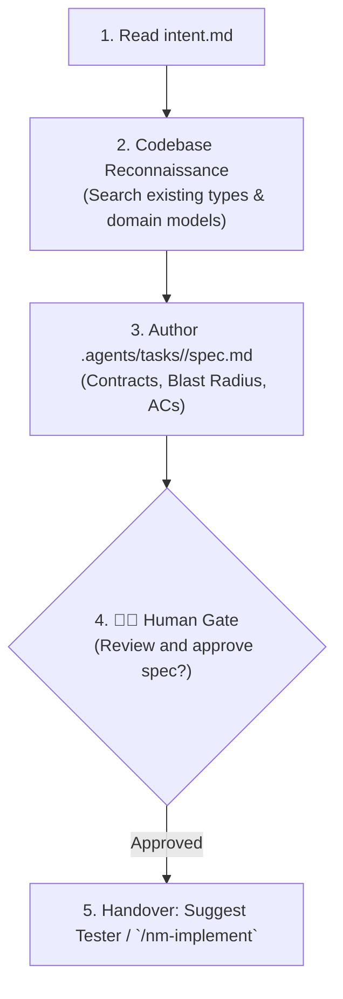

# Technical Specification Skill (`/nm-specify`)

The `/nm-specify` skill transforms business intent (`intent.md`) into a precise technical specification (`spec.md`). It maps existing code, prevents hallucinations, defines contracts, outlines the blast radius, and formulates acceptance criteria.



---

## Step 1: Locate Active Task and Read Intent

   - The task folder is named after the task, under the tasks folder of `.agents`.
   - Example: the task folder
2. Read `intent.md` in the task folder.
   - If `intent.md` does not exist, ask the user to run `/nm-clarify` first.

---

## Step 2: Codebase Reconnaissance (Anti-Hallucination Gate)

Before proposing new files, types, or methods, search the codebase:

1. Search existing domain models, ports, and DTOs across `libs/core/kernel` and `apps/desktop`.
2. Check existing composables, components, and utilities in `libs/ui/components`.
3. Check `AGENTS.md` and the rules in `.agents/rules/` governing the touched area.

---

## Step 3: Author `spec.md` in the task folder

Generate `spec.md` in the task folder with:

```markdown
# Specification: <Task Title>

**Task Slug:** `<slug>`
**Date:** `<YYYY-MM-DD>`
**Intent:** `intent.md` in the task folder

## 1. Target Architecture & Interfaces

- Type signatures, interface definitions, or component prop/event contracts.
- Explicit placement: which layer each file belongs to (`shared`, `entities`, `features`, `pages`, `app`).
- Name the placement skill of each area the work touches in the blast radius ([`nm-place-core`](../nm-place-core/SKILL.md), [`nm-place-window`](../nm-place-window/SKILL.md), [`nm-place-plugin`](../nm-place-plugin/SKILL.md) or [`nm-place-library`](../nm-place-library/SKILL.md)), and take the placement of every file from it.

## 2. Blast Radius Matrix

| Package / Path        | File                                | Action (Create/Modify) | Downstream Consumers                   |
| :-------------------- | :---------------------------------- | :--------------------- | :------------------------------------- |
| `libs/core/kernel`           | `domain/card.go`                    | Modify                 | `usecase/flashcards`, `adapter/sqlite` |
| `apps/desktop/editor` | `src/features/deck/ui/DeckView.vue` | Create                 | `pages/DeckPage.vue`                   |

## 3. Negative Invariants (Architectural Prohibitions)

- Explicit architectural constraints (e.g. No direct DB access from UI, no god objects, preserve layer arrows).

## 4. Acceptance Criteria

### AC-1: <Title of Behavior 1>

- **Given**: <initial state / preconditions>
- **When**: <action or event triggered>
- **Then**: <expected observable outcome>

### AC-2: <Title of Behavior 2>

- **Given**: <initial state / preconditions>
- **When**: <action or event triggered>
- **Then**: <expected observable outcome>
```

> **Important on Test Naming**: Acceptance Criteria (AC-1, AC-2) are requirements tracking identifiers in `spec.md`. When converting them to code, tests must use **pure behavioral sentences** (e.g. `it('rejects card with empty front')` or a Go test named for the behaviour, as in "push rejects a client that is behind the ack") — never prefix test functions with `AC-1` or synthetic tags.

---

## Step 4: Human Checkpoint & Next Step Handover

Present a concise summary of the specification to the user and request confirmation:

> 📐 **Specification created in `spec.md` in the task folder.**
>
> - **Blast Radius:** `<N> files touched across <modules>`
> - **Acceptance Criteria:** `<Count> verifiable behaviors defined`
>
> _Please review the specification above. Once approved, proceed to `/nm-implement` (or let `tester` write the red acceptance tests)._
