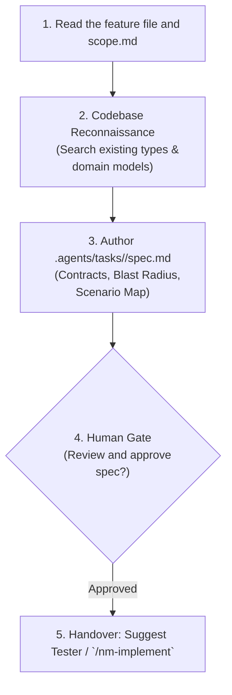

# Technical Specification Skill (`/nm-specify`)

The `/nm-specify` skill turns the approved feature file (`features/<area>/<name>.feature`) into a technical specification (`spec.md`). The scenarios are the acceptance criteria; the spec has no acceptance criteria section. It maps existing code, defines contracts, outlines the blast radius, and maps each scenario to the layers that implement it and the lower-level tests it needs. `spec.md` and `scope.md` are local files in .agents/tasks/<slug>/ and are not committed.



---

## Step 1: Locate Active Task and Read the Feature

1. Identify the task directory from arguments or git branch: .agents/tasks/<slug>.
2. Read the feature file the task names, and .agents/tasks/<slug>/scope.md if it exists (what the interview found out of scope or limiting that is not a scenario).
   - If no feature file exists, ask the user to run `/nm-feature` first.

---

## Step 2: Codebase Reconnaissance (Anti-Hallucination Gate)

Before proposing new files, types, or methods, search the codebase:

1. Search existing domain models, ports, and DTOs across `libs/core/kernel` and `apps/desktop`.
2. Check existing composables, components, and utilities in `libs/ui/components`.
3. Check `AGENTS.md` and the rules in `.agents/rules/` governing the touched area.

---

## Step 3: Author `spec.md` in the task folder

```markdown
# Specification: <Task Title>

**Task Slug:** `<slug>`
**Date:** `<YYYY-MM-DD>`
**Feature:** `features/<area>/<name>.feature`
**Scope:** .agents/tasks/<slug>/scope.md (if present)

## 1. Target Architecture & Interfaces

- Type signatures, interface definitions, or component prop/event contracts.
- Explicit placement: which layer each file belongs to (`shared`, `entities`, `features`, `pages`, `app`).
- Name the placement skill of each area the work touches in the blast radius ([`nm-place-core`](../nm-place-core/SKILL.md), [`nm-place-window`](../nm-place-window/SKILL.md), [`nm-place-plugin`](../nm-place-plugin/SKILL.md) or [`nm-place-library`](../nm-place-library/SKILL.md)), and take the placement of every file from it.

## 2. Blast Radius Matrix

| Package / Path | File             | Action (Create/Modify) | Downstream Consumers                   |
| :------------- | :--------------- | :--------------------- | :------------------------------------- |
| `libs/core/kernel` | `domain/card.go` | Modify                 | `usecase/flashcards`, `adapter/sqlite` |

## 3. Negative Invariants (Architectural Prohibitions)

- Explicit architectural constraints (e.g. No direct DB access from UI, no god objects, preserve layer arrows).

## 4. Scenario Map

| Scenario (title from the feature file) | Layers that implement it | Lower-level tests it needs (Go, vitest, stories) |
| :------------------------------------- | :----------------------- | :----------------------------------------------- |
| A deleted note leaves the vault        | `usecase/notes`, window  | Go use case test, vitest for the list state      |
```

> **Test naming**: tests use pure behavioral sentences (e.g. `it('rejects card with empty front')`), never tags or scenario numbers.

---

## Step 4: Human Checkpoint & Next Step Handover

> **Specification created in .agents/tasks/<slug>/spec.md.**
>
> - **Blast Radius:** `<N> files touched across <modules>`
> - **Scenarios mapped:** `<Count>`
>
> _Please review the specification. Once approved, let `tester` write the steps, the driver and the red tests, then run `/nm-implement`._
