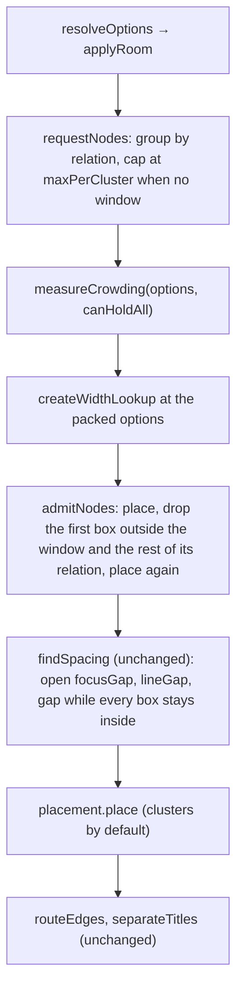

# Specification: Plex places each relation as a compact cluster

**Task Slug:** `plex-clusters`
**Date:** `2026-11-12`
**Intent:** `intent.md` in the task folder (three open questions, section 6; the spec takes the proposed answer for each and marks where it would change)

All paths are under `plugins/views-plex-graph/frontend/plex/`. Placement skill: [`nm-place-plugin`](../../skills/nm-place-plugin/SKILL.md). Everything new is in `lib/arrange/` (pure, no Vue, no DOM, no clock). The behavior to match is `arrangeClusters`, `placeNear`, `interleave`, `getDirection` and `Room.fits` of the prototype `plex/lab/layout.ts` on branch `proto/plex-clusters` (not on main; nothing of it is copied or deleted here).

## 1. The pipeline after the change

`arrangePlex` (`lib/arrange/arrange.ts`) keeps its order and its `Placement` strategy seam. What changes is how much is admitted and how crowding is measured: both now ask the placement itself, through the window, instead of the per-line limits.



### 1.1 Placement: `clusters` (new, `lib/arrange/layout/clusters.ts`)

`export const clusters: Placement = { name: 'clusters', place: placeClusters }`. It replaces `rowsAndColumns` as the default of `ArrangeInput.placement`.

`placeClusters(nodesByRelation, focus, context)`:

1. **Turns.** `takeTurns(nodesByRelation): PlexNode[]` orders the nodes one per relation in turn, relations in `RELATION_NAMES` order (parent, child, jump, sibling; reference goes between jump and sibling when #1839 adds it, as in the prototype's `ORDER`), each relation in the order it arrived. Relations that run out drop out of the turn. (Prototype `interleave`.)
2. **Direction of a group.** `getClusterDirection(side: Direction, lean: Lean | null): Vector`, a unit vector: `up` (0, −1), `down` (0, 1), `left` (−1, 0), `right` (1, 0), plus `LEAN = 0.42` on the cross axis toward `lean`, normalized. `side` is `options.direction[relation]` (so a caller who sends children up still moves them); `lean` is `RELATIONS[relation].lean` (section 2). Jump: side `left`, lean `down` → normalize(−1, 0.42). (Prototype `getDirection`.)
3. **Anchor.** `getAnchor(direction, focus, options): Vector`, the nearest point a group may reach:
   - straight direction: `direction × (focus half-size on that axis + focusGap)`;
   - leaning direction: `x = sign(dx) × (focus.width / 2 + focusGap)`, `y = sign(dy) × (focus.height / 2 + lineGap)`, so the anchor is clear of the focus on both axes.
4. **Start and middle.** For a box `w × h`: `reach = |dx| × w/2 + |dy| × h/2`; `start = anchor + direction × reach`. Cell = `(w + gap, h + lineGap)`. `depth = max(0, (√size − 1) / 2) × (|dx| × cell.w + |dy| × cell.h)` where `size` is the number of nodes of that relation being placed; `middle = start + direction × depth` (`getClusterMiddle`).
5. **Free spot.** `findFreeSpot(taken, request): Spot` (prototype `placeNear`):
   - Candidates, in this order: `middle`, `start`, then for every box `b` already placed in the same group: right, left, below, above of `b` (touching at exactly one gap: `gap` sideways, `lineGap` up and down), then the four half-steps (half-way to the right or left neighbor, one row below or above).
   - Cost of a candidate `c`: `Infinity` when `(c − start) · direction < −0.5` (nearer the focus than the start); else `hypot((c.x − middle.x) / cell.w, (c.y − middle.y) / cell.h)` — distance to the middle counted in boxes.
   - Sort by cost, stable, so equal costs keep candidate order (deterministic). The first candidate whose box is free wins.
   - Tie-break: costs are rounded to 1e-6 before they are compared, so floating-point error does not decide a tie; of equal costs the candidate nearer the start along the direction (smaller `(c − start) · direction`) wins, which fills a group across its axis before it goes deeper; only then does candidate order decide. The search takes the least (cost, along) candidate that is free without sorting; a grid index of the placed boxes answers `isFree`.
   - The places beside every box already placed inside the window are tried first. A box wider than the ones before it may sit behind the start of its group (the `along` test is relaxed) where the window has room and its center stays on the side of the group.
   - If none is free, walk outward from `middle`: step `k = 1 … 400` along `direction` by a quarter of `nodeSize.height`, with sideways offsets `0, 1, −1, 2, −2, 3, −3` cells across the direction; the first free box wins; after that, `middle`. (The walk keeps to the window, so a note is dropped only when the window has no free place left for it.)
   - A spot whose line to a placed note (`PlacementContext.edges`) would run along another line that meets it at a note other than the focus, or through another note, or whose box lies on a line already drawn, is taken only when no free spot is without that defect (`lib/arrange/layout/lines.ts`).
6. **Free.** `isFree(spot, taken, gaps): boolean` — no taken box (the focus included) with `|Δx| < (w₁ + w₂)/2 + gap − TOLERANCE` and `|Δy| < (h₁ + h₂)/2 + lineGap − TOLERANCE`, `TOLERANCE = 0.5`. The tolerance is load-bearing: candidates are built exactly one gap from a neighbor, and without it floating-point error makes such a box count as overlapping, every touching spot is refused and the groups degrade into lines.
7. **Output.** Each node keeps its relation, identity and title; `width = context.width(node)`, `height = options.nodeSize.height`, `opacity = 1`, `order` = its index within its relation. The returned array is grouped by relation in `RELATION_NAMES` order, each relation in arrival order — the order today's placement returns, so the drawing order and the tab order of nodes do not change.

Splitting: `clusters.ts` holds `clusters`, `placeClusters`, `takeTurns`, `getAnchor`, `getClusterMiddle`; `lib/arrange/layout/freeSpot.ts` holds `findFreeSpot`, `listCandidates`, `measureCost`, `findFreeSpotOutward`, `isFree`, `TOLERANCE`. Requests to these take one object (max 4 params). Each file well under 350 lines, each function under 80 lines and complexity 10. `Vector` is `Position` from `lib/node.ts`; a spot is `{ x, y, width, height }`.

### 1.2 Admission (new, `lib/arrange/layout/admission.ts`)

Replaces `canPlace` in `arrange.ts` and the per-line capacity of `limits.ts`.

- `requestNodes(nodes, options): NodesByRelation` — group by relation in arrival order. Without a viewport each relation is cut to `options.maxPerCluster` (default 20, today's 5 × 4 capacity without a window). With a viewport nothing is cut here: the window decides (open question 1; if the owner wants a cap in a window too, it is applied here and nowhere else).
- `admitNodes(requested, lay, isInside): { nodesByRelation, overflow }` where `lay(nodesByRelation) → PlacedNode[]` places at the packed options and the gaps as set, and `isInside(node)` is the window test of `arrange.ts` (`isInsideViewport` per node, less `margin`). Loop: lay the current set; for each relation, keep the prefix of its nodes (arrival order) up to the first one whose box is not inside, and halve the group when its first box is outside (the middle of a smaller group lies nearer the focus); when nothing was cut, stop. Every pass removes at least one node, so it ends. Then the cut notes are taken back (refill): one note of each relation in turn, while the window still holds every box. A note is dropped only when the window has no free place for it. Without a viewport `isInside` is always true and one pass suffices (skip the lay).
- `overflow[relation]` = number arrived − number admitted, set only when above 0 — the same shape `Plex.vue` already prints ("N children not shown").
- This works for any `Placement` (the `ring` fixture too), so the strategy still does not decide how much is shown.

### 1.3 Fit to the window

- **Crowding** (`layout/crowding.ts`): `measureCrowding(options, canHoldAll: (packed: PlexOptions) => boolean)`. Same binary search over `packOptions` (7 halvings), same early returns (no viewport, `squeeze >= 1`, holds at the settings). `canRelationAll` and the import of `getLimits` go. `arrange.ts` supplies `canHoldAll`: lay every requested node at `packed` with the width lookup of `packed` and the gaps as set, and check every box is inside the window.
- **Spacing** (`layout/spacing.ts`): unchanged. `findSpacing` already measures the arrangement it gets; `arrange.ts` passes the admitted nodes and the clusters placement. It opens `focusGap`, then `lineGap`, then `gap`.
- **Room** (#1836): `applyRoom` still widens all three gaps before crowding.

### 1.4 Options (`lib/arrange/options.ts`)

- `LimitOptions` becomes `{ maxPerCluster: number; maxHeadings: number }`. `maxPerLine` and `maxLines` are removed (no manifest setting uses them; only stories and tests do).
- `direction` stays (drop gestures and the edge axis read it, and it sets the side of each group). `isVertical` stays for routing.
- `lineGap` stays: it is the gap between boxes one above another (open question 2; if one gap should serve both axes, `isFree`, the cell and the leaning anchor use `gap` and `lineGap` is removed).

### 1.5 Routing

`edges/routing.ts` is not changed. `getAxis` still takes the axis from the side of the relation (`vertical` for parents and children, `horizontal` for jumps and siblings). Sibling edges come from the graph as parent → sibling and are routed as today. Lines that pass behind a box in a second row are accepted for this issue (open question 3).

## 2. The direction table (`lib/relation.ts`)

```ts
export type Lean = 'up' | 'down'

export interface RelationDescriptor {
  readonly grows: 'up' | 'down' | 'left' | 'right'
  /** The cross-axis tilt of the group, or null for a group that grows straight out. */
  readonly lean: Lean | null
  readonly plural: readonly [one: string, many: string]
}

export const RELATIONS = {
  parent: { grows: 'up', lean: null, plural: ['parent', 'parents'] },
  child: { grows: 'down', lean: null, plural: ['child', 'children'] },
  jump: { grows: 'left', lean: 'down', plural: ['jump', 'jumps'] },
  sibling: { grows: 'right', lean: null, plural: ['sibling', 'siblings'] },
} as const satisfies Record<PlexRelation, RelationDescriptor>
```

#1839 adds `reference: { grows: 'left', lean: 'up', plural: ['reference', 'references'] }` (plus the relation in the types) and nothing in the placement. Which relation a drag to the left makes once two relations share `left` (`drop.ts` takes the first) is #1839's decision.

## 3. What is removed

- `lib/arrange/layout/limits.ts` and `limits.test.ts`: deleted (`getLimits`, `Limits`, `RoleLimits`, `getViewportLimits`, `getWidestRow`, `getRelationLimits`).
- `lib/arrange/layout/placement.ts`: `rowsAndColumns`, `line`, `inRows`, `inColumns`, `lines`, `getReach`, `measureWidestWithin`, `LineContext`, `AxisPlacement` deleted. The file keeps `Placement`, `NodesByRelation`, `Widths` and `PlacementContext`, which loses `limits` (`{ options, width }`).
- `arrange.ts`: `canPlace`, the `getLimits` call and the `limits` passed to the placement.
- `crowding.ts`: `canRelationAll`.
- `options.ts`: `maxPerLine`, `maxLines`.
- `index.ts`: exports `clusters` instead of `rowsAndColumns`.

## 4. Blast radius

| Path | File | Action | Consumers |
|---|---|---|---|
| `lib` | `relation.ts` | Modify (`lean`, `Lean`) | `options.ts`, `clusters.ts`, `drop.ts`, `fixtures/build.ts` |
| `lib/arrange/layout` | `clusters.ts`, `freeSpot.ts`, `admission.ts` | Create | `arrange.ts`, `index.ts` |
| `lib/arrange/layout` | `placement.ts`, `crowding.ts` | Modify | `arrange.ts`, `fixtures/ring.ts` |
| `lib/arrange/layout` | `limits.ts`, `limits.test.ts` | Delete | `arrange.ts`, `crowding.ts`, `crowding.test.ts` |
| `lib/arrange` | `arrange.ts`, `options.ts`, `index.ts` | Modify | `model/transition.ts`, `ui/Plex.vue`, `model/sizing/plexScale.ts` |
| `model` | `transition.ts` | Modify: track `maxPerCluster` instead of `maxPerLine`, `maxLines` | `ui/Plex.vue` |
| `ui` | `Plex.stories.ts` | Modify: `maxPerCluster` control, placement mapping `clusters` / `ring` | Storybook |
| `fixtures` | `ring.ts` | Unchanged (implements `Placement`, never read `limits`) | `arrange.test.ts`, stories |

No proto, wire, manifest or setting change. `apps/landing` has its own plex demo and is not touched.

### Tests and stories that pin rows-and-columns and must change

- `lib/arrange/layout/placement.test.ts`: every `describe` but "what arrives back" pins rows and columns ("a row", "a row too long for one line", "a column", "rows and columns together", "how far a column reaches before it clears the rows"). Replaced by `clusters.test.ts` and `freeSpot.test.ts`; the "what arrives back" cases move to `clusters.test.ts` against `clusters`.
- `lib/arrange/layout/limits.test.ts`: deleted with `limits.ts`; its window cases ("nothing reaches past the edge", "the margin is a setting") become admission cases.
- `lib/arrange/layout/crowding.test.ts`: "the loosest packing that fits everything" uses `getLimits` and `canRelationAll`, and "leaves a window alone… twelve to a line and four lines" counts lines; rewritten against `measureCrowding(options, canHoldAll)` with a `canHoldAll` built from `arrangePlex` placement. "leaves the heights, the counts…" checks `maxPerLine`/`maxLines` → `maxPerCluster`.
- `lib/arrange/arrange.test.ts`: "clears the rows a column runs alongside, and only those"; "leaves a row packed to one gap…", "turns one edge of a column towards the focus", "starts each further column beyond the widest of the one before it"; "the lines of a relation are shared out evenly" (both); "order along a line follows the order given" ("lays a row out left to right", "puts the second line further from the focus than the first"); "counts the nodes past the last line" and "does not let a strategy decide how much is shown" (`maxPerLine × maxLines` → `maxPerCluster`); "lets the caller change how many fit on a line"; "uses rows and columns unless told otherwise" → clusters; "passes a strategy only the relations that have nodes in them" (wraps `rowsAndColumns`); "a window that holds the arrangement exactly" (row-shaped window). "puts every jump clear to the left" stays true and stays.
- `lib/arrange/layout/spacing.test.ts`: "a line runs as long as the window holds" (both), "the gap an edge crosses opens first" (eleven children edge to edge in one row), "a gap opens into the room the window leaves" (`stepAxis` reads the first two children as a row). The `findSpacing` unit cases and "what opens still keeps the window" stay.
- `lib/arrange/look.test.ts` (#1836): "places every neighbor where the plex placed it before, within a pixel" and its `TODAY` positions are removed (positions change by design); the width/height, focus, edges (`TODAY_EDGES` stays) and "is the look the arrangement takes…" cases stay. "moves the boxes apart where no window limits them" groups children by row; it is rewritten to compare the smallest box-to-box distance with and without room. "counts the notes that still do not fit as not shown" stays.
- `model/transition.test.ts`: `rowsAndColumns` → `clusters`; "the nodes allowed on a line" and "the lines allowed" → one case "the notes allowed in a group" (`maxPerCluster`).
- `model/sizing/plexScale.test.ts`: the unscaled-key list and the two `maxPerLine`/`maxLines` expectations → `maxPerCluster`.
- `ui/Plex.stories.ts`: `rowsAndColumns` import, the placement mapping, the `maxPerLine` arg and control, and the args of the story with `maxPerLine: 9`. `MakingOne` and `DraggingThemIn` drag 220 px above the focus to make a parent; that point must still be empty (parents of `typical` stay within 220 px; the tester checks it in the play run). `SmallWindow` and `Overcrowded` are visual only.
- `ui/PlexMap.stories.ts`: no position pinned (menus, headings, line ends); re-run only.
- Acceptance `features/editor/plex/*.feature` (they replace the e2e specs of `views.plex.graph`): no scenario reads a position; they check relations. Run only.

## 5. Negative invariants

- `lib/` has no Vue, DOM, clock or text measuring; widths come in as numbers.
- `arrangePlex` stays pure and deterministic: no randomness, stable sort, ties keep candidate order.
- The `Placement` interface stays a coordinates-only strategy: admission and fitting live in `arrange.ts` / `admission.ts` / `crowding.ts`, not in `clusters`.
- No camera zoom, no change of box sizes by the placement, no "+N" node.
- Files ≤ 350 lines, functions ≤ 80 lines, complexity ≤ 10, ≤ 4 params; imperative names (`placeClusters`, `takeTurns`, `getAnchor`, `getClusterMiddle`, `findFreeSpot`, `listCandidates`, `measureCost`, `isFree`, `requestNodes`, `admitNodes`); comments only for what the code cannot show (the 0.5 tolerance, the stable tie order).
- Tests use invented fixtures (`fixtures/build.ts`, `fixtures/graphs.ts`), assert behavior on the frame (positions relative to the focus and each other, counts, edges), never CSS or pixels of the rendering, and do not mock the placement or admission they verify.

## 6. Acceptance criteria

Every criterion runs through `arrangePlex` unless it names a unit. The counts and window sizes below were chosen from the prototype's behavior; if one proves false against a faithful port of it, the tester reports it with the frame before changing it. "Window" is `options.viewport`; "inside" means inside the window less `margin`. Overlap is `isOverlapping` of the boxes (`layout/boxes.ts` `getBox(node, 0)`).

### AC-1: No two boxes overlap
- **Given** every fixture in `graphs`, unmeasured and measured by title, with no window and in windows 2400×1400, 1200×800, 700×600, 420×320, and the `room` setting at 0 and 20
- **Then** no two nodes of the frame overlap, the focus included.

### AC-2: Each relation on its side
- **Given** `typical` and `build('A note', { parent: 8, child: 20, jump: 8, sibling: 8 })` in a 1600×1000 window
- **Then** every parent's bottom is above the focus's top, every child's top below the focus's bottom, every sibling's left edge right of the focus's right edge, every jump's right edge left of the focus's left edge; and the mean center of the jumps is below the focus's center (jumps lean down).

### AC-3: A group never comes nearer the focus than its start
- **Given** a single relation of 1, 4, 9 and 20 nodes, each of the four relations
- **Then** no node's center lies nearer the focus, measured along the group's direction, than the center of the first node of that relation placed alone.

### AC-4: A large group is a block, not a line
- **Given** `build('A note', { child: 9 })` in a 1600×1000 window (and with no window)
- **Then** the children take at least two distinct rows (center `y`), and no row holds more than five children.
- **Given** `build('A note', { sibling: 9 })` likewise
- **Then** the siblings take at least two distinct columns (center `x`).

### AC-5: A larger group stands further out
- **Given** `build('A note', { child: n })` for n = 1, 4, 9, 16 with no window
- **Then** the mean center `y` of the children grows with n.

### AC-6: Groups take turns
- **Given** `build('A note', { child: 20, jump: 1, sibling: 1, parent: 1 })` and the same graph with only the single parent, jump and sibling, no window
- **Then** the parent, the jump and the sibling sit at the same position in both frames: twenty children placed alongside do not push the first note of another group away from its start.

### AC-7: A group fills free space beside another
- **Given** `build('A note', { child: 24 })` in a 1600×1000 window
- **Then** every child is shown, and some child's box lies beside the focus's row of boxes further sideways than the focus's half-width plus one box (the group spreads sideways instead of running down in one column).
- **Given** `build('A note', { child: 16, jump: 16 })` in a 1600×1000 window
- **Then** no box overlaps, and the bounding rectangles of the children and of the jumps intersect (group areas interlock).

### AC-8: A long group spreads instead of running into one column
- **Given** `build('A note', { jump: 30 })` in a 1600×1000 window
- **Then** at least 20 jumps are shown, and the shown jumps take at least three distinct columns (center `x`) and at least three distinct rows (center `y`).

### AC-9: Overflow is counted, and only the last notes go
- **Given** `graphs.overcrowded` and `build('A note', { parent: 9, child: 40, jump: 9, sibling: 9 })` in a 400×400 window
- **Then** for each relation the shown nodes are the first ones in arrival order; `overflow[relation]` + shown = arrived; at least one relation has overflow; no box lies outside the window; edges to nodes not shown are dropped.
- **Given** no window and a relation of 30 nodes
- **Then** 20 are shown (`maxPerCluster`) and `overflow` is 10; with `maxPerCluster: 5`, 5 and 25.

### AC-10: Boxes narrow and gaps close before a note is left out
- **Given** `build('A note', { parent: 4, child: 12, jump: 4, sibling: 4 })` in windows 600×1000, 500×1000, 440×1000
- **Then** `measureCrowding` with the clusters `canHoldAll` returns the loosest packing (to a 128th) at which every node is inside, and one step looser does not hold them all; a window that holds all at the settings is returned unchanged.

### AC-11: Gaps open in a roomy window and the arrangement stays inside
- **Given** `build('A node', { child: 3 })` in a 2400×1400 window
- **Then** the distance between neighboring children is larger than at the settings and at most `spread` times the gap.
- **Given** `build('A node', { parent: 6, child: 21, jump: 7, sibling: 7 })` with `spread: 4` in windows 2400×1400, 1970×1440, 1200×800, 700×600, 560×480
- **Then** no box lies outside the window.

### AC-12: Siblings join their parent
- **Given** `typical`
- **Then** every sibling has an edge from a shown parent and no edge to the focus; every other neighbor's edge joins it to the focus — the same pairs as `TODAY_EDGES` in `look.test.ts`.

### AC-13: The same input gives the same picture
- **Given** every fixture arranged twice, and `typical` with its relations listed in another order and the nodes of each relation kept in their order
- **Then** the two arrangements of a fixture are strictly equal, and every node of the reordered `typical` has the position it has in the original.

### AC-14: Free spot unit (`freeSpot.ts`)
- **Given** a taken box and a box of the same size exactly one `gap` to its right (and one `lineGap` below)
- **Then** `isFree` is true; at one `gap` less 1 it is false. (Pins the tolerance: without it, the touching spot is refused.)
- **Given** a group with one placed box and nothing else taken
- **Then** `findFreeSpot` returns a spot touching that box at one gap, never a spot nearer the focus than `start`.
- **Given** every candidate taken
- **Then** `findFreeSpot` returns a free spot further out along the direction.

### AC-15: The direction table drives the sides
- **Given** `direction: { parent: 'down', child: 'up', jump: 'left', sibling: 'right' }`
- **Then** every child is above the focus and every parent below.
- **Given** `getClusterDirection('left', 'down')` and `getClusterDirection('left', 'up')`
- **Then** both are unit vectors with negative `x`; the first has positive `y`, the second negative `y`, of equal size.

### AC-16: Any placement strategy is admitted by the window
- **Given** the `ring` placement and `overcrowded` in a 700×600 window
- **Then** every shown node is inside the window and overflow + shown = arrived per relation; with no window the counts equal `maxPerCluster` per relation, whatever the strategy returns.

### AC-17: The plex in the window
- **Given** `Plex.stories.ts` `Overcrowded` in Chromium and WebKit
- **Then** the status text reads "N … not shown" for the relations left out, and no two `.plex__box` rectangles intersect.
- **Given** `MakingOne` and `DraggingThemIn`
- **Then** they pass unchanged (a drag above the focus still makes a parent).

## 7. Performance check (reported, not a test)

`admitNodes` and `measureCrowding` lay the arrangement several times. The coder measures `arrangePlex` on `crowded`, `overcrowded` and AC-11's full graph in a 1200×800 window on mridanga and reports the time per call in the PR thread; above 16 ms it is raised with the owner before merge.

Measured on mridanga in a 1200×800 window at the time of #1837 (before the names of #1840 and the refill; not measured again since), per `arrangePlex` call: `crowded` 3.8 ms, AC-11's full graph (6/21/7/7) 3.6 ms, `overcrowded` (200 children, 40 jumps) 12.2 ms, down from 1890 ms. The free-spot search keeps placed boxes in a grid; fit checks (`measureCrowding`, `findSpacing`) stop laying at the first box outside the window and admission stops a pass once every relation has met a box outside or is fully placed (`PlacementContext.shouldStop`). The results are unchanged.

## 8. Amendments after #1840 (2026-11-13)

1. A note is dropped only when the window has no free place for it. The free-spot search tries the places beside every placed box inside the window first, and its walk keeps to the window.
2. Notes cut by the loop are taken back, one of each relation in turn, while the window still holds every box (refill). The loop halves a group whose first box is outside.
3. A measured title is never cut by packing: a box keeps the width its title needs, up to the widest box of the settings. Unmeasured boxes narrow with the packing.
4. The `along` test is relaxed for a note wider than the ones before it: where the window has room, it may sit behind the start of its group while its center stays on the side of the group.
5. The numbers of section 7 were measured on the code of #1837. The footprints of #1840 (names) and the refill change them; the limit of 16 ms stands.
