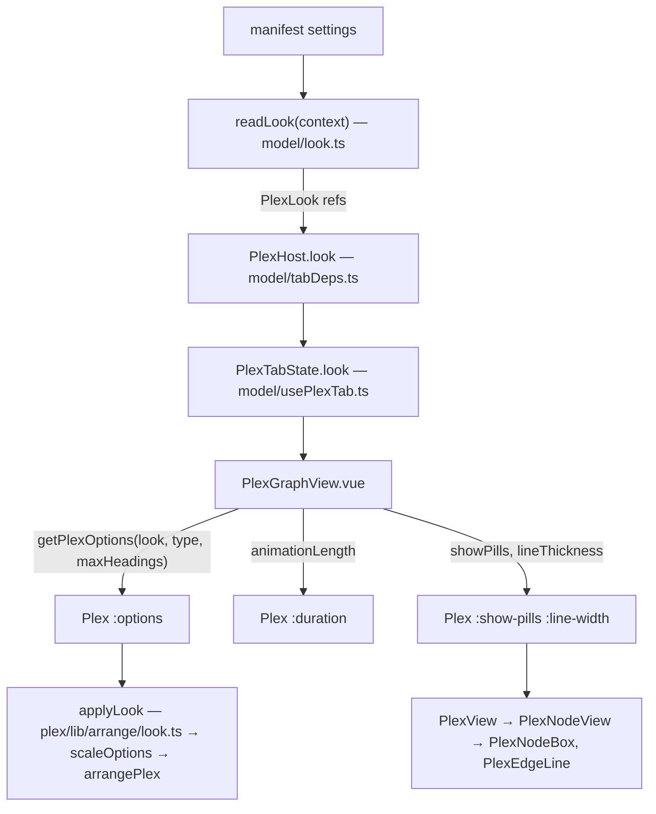

# Specification: Plex look settings

**Task Slug:** `plex-settings`
**Date:** `2026-11-12`
**Intent:** `intent.md` in the task folder (its open questions are not decided here; where the spec needs a value it names the question)

All paths are under `plugins/views-plex-graph/`. Placement skill: [`nm-place-plugin`](../../skills/nm-place-plugin/SKILL.md). The plex slice (`frontend/plex/`) is reached only through `frontend/plex/index.ts`; `frontend/plex/lib/` has no Vue.

## 1. Manifest entries

Appended to `settings[]` after `headingLimit`. Ranges are the playground's (open question 7).

| key | type | title | description | default | min | max | step |
|---|---|---|---|---|---|---|---|
| `showPills` | boolean | Pill background | Draw a pill behind each title. Off: the title alone, with a dot in the color of its relation. | `true` | | | |
| `pillPaddingSides` | number | Pill padding, sides | Space between a title and the left and right edge of its pill, in pixels. | `12` | 0 | 24 | 1 |
| `pillPaddingEnds` | number | Pill padding, top and bottom | Space between a title and the top and bottom edge of its pill, in pixels. | `6` | 0 | 16 | 1 |
| `focusSize` | number | Focus size | How much larger the note in the middle is. The other notes keep their size. | `1.3` | 1 | 2.5 | 0.05 |
| `animationLength` | number | Animation | How long moving to another note takes, in milliseconds. 0 moves at once. | `420` | 0 | 2000 | 20 |
| `lineThickness` | number | Line thickness | Width of the lines between notes and of pill outlines, in pixels. | `1.25` | 0.5 | 4 | 0.25 |
| `lineCurvature` | number | Line curvature | How far a line between two notes bends. 0 is a straight line. | `0.55` | 0 | 1 | 0.05 |
| `noteRoom` | number | Room around a note | Extra empty space kept around every note, in pixels. Larger is sparser. | `0` | 0 | 40 | 1 |

No `palette` flag (open question 8).

## 2. How a value reaches the drawing

- **`model/look.ts`** (new, beside `nesting.ts`): the eight keys as constants, the defaults and ranges, `interface PlexLook` (one `Readonly<Ref<…>>` per setting: `showPills`, `pillPaddingSides`, `pillPaddingEnds`, `focusSize`, `animationLength`, `lineThickness`, `lineCurvature`, `noteRoom`) and `readLook(context: Pick<PluginContext, 'settings'>): PlexLook`. It reads with `settings.get` and follows with `settings.onChange`, as `readNesting` does. A value of the wrong kind gives the default; a number out of range is clamped. One `parseNumber(value, range)` serves the seven numbers.
- **`index.ts`**: `look: readLook(context)` next to `nesting`.
- **`model/tabDeps.ts`, `types.ts`, `model/usePlexTab.ts`, `fixtures/host.ts`**: `PlexHost.look` → `PlexTabDeps.look` → `PlexTabState.look`, passed through unchanged. `usePlexTab.ts` is at 309 lines; the pass-through is one field.
- **`model/plexOptions.ts`** (new): `getPlexOptions(look, type, maxHeadings): PlexOptionsInput` — keeps `PlexGraphView.vue` under 100 script lines. It is the only place the settings become arrangement options.
- **Arrangement options** (`plex/lib/arrange/options.ts`): `BoxOptions` gains `focusScale: number`, `padding: { inline: number; block: number }`, `room: number`. `focusSize` is no longer a constant; `RoutingOptions.curvature` already exists.
- **`plex/lib/arrange/look.ts`** (new, pure): `applyLook(options): PlexOptions` derives, at the designed type (13 px, `DESIGNED_TYPE`):
  - `nodeSize.height = TITLE_LINE + 2 × padding.block`, where `TITLE_LINE` is the line of a title at the designed type (13 × 1.35, the `--numen-line-height` token), a constant beside `DESIGNED_TYPE`.
  - `focusSize = nodeSize × focusScale` (width cap and height).
  - `gap`, `lineGap`, `focusGap` each grow by `2 × room`; `margin` by `room`. Whether crowding may squeeze the room is open question 6; until answered the room is added after `measureCrowding`, so it is kept in full.
  - Called by `resolveOptions`, so every caller of the arrangement sees derived sizes. `scaleOptions` (`plex/model/sizing/plexScale.ts`) then scales `padding` and `room` with the text size like every other length (open question 3).
- **Measuring** (`plex/model/sizing/measure.ts`, `room.ts`): the side padding comes from `options.padding.inline` instead of the `--numen-node-padding` token, so a box is as wide as its title plus the setting. The focus is measured at `focusScale` (its title width × `focusScale`, plus padding × `focusScale`); the other nodes as today. With pills off, the dot is reserved like an icon (dot plus gap). `createWidthLookup` in `arrange.ts` caps the focus at `focusSize.width`.
- **Routing** (`plex/lib/arrange/edges/routing.ts`): the reach of a curve is `|span| × curvature`; the `minReach` floor applies only when `curvature > 0`, so at 0 the control points lie on the line and the path is straight (open question 10).
- **Rendering**:
  - `plex/ui/props.ts`, `Plex.vue`: new props `showPills?: boolean` (default `true`) and `lineWidth?: number` (default 1.25). `Plex.vue` sets `--plex-line` and the side padding (`--plex-pad-inline`) on the frame next to `--plex-move`; `duration` is the existing prop.
  - `PlexView.vue` → `PlexNodeView.vue` → `PlexNodeBox.vue`: `showPills` handed down. On: today's `rect.plex__box`, its stroke width `var(--plex-line)`, padding `var(--plex-pad-inline)`. Off: no `rect.plex__box`; a `circle.plex__dot` in `--relation-hue` before the icon and title; a transparent hit rect of the same box keeps pointer events. The focus with pills off is open question 4; ghost and link target with pills off are open question 5.
  - The focus title type is set at `focusScale` × the node type (open question 2).
  - `PlexEdgeLine.vue`: stroke width `var(--plex-line)` instead of `--numen-edge-width`.
  - Animation: `Plex.vue` `duration` already feeds `usePlexTransition` and `--plex-move`; `ms <= 0` already jumps.

## 3. Blast radius

| Path | File | Action | Consumers |
|---|---|---|---|
| plugin root | `manifest.json` | Modify | settings page, `manifest.test.ts` |
| `frontend/model` | `look.ts` | Create | `index.ts` |
| `frontend/model` | `plexOptions.ts` | Create | `ui/PlexGraphView.vue` |
| `frontend/model` | `tabDeps.ts`, `usePlexTab.ts` | Modify | `kind.ts` |
| `frontend` | `index.ts`, `types.ts` | Modify | host |
| `frontend/fixtures` | `host.ts` | Modify | `index.test.ts`, tab tests |
| `frontend/ui` | `PlexGraphView.vue` | Modify | tab kind |
| `frontend/plex/lib/arrange` | `options.ts`, `look.ts` (create), `arrange.ts`, `index.ts` | Modify | arrangement, gesture, drag |
| `frontend/plex/lib/arrange/edges` | `routing.ts` | Modify | edge paths |
| `frontend/plex/model/sizing` | `plexScale.ts`, `measure.ts`, `room.ts` | Modify | `Plex.vue` |
| `frontend/plex/ui` | `Plex.vue`, `props.ts` | Modify | `PlexGraphView.vue`, stories |
| `frontend/plex/ui/render` | `PlexView.vue`, `PlexNodeView.vue`, `PlexNodeBox.vue`, `PlexEdgeLine.vue`, `props.ts` | Modify | `Plex.vue` |
| `frontend/plex` | `index.ts` | Modify only if a new export is needed | `PlexGraphView.vue` |

Contract: no proto, wire or shared payload change; `ManifestSetting` already carries boolean/number with fractional `step`. The manifest is the plugin's own contract with the settings page; the new keys are additions. `apps/landing` has its own plex demo and is not touched.

## 4. Negative invariants

- No setting is read outside `model/look.ts` and `model/nesting.ts`; nothing in `plex/` reads `PluginContext`.
- `plex/lib/` stays free of Vue and of CSS tokens; `applyLook` takes numbers.
- No camera zoom: Focus size changes the focus box and nothing else in `nodeSize`.
- Files ≤ 350 lines, functions ≤ 80, complexity ≤ 10, max 4 params, Vue script ≤ 100 lines.
- Names imperative (`readLook`, `applyLook`, `getPlexOptions`, `parseNumber`), booleans `is…/has…/show…`, plain English.

## 5. Acceptance criteria

### AC-1: Every declared setting is read under its camelCase key
- **Given** a settings store holding a non-default value for each of the eight keys
- **When** the plugin reads its look
- **Then** each value of the look equals the stored value; a store holding snake_case keys gives the defaults.

### AC-2: Defaults and repair
- **Given** an empty store, then a store holding text for every number, then values beyond every range
- **When** the look is read
- **Then** the defaults of section 1 are used for the first two; the third gives each range's nearest end.

### AC-3: A change applies live
- **Given** an open plex tab
- **When** any setting changes through `onChange`
- **Then** the plex redraws with the new value without reopening the tab.

### AC-4: Pill background off draws the title with a dot
- **Given** a plex of a focus with a parent and a child, Pill background off
- **Then** no node draws a pill; each draws a dot in its relation's color and its title; switching it on draws the pills again.

### AC-5: A note without a pill still answers the pointer
- **Given** Pill background off
- **When** a neighbor's title is pressed, or right-clicked
- **Then** `activate` (or `menu`) is emitted for that note, as with pills on.

### AC-6: Side padding widens the box
- **Given** the same note drawn at Pill padding, sides 4 and at 20
- **Then** its box is wider at 20, by twice the difference at the designed type; the title is unchanged.

### AC-7: Top and bottom padding sets the height
- **Given** Pill padding, top and bottom 2 and 12
- **Then** every box is taller at 12, by twice the difference at the designed type.

### AC-8: Focus size grows only the focus
- **Given** a neighborhood arranged at Focus size 1 and at 2
- **Then** at 1 the focus box and a neighbor box have the same height; at 2 the focus is twice the height of a neighbor; neighbor boxes are the same size in both.

### AC-9: Animation sets the length of the move
- **Given** a controllable clock and Animation 1000
- **When** another note is activated
- **Then** the plex is still moving at 900 ms and has stopped at 1000 ms; at Animation 0 it is not moving right after the activation and the frame is the target.

### AC-10: Curvature 0 draws straight lines
- **Given** a focus with a child offset sideways, curvature 0
- **Then** both control points of the edge lie on the segment between its ends; at 0.55 they do not.

### AC-11: Room around a note makes the plex sparser
- **Given** the same neighborhood in the same window at Room 0 and Room 20
- **Then** the distance between two neighboring boxes is larger at 20, no two boxes overlap at either, and a neighborhood too large for the window counts more notes as not shown at 20.

### AC-12: Line thickness reaches lines and outlines
- **Given** Line thickness 3
- **Then** the plex frame is given 3 px as the line width its edges and outlines are drawn with (asserted on the prop or the value handed down, not on computed CSS).

### AC-13: The plex follows the text size
- **Given** the window's text size doubled
- **Then** padding, room and box sizes double; Focus size and curvature do not change.

## 6. Test plan

- Behavior only: pill present or absent, dot present, box sizes compared with each other, the moving state against a fake clock, control points of a path, overlap and overflow counts. No test reads CSS text, pixels, colors, gaps as styles, contrast, or screenshots.
- Nothing mocks the part it verifies: `readLook` runs against an in-memory settings object with real `onChange` callbacks; arrangement tests call `arrangePlex` with real options; component tests mount `Plex` with an injected clock and viewport (existing ports).
- Fixture notes are invented (`plex/fixtures/`, `fixtures/`), never a user's vault.
- Files: `model/look.test.ts` (AC-1, AC-2), `model/setting-keys.test.ts` (keys), `index.test.ts` (AC-3), `plex/lib/arrange/look.test.ts` and `arrange.test.ts` (AC-6–8, AC-11, AC-13), `edges/routing.test.ts` (AC-10), `plex/ui/Plex.test.ts` (AC-4, AC-5, AC-9, AC-12), `render/PlexNodeView.test.ts` (AC-4).
- Existing tests that pin today's sizes (176×44, 144×36, padding token) move with the new defaults; that is the fixture moving with the type, not a weakened test.
