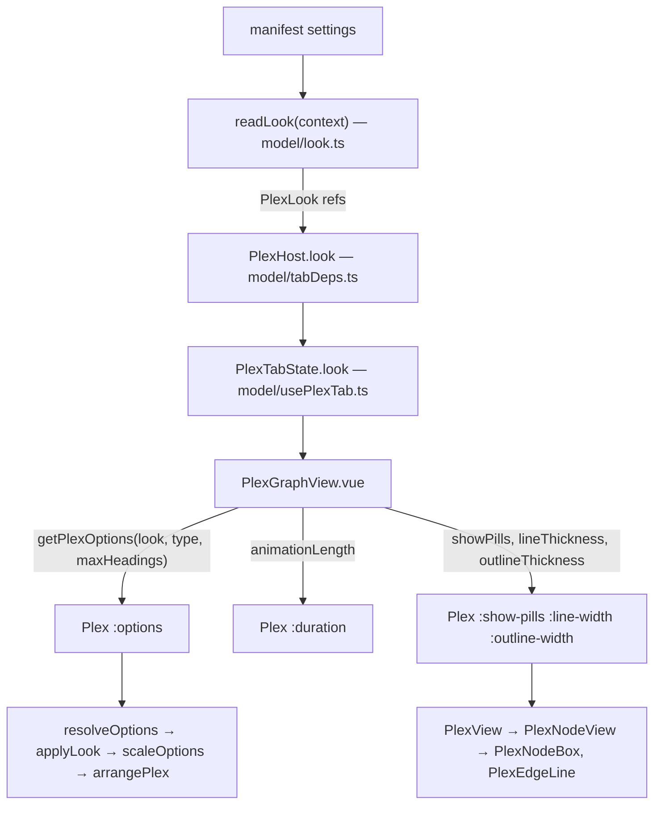

# Specification: Plex look settings

**Task Slug:** `plex-settings`
**Date:** `2026-11-12`
**Intent:** `intent.md` in the task folder (all questions answered)

All paths are under `plugins/views-plex-graph/`. Placement skill: [`nm-place-plugin`](../../skills/nm-place-plugin/SKILL.md). The plex slice (`frontend/plex/`) is reached only through `frontend/plex/index.ts`; `frontend/plex/lib/` has no Vue.

## 1. Manifest entries

Appended to `settings[]` after `headingLimit`. Defaults are today's values, rounded where the owner accepted it. Box lengths are in the plex's option unit: pixels at the designed text size (13, `DESIGNED_TYPE`), multiplied by the text size as every option length is today (`scaleOptions`). The two line widths are screen pixels, as the tokens they replace are today. Ranges and steps are the playground's.

| key | type | title | description | default | min | max | step |
|---|---|---|---|---|---|---|---|
| `showPills` | boolean | Pill background | Draw a pill behind each title. Off: the title alone. | `true` | | | |
| `pillPaddingSides` | number | Pill padding, sides | Space between a title and the left and right edge of its pill. | `10` | 0 | 24 | 1 |
| `pillPaddingEnds` | number | Pill padding, top and bottom | Space between a title and the top and bottom edge of its pill. | `9.25` | 0 | 16 | 0.25 |
| `focusSize` | number | Focus size | How much larger the note in the middle is drawn: its pill, title and icon. | `1.22` | 1 | 2.5 | 0.01 |
| `animationLength` | number | Animation | How long moving to another note takes, in milliseconds. 0 moves at once. | `420` | 0 | 2000 | 20 |
| `lineThickness` | number | Line thickness | Width of the lines between notes, in pixels. | `2` | 0.5 | 4 | 0.25 |
| `outlineThickness` | number | Outline thickness | Width of the outline of a pill, in pixels. | `1` | 0.5 | 4 | 0.25 |
| `lineCurvature` | number | Line curvature | How far a line between two notes bends. 0 is a straight line. | `0.55` | 0 | 1 | 0.05 |
| `noteRoom` | number | Room around a note | Extra empty space kept around every note. Larger is sparser. | `0` | 0 | 40 | 1 |

`showPills` also carries `"palette": true` and `"icon": "waypoints"`, as `nestHeadings` does.

Sources of the defaults: side padding `--numen-node-padding` 0.625rem (= 10 at the designed size); top and bottom `(36 − 13 × 1.35) / 2 = 9.225`, rounded to 9.25 (a pill 36.05 tall); focus `176/144 = 44/36 ≈ 1.2222`, rounded to 1.22; animation `Plex.vue` `duration` 420; line `--numen-edge-width` 2px; outline `--numen-stroke` 1px; curvature `routing.curvature` 0.55.

## 2. How a value reaches the drawing

- **`model/look.ts`** (new, beside `nesting.ts`): the nine keys, defaults and ranges; `interface PlexLook` (one `Readonly<Ref<…>>` per setting); `readLook(context: Pick<PluginContext, 'settings'>): PlexLook`, reading with `settings.get` and following with `settings.onChange` as `readNesting` does. Wrong kind gives the default; a number out of range is clamped by one `parseNumber(value, range)`.
- **`index.ts`**: `look: readLook(context)` next to `nesting`.
- **`model/tabDeps.ts`, `types.ts`, `model/usePlexTab.ts`, `fixtures/host.ts`**: `PlexHost.look` → `PlexTabDeps.look` → `PlexTabState.look`, unchanged. `usePlexTab.ts` is at 309 lines; this is one field.
- **`model/plexOptions.ts`** (new): `getPlexOptions(look, type, maxHeadings): PlexOptionsInput`, so `PlexGraphView.vue` stays under 100 script lines.
- **Options** (`plex/lib/arrange/options.ts`): `BoxOptions` gains `focusScale` (1.22), `padding: { inline: 10; block: 9.25 }`, `room` (0). `focusSize` is derived; `nodeSize` keeps its width cap 144.
- **`plex/lib/arrange/look.ts`** (new, pure) `applyLook(options): PlexOptions`, called by `resolveOptions`:
  - `nodeSize.height = TITLE_LINE + 2 × padding.block`, `TITLE_LINE = 13 × 1.35` beside `DESIGNED_TYPE` (36.05 at the default).
  - `focusSize = nodeSize × focusScale` (≈ 175.7 × 44 at the default).
  - `gap`, `lineGap`, `focusGap` each grow by `2 × room`. This happens before `measureCrowding`, so the room shrinks with the gaps in a tight window.
  - `scaleOptions` scales `padding` and `room` with the text size, as every other length.
- **Measuring** (`plex/model/sizing/measure.ts`, `room.ts`): the side padding comes from `options.padding.inline` instead of the probe's `--numen-node-padding`; the token no longer applies to the plex. The focus title is measured like every other title; its pill is that width × `focusScale`, and the title, icon, gap and padding are drawn `focusScale` times larger inside it (a scaled `foreignObject`), capped at `focusSize.width` in `createWidthLookup` (`arrange.ts`), so a short focus title grows in width too.
- **Headings**: `lib/inside.ts` hangs headings from `node.height / 2`, so they move with a taller focus without change.
- **Routing** (`plex/lib/arrange/edges/routing.ts`): reach is `|span| × curvature`; the `minReach` floor applies only when `curvature > 0`, so at 0 the control points lie on the line. Every curve that reads `curvature` follows the same rule.
- **Rendering**:
  - `plex/ui/props.ts`, `Plex.vue`: new props `showPills?: boolean` (default `true`), `lineWidth?: number` (2), `outlineWidth?: number` (1). `Plex.vue` sets `--plex-line`, `--plex-outline` and `--plex-pad-inline` (from the scaled option) on the frame beside `--plex-move`. `duration` is the existing prop.
  - `PlexView.vue` → `PlexNodeView.vue` → `PlexNodeBox.vue` take `showPills`. On: today's `rect.plex__box`, stroke width `var(--plex-outline)`, title padding `var(--plex-pad-inline)`. Off, for every node including the focus: no `rect.plex__box`; the title alone, with no dot; a transparent hit rect of the same box keeps pointer events.
  - The link-target ring (`--numen-ring-width`) and the ghost's dashed outline are drawn as today, whatever `showPills` and `outlineWidth` are.
  - `PlexEdgeLine.vue`: stroke width `var(--plex-line)` instead of `--numen-edge-width`.
  - Animation: `duration` already feeds `usePlexTransition` and `--plex-move`; `ms <= 0` already jumps.

## 3. Blast radius

| Path | File | Action | Consumers |
|---|---|---|---|
| plugin root | `manifest.json` | Modify | settings page, palette, `manifest.test.ts` |
| `frontend/model` | `look.ts`, `plexOptions.ts` | Create | `index.ts`, `ui/PlexGraphView.vue` |
| `frontend/model` | `tabDeps.ts`, `usePlexTab.ts` | Modify | `kind.ts` |
| `frontend` | `index.ts`, `types.ts` | Modify | host |
| `frontend/fixtures` | `host.ts` | Modify | `index.test.ts`, tab tests |
| `frontend/ui` | `PlexGraphView.vue` | Modify | tab kind |
| `frontend/plex/lib/arrange` | `options.ts`, `look.ts` (create), `arrange.ts`, `index.ts` | Modify | arrangement, gesture, drag |
| `frontend/plex/lib/arrange/edges` | `routing.ts` | Modify | edge paths |
| `frontend/plex/model/sizing` | `plexScale.ts`, `measure.ts`, `room.ts` | Modify | `Plex.vue` |
| `frontend/plex/ui` | `Plex.vue`, `props.ts` | Modify | `PlexGraphView.vue`, stories |
| `frontend/plex/ui/render` | `PlexView.vue`, `PlexNodeView.vue`, `PlexNodeBox.vue`, `PlexEdgeLine.vue`, `props.ts` | Modify | `Plex.vue` |

Contract: no proto, wire or shared payload change; `ManifestSetting` already carries boolean and number with fractional `step`. The new manifest keys are additions to the plugin's own contract with the settings page. `apps/landing` has its own plex demo and is not touched.

## 4. Negative invariants

- No setting is read outside `model/look.ts` and `model/nesting.ts`; nothing in `plex/` reads `PluginContext`.
- `plex/lib/` stays free of Vue and CSS tokens; `applyLook` takes numbers.
- No camera zoom and no change of title size: Focus size changes the focus pill only.
- Files ≤ 350 lines, functions ≤ 80, complexity ≤ 10, max 4 params, Vue script ≤ 100 lines.
- Names imperative (`readLook`, `applyLook`, `getPlexOptions`, `parseNumber`), booleans `is…/has…/show…`, plain English.

## 5. Acceptance criteria

### AC-1: Every declared setting is read under its camelCase key
- **Given** a store holding a non-default value for each of the nine keys
- **When** the plugin reads its look
- **Then** each value equals the stored one; snake_case keys give the defaults.

### AC-2: Defaults and repair
- **Given** an empty store, a store of text for every number, and values beyond every range
- **Then** the first two give the defaults of section 1; the third gives each range's nearest end.

### AC-3: The defaults draw today's plex, within the accepted rounding
- **Given** a neighborhood arranged with the default look and with today's options (`focusSize` 176 × 44, `nodeSize` 144 × 36)
- **Then** every neighbor box has today's position within a pixel, today's width and a height 0.05 larger; the focus pill is 1.22 × its measured title width (capped) and 1.22 × a neighbor's height; edges join the same nodes.

### AC-4: A change applies live
- **Given** an open plex tab
- **When** any setting changes through `onChange`
- **Then** the plex redraws with the new value without reopening the tab.

### AC-5: Pill background off draws every title alone
- **Given** a focus with a parent and a child, Pill background off
- **Then** no node, the focus included, draws a pill; each draws its title alone, with no dot; switching on draws the pills again.

### AC-6: Ring and ghost stay with pills off
- **Given** Pill background off
- **When** a link is dragged over a neighbor, and when a ghost note is shown
- **Then** the target still draws its ring and the ghost still draws its dashed outline.

### AC-7: A note without a pill still answers the pointer
- **Given** Pill background off
- **When** a neighbor's title is pressed or right-clicked
- **Then** `activate` (or `menu`) is emitted for that note.

### AC-8: Side padding widens the box
- **Given** one note at Pill padding, sides 4 and 20
- **Then** its box is wider at 20 by twice the difference at the designed type.

### AC-9: Top and bottom padding sets the height
- **Given** Pill padding, top and bottom 2 and 12
- **Then** every box is taller at 12 by twice the difference at the designed type.

### AC-10: Focus size grows only the focus pill
- **Given** a neighborhood with a short focus title, at Focus size 1 and 2
- **Then** at 1 the focus and a neighbor have the same height; at 2 the focus pill is twice as tall and twice as wide as at 1; neighbor boxes and every title's measured width are the same in both.

### AC-11: Headings move with the focus
- **Given** the focus with headings, at Focus size 1 and 2
- **Then** the first heading starts lower at 2, by half the growth of the focus height.

### AC-12: Animation sets the length of the move
- **Given** a controllable clock, Animation 1000
- **When** another note is activated
- **Then** the plex is moving at 900 ms and stopped at 1000 ms; at Animation 0 it is not moving right after the activation and the frame is the target.

### AC-13: Curvature 0 draws straight lines
- **Given** a focus with a child offset sideways, curvature 0
- **Then** both control points of the edge lie on the segment between its ends; at 0.55 they do not.

### AC-14: Room makes the plex sparser and shrinks when tight
- **Given** the same neighborhood at Room 0 and Room 20 in a large window
- **Then** two neighboring boxes are farther apart at 20 and no boxes overlap.
- **Given** a window so tight the gaps are squeezed
- **Then** the room between boxes at Room 20 is less than its full value, and no boxes overlap.

### AC-15: Line and outline thickness are separate
- **Given** Line thickness 3 and Outline thickness 1
- **Then** the frame hands 3 to the edges and 1 to the pill outlines; swapping the values swaps what each is handed (asserted on the values handed down, not on computed CSS).

### AC-16: Lengths follow the text size
- **Given** the window's text size doubled
- **Then** padding, room and box sizes double; Focus size, curvature and the two line widths do not change.

### AC-17: Pill background is in the palette
- **Given** the manifest
- **Then** `showPills` is declared with `palette: true`.

## 6. Test plan

- Behavior only: pill present or absent, no dot, ring and dashed ghost present, box sizes compared, the moving state against a fake clock, control points of a path, overlap and overflow counts, values handed down. No test reads CSS text, pixels, colors, gaps as styles, contrast, or screenshots.
- Nothing mocks the part it verifies: `readLook` runs against an in-memory settings object with real `onChange` callbacks; arrangement tests call `arrangePlex` with real options; component tests mount `Plex` with the injected clock and viewport ports.
- Fixture notes are invented (`plex/fixtures/`, `fixtures/`), never a user's vault.
- Files: `model/look.test.ts` (AC-1, AC-2), `model/setting-keys.test.ts` (keys), `manifest.test.ts` (AC-17), `index.test.ts` (AC-4), `plex/lib/arrange/look.test.ts` and `arrange.test.ts` (AC-3, AC-8–10, AC-14, AC-16), `lib/inside.test.ts` (AC-11), `edges/routing.test.ts` (AC-13), `plex/ui/Plex.test.ts` (AC-5–7, AC-12, AC-15), `render/PlexNodeView.test.ts` (AC-5, AC-6).
- Existing tests that pin today's exact sizes (pill height 36, focus 176 × 44, the width of a short focus title) move with the accepted defaults; that is the fixture moving with the type, not a weakened test.
