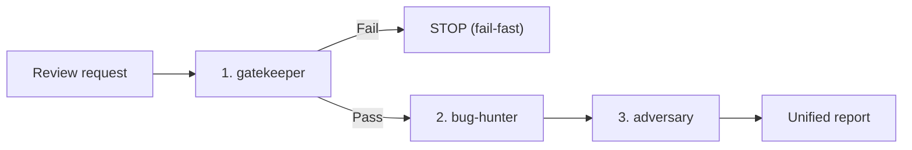

# Numen — Coding Conventions

These rules apply to all code in the numen repository. Every agent (Claude,
Gemini, or any other) must follow them.

## Canonical guides

- **Architecture guidelines**: [`.agents/rules/architecture.md`](.agents/rules/architecture.md)
- **Backend coding style (Go)**: [`.agents/rules/coding-style-backend.md`](.agents/rules/coding-style-backend.md)
- **Frontend coding style (Vue / TypeScript)**: [`.agents/rules/coding-style-frontend.md`](.agents/rules/coding-style-frontend.md)
- **Unified review skill (`/nm-review`)**: [`.agents/skills/nm-review/SKILL.md`](.agents/skills/nm-review/SKILL.md)
- **Per-module conventions**: `AGENTS.md` inside `libs/core`, `libs/ui/core`, `libs/protocol`, `apps/desktop`.

## Code review protocol: the 3-stage pipeline (`/nm-review`)

When asked to review code or a pull request, run the pipeline in
[`.agents/skills/nm-review/SKILL.md`](.agents/skills/nm-review/SKILL.md):



1. **Gatekeeper & architecture** — [`stages/1-gatekeeper.md`](.agents/skills/nm-review/stages/1-gatekeeper.md): module targets for touched packages (e.g. `make lib_core_lint lib_core_test`, `make lib_ui_lint lib_ui_test`), then the diff against `AGENTS.md` and the rules in `.agents/rules/`. A failing gate stops the pipeline. Go tests run without `-race` locally; the race detector runs in CI only (`GO_RACE=1` turns it on for a make target).
2. **Semantic logic audit** — [`stages/2-bughunter.md`](.agents/skills/nm-review/stages/2-bughunter.md): the blast radius, and every defect proven with _Given → When → Then_.
3. **Dynamic stress verification** — [`stages/3-adversary.md`](.agents/skills/nm-review/stages/3-adversary.md): a test that forces the failure, and the mutation check on the change's own tests.
4. **Report** — the review report as templated in the skill: verdict and findings first, only the checks that ran.

One pipeline covers Go and Vue. A reviewer reports findings and does not fix
them.

---

## 1. Comments state facts and invariants

A comment describes the active behavior, invariant, or constraint. It does not argue, justify rejected alternatives, or narrate history.

Before writing a comment, verify that it provides concrete value that code cannot express directly.

Rewrite on sight of any of these:

- `rather than X`, `instead of X`, `not X but Y`
- `X would have…`, `otherwise somebody would…`, `told only Y, a caller would…`
- `so that we do not…`, `to avoid…`
- `these are those X`, `which is why this exists`
- benchmark numbers, or any comparison with a previous implementation
  (measurements are stored only in `docs/performance.md`)

Comments must be concise, factual, and strictly technical engineering English. Avoid storytelling and literary cadence.

---

## 2. Function and method naming (all languages)

Functions and methods take **imperative verb phrases** in the base form
(`get…`, `read…`, `write…`, `fetch…`, `create…`, `open…`, `delete…`) or
**predicate phrases** (`is…`, `has…`, `can…`).

Forbidden patterns:

| Pattern               | Example                       | Fix                                    |
| --------------------- | ----------------------------- | -------------------------------------- |
| Third-person singular | `carries`, `attends`, `reads` | `carry`, `attend`, `read`              |
| Past participle       | `listened`, `spoken`, `cued`  | `getTranscript`, `transcribe`          |
| Bare noun / adjective | `highlight`, `book`           | `getHighlight`, `createBook`           |
| Literary metaphor     | `minting`, `held`, `cold`     | `getTitle`, `getActiveTab`, `getTitle` |

A method states **what operation is performed** using standard engineering
terms, never literary third-person narrative.

---

## 3. Event handler naming (frontend — TypeScript / Vue)

Event handlers are named `on<Action>`:

```ts
// ✅ correct
;(onSubmit, onClose, onClick, onSelect, onToggle)

// ❌ wrong
;(cold, submitted, handle, doThing)
```

In Vue `<template>`, emits use kebab-case (`@item-selected`); the
corresponding handler in `<script>` is `onItemSelected`.

---

## 4. Vue component structure (`<script setup>` / `<script>`)

All Vue components organize their `<script>` block into sections separated by
80-character comment banners:

```vue
<script setup lang="ts">
/* --------------------------------- Props ---------------------------------- */
const props = defineProps<{ ... }>()

/* --------------------------------- Events --------------------------------- */
const emit = defineEmits<{ ... }>()

// Or when combined:
/* ----------------------------- Props & Emits ------------------------------ */

/* --------------------------------- State ---------------------------------- */
const isOpen = ref(false)
const title = computed(() => ...)

/* --------------------------------- Hooks ---------------------------------- */
onMounted(() => { ... })

/* -------------------------------- Handlers -------------------------------- */
function onSubmit() { ... }
function onClose() { ... }

/* -------------------------------- Helpers --------------------------------- */
function formatValue(val: string) { ... }
</script>
```

Rules:

1. Always follow the order: **Props → Events (or Props & Emits) → State → Hooks → Handlers → Helpers**.
2. Only include headers for sections that actually exist in the component.
3. The banner is the 80-character form: `/* --------------------------------- <Name> ---------------------------------- */`.
4. A section with independent state, or a part rendered on its own elsewhere, is extracted into its own component.
5. Business logic does not live in a `.vue` file — it is a composable or a domain model.

The components in the tree still use the short `// --- <Name> ---` form. They
are being migrated to the banner above; until the migration is done, new and
touched components use the banner.

---

## 5. Composables naming (`use<Feature>`)

Composables and reactive state factories in Vue must be named with the `use…` prefix:

```ts
// ✅ correct
;(useBookTab, useDocumentTab, useAgentChat, useFileManager)

// ❌ wrong (gerunds, verbs, literary words)
;(booking, documenting, talking, opening)
```

---

## 6. Type and interface naming (all languages)

Types and interfaces are **singular nouns** or noun phrases:

```ts
// ✅
;(Tab, FileEntry, MoveResult, TranscriptSegment)

// ❌ gerunds, adjectives, verbs
;(Opening, Doing, Failed)
```

### Boolean fields

Boolean fields and properties use `is…` / `has…` / `can…` prefix:

```ts
// ✅
isUserRequested: boolean
hasTranscript: boolean

// ❌
userRequested: boolean // reads as past tense, not boolean
failed: string // "failed" looks boolean but is a string — rename to failureReason
```

### Struct / interface fields

Fields are **noun phrases** that say what they hold:

```ts
// ✅
;(title, completedCount, totalCount, failureReason, progressPercent)

// ❌ cryptic or ambiguous
;(about, doing, done, total, counting)
```

---

## 7. Factory and constructor functions

### Frontend (TypeScript / Vue)

Factory functions use `create…`:

```ts
// ✅
;(createTab, createBookKind, createDocumentTab)

// ❌
;(makeTab, bookKind, newTab)
```

The word `make` is **not used** in frontend code for factories.

### Go

Go follows its own idioms: `New…` for constructors, `make` for built-in
allocation. Both are allowed.

```go
// ✅
NewServer(), NewReading(), make(map[string]string)
```

---

## 8. Result pattern for fallible operations (frontend)

Functions that can fail return a **discriminated result**, never a bare value,
implicit `null`, or custom `refusal`:

```ts
type Result<T, E = ErrorCode> = { ok: true; value: T } | { ok: false; error: E }

// ✅
function openVault(id: string): Result<Vault, ErrorCode>

// ❌ caller cannot tell success from failure, or uses custom discriminant
function openVault(id: string): Vault | ErrorCode | undefined
function openVault(id: string): { ok: boolean; refusal?: RefusalReason }
```

Pick **one** word for the failure discriminant: **`error`** (never `refusal`, `reason`, or `refusalReason`).

---

## 9. Domain terminology

A concept is named with the standard term of its field (W3C, LSP, MIME, gRPC codes).

Specific term rules:

| Wrong                | Correct              | Context                          |
| -------------------- | -------------------- | -------------------------------- |
| `refusal`, `refused` | `error`, `errorCode` | operation error discriminants    |
| `spoken`, `spokenBy` | `transcript`         | audio/video transcription output |
| `make` (frontend)    | `create`             | factory functions in TS/Vue      |

### Vault and link formatting rules

- **Books and passages:** `[Passage description](numen:<path>?start=<offset>&length=<len>)` (using the `at` field from `note_search` / `source_read`).
- **Notes:** `[[Note Title]]` or `[[notes/path.md]]`.
- **Prohibited:** Never format vault notes, books, or passages as `file://` URLs. The `file://` scheme is only for repository source code files.

---

## 10. File placement — domain code stays in its domain

Code that serves one domain is in that domain's folder under
`apps/desktop/editor/src/` (or its respective plugin under `plugins/`):

| File                                             | Belongs in |
| ------------------------------------------------ | ---------- |
| Note-specific types (`Move`, `Focus`, `Enabler`) | `note/`    |
| File-manager entries (`FileEntry`, `MoveResult`) | `files/`   |
| Flashcard review settings                        | `cards/`   |

There is no `tabs/` folder and no `shared/`. What two or more domains genuinely
use is at the top of `src/` under the word for what it is — `transport.ts`,
`theme.ts`, `words.ts` — and a type only one domain reads never moves there.

---

## 11. Single Responsibility — no god objects

Do not build a single type or composable that handles all variants of a
concept. Split by capability:

```ts
// ❌ one ArtifactRunner that can transcribe, correct, fetch for all artifact types
class ArtifactRunner {
  transcribe()
  correct()
  fetch()
}

// ✅ separate by capability, composed via generics or mixins
interface Transcribable {
  getTranscript(): Transcript
}
interface Correctable {
  applyCorrection(c: Correction): void
}
```

A file is split when it holds a second responsibility. The unit of organisation
is the thing, not the kind of thing: a folder collecting every type, every
handler or every use case is unstructured at fifty entries and was already unstructured at
five.

## 12. File and directory naming (frontend — TypeScript / Vue)

Directories and files follow strict casing rules:

1. **Directories**: always `kebab-case` (`status-corner/`, `command-palette/`, `file-routing/`, `tabs/`).
2. **Vue components**: always `PascalCase` (`App.vue`, `NoteTab.vue`, `Field.vue`).
3. **TypeScript / JavaScript files**: always `camelCase` (`useWorkspaceTabs.ts`, `useFileRouter.ts`, `transport.ts`, `words.ts`, `answers.ts`).

## 13. Absolute ban on narrative slop, participles, and Anglish metaphors (all languages)

To keep code readable, pseudo-literary prose, Anglish idioms, irregular past participles as identifiers, and bare prepositions are strictly forbidden across TypeScript, Vue, and Go.

### Forbidden variable & identifier patterns:

1. **Irregular past participles as identifiers**: `held`, `said`, `asked`, `drawn`, `done`, `written`, `kept`, `shown`, `seen`, `told`, `settled`, `cut`, `put`, `taken`, `left`, `answered`.
   - _Fix_: Use standard engineering nouns: `instance`, `wrapper`, `binding`, `response`, `query`, `request`, `result`, `count`, `target`, `item`.
2. **Bare prepositions as identifiers**: `beside`, `under`, `over`, `behind`, `along`, `near`, `around`, `across`.
   - _Fix_: Use concrete nouns: `adjacentPath`, `sidePane`, `parent`, `delta`, `range`.
3. **Literary metaphors & bare adjectives**: `bare`, `wide`, `stale`, `fresh`, `plain`, `shut`, `loose`, `quiet`, `warm`, `unseen`, `cold`, `minting`.
   - _Fix_: Use descriptive identifiers: `rawText`, `isExpanded`, `isAvailable`, `isClosed`.
4. **Third-person singular verbs as function names**: `carries`, `attends`, `reads`, `names`, `answers`, `stands`.
   - _Fix_: Use imperative verb phrases: `carry`, `attend`, `readText`, `getName`, `respond`.
5. **Fake turn casts**: Never write `voice: 'said'`, `state: 'done'`, or `as unknown as Turn`. Adhere strictly to the domain types `voice: 'asked' | 'answered'` and `TurnState: 'settled' | 'arriving' | 'failed'`.
6. **Forbidden error terminology**: Never use `refused` or `refusal`. Always use `error` or `errorCode`.
7. **Narrative comments & docstrings**: Do not write biblical or Saxon idioms (`hands back`, `comes to`, `stands on`, `where it sits`, `what holds here`). Write plain, technical engineering English.
8. **Personification and metaphor in prose a person reads**: A task title, notice, error, manifest `title` or `description`, Markdown document or test title states the operation or the fact in standard engineering terms. A window does not `wear` a theme, a plugin does not `speak` a protocol, a page does not `hand over` a value; a task is titled `Apply theme`, not `Wearing a theme`, and its detail reads `Theme not found: dracula`. `tools/lint-narrative/scan.mjs` rejects these families (`wear`/`dress`, `hand over`/`hand back`, `speaks`, `breathe`/`eat`, `lit up`, `bring level`, `stands`/`sits` at a place, `nowhere to put`) in Markdown, comments, test titles, Go and TypeScript string literals and `manifest.json`; words inside backticks are quoted, not checked.
9. **Test titles and comments**: name the subject, a standard verb and concrete nouns. `tools/lint-narrative/scan.mjs` category 24 checks the lines a change adds. Examples:
   - `it('releases pointer capture when the scope is disposed')`
   - `it('clears the interval on dispose')`
   - `it('keeps its position when the list has one item')`
   - `it('cancels the drag when no listener is registered')`
   - `it('reports an error when the core rejects the tab report')`
   - `/** Converts a viewport point to screen coordinates. */`

---

## 14. Known gotchas

- **Every worktree shares one `git stash` stack.** Two agents stashing at once
  mix up the entries: one `pop` takes the other's entry into the wrong tree. For a clean
  tree, commit first and `git checkout HEAD~1 -- <path>`, or copy the file
  aside.
- **The windows import `@numen/ui` from its build.** Run `npm run build` in
  `libs/ui/core` before the suites in `apps/desktop/editor` and
  `flashcards`, or they fail on `Cannot find module '@numen/ui'`.
- **`node_modules` symlinked from the primary checkout resolves
  `@numen/protocol` to whatever branch that checkout has checked out.** A
  generated symbol missing there is that, not the branch under test. Install
  for real when the answer matters.
- **`npm test` in `libs/ui/core` starts both story instances at once**, and
  the run fails before any test executes. Take them one at a time:
  `npm run test:unit`,
  `vitest run --project 'stories (chromium)'`,
  `vitest run --project 'stories (webkit)'`. WebKit does run on this machine.

---

## 15. Rules for agents learned from review

The plugin model is [`.agents/rules/architecture.md`](.agents/rules/architecture.md) §11.

1. A window (editor, flashcards, mobile) calls the core only through `@numen/core-client`. A plugin frontend calls it only through `@numen/plugin-sdk`, a plugin backend only through `libs/plugin-sdk-go`. The core routes every call; windows and plugins never call each other directly.
2. A plugin depends on the SDK and third-party code, and its frontend also on `@numen/ui`. Never add a direct import or require of `libs/notes`, `libs/protocol`, `@numen/core-client`, `@connectrpc` or another library to a plugin. `// indirect` lines in a plugin's `go.mod` come from the SDK and are allowed.
3. Never add to the plugin SDK what no plugin uses. Every SDK export has a plugin that imports it. Never propose a third shared library for plugins.
4. An SDK type may be an alias of a `libs/notes` type. Each type has one name; never add a second set of names.
5. A plugin has no `.proto` file and no protobuf code. Its backend exposes JSON methods to its frontend. A plugin's own service is named after its plugin id; shared services such as `numen.v1.AgentService` are declared by the core.
6. Code may be duplicated between plugins. Never add or keep a check that pushes code into the SDK or `@numen/ui`.
7. Logic that depends on time takes a clock as a port. A plugin takes the SDK clock or declares its own.
8. Size and complexity limits are rules, with one set for Go, TypeScript and Vue ([`.agents/rules/architecture.md`](.agents/rules/architecture.md) §8).
9. Nothing is published for now. Publishing, API compatibility tooling and iframe isolation come later, when the SDK is released.
10. Checks are structural. Use an off-the-shelf tool with configuration where one exists (dependency-cruiser, depguard and gomodguard, golangci-lint linters, stylelint). Write a check by hand only over syntax trees, import graphs and type information. A check never decides by a regular expression over source text, a list of names or a list of files ([`.agents/rules/architecture.md`](.agents/rules/architecture.md) §10).
11. Checks never get weaker: no exclusion and no workaround that bypasses a rule (such as obtaining the time through `time.After(0)`). Derive sets from structure.
12. Tell the owner a design decision before writing it into a plan file or implementing it. Do not present a guess as agreed.
13. Do the work first. Run the heavy checks (full lint-layers, tests across modules, linters) once at the end.
14. Commit messages carry no `Co-Authored-By` line and no session trailer.
15. Write comments and docs in plain technical English (§1, §13).
