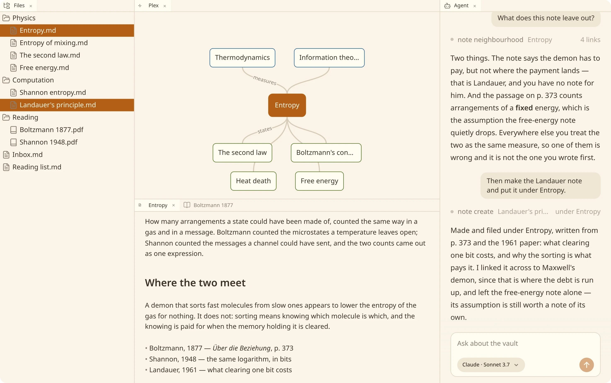

**Numen — Markdown notes with a connection graph, an AI agent and spaced repetition.**

<picture>
  <source media="(prefers-color-scheme: dark)" srcset="modules/apps/landing/src/assets/window-filing-dark.webp">
  
</picture>

**[Download](#download)** · [Website](https://numen.md) · [User Manual](https://docs.numen.md) · [Forum](https://forum.numen.md)

## Why Numen

- **Notes** — plain Markdown files on your disk, alongside the PDFs, EPUBs, recordings and videos they come from.
- **Graph** — typed links between notes, drawn as a live map around the note you are reading.
- **Agent** — ask your vault a question and get an answer that links to the notes it used.
- **Spaced repetition** — flashcards written inside your notes, scheduled with FSRS.

## Download

| Platform | Download |
|:---|:---|
| **macOS** (Apple Silicon & Intel) | [.dmg](https://github.com/jiva-studio/numen/releases/latest/download/numen-macos.dmg) |
| **Windows** (x64) | [Installer](https://github.com/jiva-studio/numen/releases/latest/download/numen-windows-setup.exe) · [Portable .zip](https://github.com/jiva-studio/numen/releases/latest/download/numen-windows-amd64.zip) |
| **Linux** (x64) | [.deb](https://github.com/jiva-studio/numen/releases/latest/download/numen-linux-amd64.deb) · [.rpm](https://github.com/jiva-studio/numen/releases/latest/download/numen-linux-amd64.rpm) · [Flatpak](https://github.com/jiva-studio/numen/releases/latest/download/numen-linux-amd64.flatpak) · [.tar.gz](https://github.com/jiva-studio/numen/releases/latest/download/numen-linux-amd64.tar.gz) |

## Community

- [User Manual](https://docs.numen.md) — setting up a vault, linking, cards and review.
- [Forum](https://forum.numen.md) — workflows, questions and feature requests.
- [Issues](https://github.com/jiva-studio/numen/issues) — bug reports.

## License

Numen is free software under the [GNU AGPL v3.0](LICENSE).
