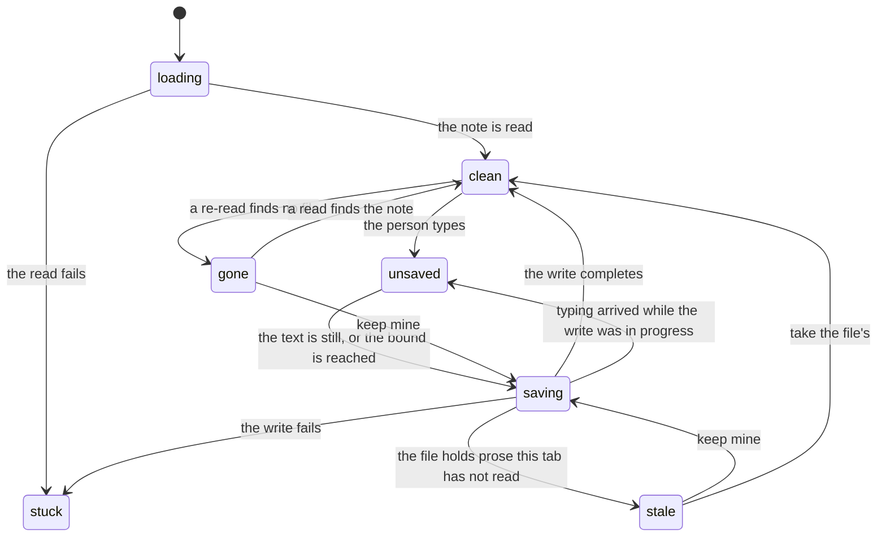

# A note in a tab

A note open in the window has three parts: the prose on screen, the file it came from, and the pending write. Saving is automatic: what a person types is written to the file without any key press. This page describes what a tab does with a note: when it writes, what it writes, what stops it, and what it shows while it is stopped.

Scope is one note in one tab, and the operations that move or rename the file under it. The bytes of a note are [Note format](note-format.md); how a link finds its target is [Links](links.md).

## Saving

Every change postpones the write. A write starts when either of these holds:

- the text has been still for 800 milliseconds;
- the oldest unwritten change is five seconds old.

A save with no change writes nothing. `Ctrl+S` writes the unsaved changes at once, under every rule below.

Closing a tab and quitting the window write the unsaved changes and wait for them. Renaming or removing the file does the same, and that write goes to the path the tab is still at.

A save updates the index at once: the note is parsed again, split into chunks again, and searchable by word. Its vectors are requested once the vault has had no writes for eight seconds, and every write restarts that wait. The wait is longer than the five-second bound above, so one editing session on one note is embedded once.

## What counts as a change

The save reads the file it is replacing and compares the prose there with the prose the tab read. Two things are not a change:

- **Equal prose.** Text equal to what the tab was given counts as unchanged, whatever the file's size and modification time are. A synchroniser, a checkout and a touch change those without changing the text.
- **A file still as this caller's own last write left it.** A write returns the fingerprint of the file it made, and a caller that presents that fingerprint is presenting its own write. The prose there can differ from what the caller sent — a save adds the trailing line break and keeps the line endings the file already had.

The frontmatter is not compared. It is copied unchanged into the new file.

## When the file changed after the tab read it

If the file holds prose the tab has not read, the save stops. Nothing is written, the tab shows the mark `stale`, and the automatic save is disabled for that tab: what the person typed stays in the buffer. `Ctrl+S` stops here too.

The person chooses one of two actions, and the automatic save runs again afterwards:

- **keep mine** writes the tab's prose over the file, presenting no fingerprint;
- **take the file's** reads the file again, and that read replaces the buffer.

A stale tab needs an answer before it closes and before the window quits.

### The states a tab is in

The predicates are evaluated in order, so a tab is in exactly one state. The mark is the one word shown beside the tab title, and a screen reader reads it out.

| State     | What it means                                                      | Mark      |
| --------- | ------------------------------------------------------------------ | --------- |
| `stuck`   | reading or writing this note is impossible, and the tab says why   | `stuck`   |
| `loading` | the first read has not returned; there is no document to type into | —         |
| `gone`    | the path of the tab has no file                                    | `gone`    |
| `stale`   | the file holds prose this tab has not read, and the save stopped   | `stale`   |
| `saving`  | a write is in progress                                             | `unsaved` |
| `unsaved` | what is shown differs from what was written                        | `unsaved` |
| `clean`   | the file holds what is shown                                       | —         |

A tab is `stuck` on one of six errors:

| Error            | What the person is told                                            |
| ---------------- | ------------------------------------------------------------------ |
| `tooLarge`       | this note is longer than the editor holds                          |
| `bodyUnwritable` | a note begins below its frontmatter, and this text begins with one |
| `notANote`       | this file is not a note                                            |
| `notText`        | this file is not text                                              |
| `unreadable`     | the frontmatter of this note cannot be read                        |
| `unreachable`    | the vault could not be reached, so this note was not written       |

After three of them — `tooLarge`, `bodyUnwritable` and `unreachable` — typing clears the error and the save is tried again. The other three are conditions of the file. A tab with such a recoverable error shows the error the first time it is asked to close, and closes the second time.

## What a save writes

The buffer holds the body. The save reads the file under the vault's write lock, takes the frontmatter as it is then, adds the body to it, and replaces the file. The read and the rename are atomic with respect to every other write that reads a note and writes it back.

**A save writes no identifier.** The only content it writes into the note is the person's. A note the save creates — for a name with no file, when the person chooses keep mine — has no frontmatter at all. An identifier is added by the operations that change what is in a note: a create, a link, a rename that writes the `title` key.

**A note this application moves is followed.** The move reports both names, so the tab switches to the new name and continues reading and writing there. The move itself reports the new name, and this holds for every caller of a move.

**A missing note is reported.** A note missing from its name and not known to be anywhere else leaves the tab open, showing what the person was reading, with the mark `gone`. The automatic save stops. The note is created again at that name only when the person chooses **keep mine**.

A name is marked gone when a read of it finds nothing, and a read that finds the note again — at that name or the name it moved to — clears the mark. A note renamed by something other than this application looks like one note missing from one name and a new note at another, with nothing to connect the two. The tab reports the note as gone, which is all that is known.

## Following a link

A link in the prose is followed with the platform's modifier held down. `[[Entropy]]` and `[[note://<identifier>]]` are read as an address, resolved the way every link in the vault is, and the note the address resolves to opens in a tab beside this one. An address that resolves to no note opens nothing.

## How a wikilink is drawn

`[[target]]`, `[[target|alias]]` and `[[target#heading]]` are each one link. With the caret and selection away from it, the brackets are hidden and the link shows its target, or its alias when it has one, in the link colour. With the caret inside or touching it, and with live preview off, the brackets and the target of an alias are shown in the muted mark colour inside the link. The brackets of a wikilink are never highlighted as a matching pair, and an unfinished `[[b` is plain text.

## Smart wikilink autocomplete and instant creation

Typing `[[` inside the editor opens an autocomplete list of matching notes across the vault.

- Suggestions filter fuzzy matches over note titles and paths as you type.
- `ArrowUp` and `ArrowDown` navigate suggestions; `Enter` or `Tab` selects the active match.
- Brackets balance automatically and prevent duplicate closing brackets (`[[]]`).
- Choosing a title that does not exist in the vault creates the new empty note immediately in the vault root and inserts `[[New Note]]` without shifting editor focus.

## Limits

**A note larger than one megabyte is not read here.** The size is read from the file metadata before the file is opened, so a file over the bound is refused without reading any of its bytes, and the tab shows which file and what the bound is. A returned body over the same bound is refused too. The bound is set in the core, so what the window refuses is refused to an agent as well.

**A body that opens with the frontmatter delimiter is refused.** A body is the prose below the frontmatter, and a whole note passed as a body is not a body.

**A file that is not valid UTF-8 is not opened here.**

**Line endings are decided by the whole file.** Every line break in the file is checked. A file whose breaks are all CRLF has its body written with CRLF; any other file has its body written with LF, and a new file is written with LF. The frontmatter is written back with the same bytes it was read with, so a file whose breaks are mixed above the body keeps that mixture, and a save that changes no text leaves the file byte for byte as it was. A body with mixed line endings is written with one line ending throughout.

**The buffer is LF throughout.** What is compared for having changed is the normalised text, and the prose read back from disk is normalised the same way before the comparison. Normalised text is shown to the person and never sent to the index. Offsets into a note are byte offsets into the file as it is on disk.

## Creating a note

`note_create` takes a title. The file is named after the title. A note is shown by its `title`, else by its filename. The file gets the extension `.md`, the only extension a vault stores notes under.

The conversion from a title to a filename removes control characters, replaces each of `/ \ : * ? " < > | #` with `-`, collapses a doubled `[` or `]` to one, truncates the name to 120 bytes without splitting a character, and trims a dot or a space from either end. A name that Windows reserves for a device gets a `-` appended, and a title converted that way was not kept unchanged.

If the title is kept unchanged, the filename holds it and nothing is written into the frontmatter. Otherwise the filename is the converted title and the frontmatter stores the exact title under `title`.

A title that leaves no characters usable in a filename is rejected, and so is one containing a line break. Nothing is written.

Creating a note under a name another note already has is allowed, and the result lists the other notes with that name.

## Renaming

Renaming updates whichever of the two (the `title` key or the filename) names the note. It takes one title, and one of these is written:

- the note has a non-empty `title` — the key is set to the new title;
- the note has none, and the title cannot be used unchanged as a filename — the key is added with the exact title;
- the note has none, and the title can be used unchanged — nothing is written, and the filename holds it.

Creating a note and renaming one use the same convention: the same characters are rejected, the same length is the limit, and the same result reports whether the title was kept unchanged.

**A title that reduces to nothing is rejected**, by renaming and by creating alike. There is no name to give the file, so the note is not opened and nothing is written. A title that cannot be kept unchanged is converted, the frontmatter stores it, and the rename succeeds.

**The note is updated before the file is moved.** A move can fail — a file already exists at the target path — and the failure leaves the title updated and the filename unchanged. Repeating the rename once the name is free completes it.

**`title` is added only where the filename cannot hold the title unchanged.** A vault whose filenames are the note names has no `title` keys.

**A note named by its filename keeps its bytes.** Nothing in it needs updating, so nothing is written and the rename is only a move. It gets no identifier. A rename that writes the key is an edit, and adds an identifier as every other edit does.

**A note whose frontmatter cannot be read is not renamed.** The cases above cannot be decided without reading the frontmatter, and the application stops reading a block that does not parse. Whether the note has a `title` is unknown, so the rename cannot be done. The application reports this and changes nothing.

**The file keeps the extension it had.** A note is created under `.md`, and a rename never changes the extension a note already has. Inline renaming in the file tree opens directly on the row, selecting the name stem while preserving the extension.

**A heading in the body text does not define the note title.** What a person types into the body is content: writing `# Something` at the top of a note does not rename it, and neither does changing one. The name is the `title` key, else the filename.

## After a move

A note that moves does not usually break a link. A name resolves by an exact path, then by a path relative to the note the link is written in, then by a single file of that name anywhere in the vault, so a link still resolves to a note that moved, whichever of the two forms it was written in. See [Links](links.md).

The backlinks known before the move are resolved again after it, and **only those that now resolve to nothing are repaired**, by writing the name. Nothing else in anyone's file changes.

- A link that now resolves to a **different** note is not repaired. It is not broken but ambiguous, as when two notes share a name. It is reported.
- **The identifier form is never written in a repair.** `note://` is the auxiliary form, needed only where a name cannot identify a target.
- A repair is not an edit of the note it is written in. What changes is the address inside one link, and no identifier appears there.
- A link taken out of its note between the backlinks being read and the repair is neither repaired nor reported.
- A note whose frontmatter cannot be read is not written, so its link stays broken and is reported as a problem.

A move over many notes reports what happened to each, and is not a transaction: each rename is independent, and any one can fail on its own.

## Removing

A removed note is moved into `.trash/` inside the vault, keeping its path below it. If that path already exists in the trash, the note is moved to a name with `-2` before the extension, then `-3`, and so on.

Anything under a dot-folder is not a note, so the note leaves the index, the search and the plex, without being deleted.

The trash is emptied by the separate command **Empty trash**, which asks for a confirmation and cannot be undone.

The notes whose links pointed at the removed note are reported and not repaired: the link is not wrong, its target is removed, and only the person knows the intended target.

## Importing files

A file dragged from outside the application and dropped on the tree is copied into the vault. The row under the pointer sets the destination: a folder receives it inside, and any other row receives it beside itself. A drop on the tree and on no row goes to the top level. The target row is outlined while the pointer is over it, and a drop anywhere else in the window does nothing.

The file is copied, so the original stays where it was. A folder is copied with everything under it. A file of any kind is copied — a picture, a recording, an archive — and the bytes are streamed, so the file size is limited by the disk and not by memory. Each file is written beside its destination and renamed over it, so the vault watcher reads it once and reads it whole.

**A filename already present in the folder is rejected, and that file is skipped.** Remaining dropped files are imported, and any skipped files appear in the status corner with the reason. A folder containing the vault root itself is rejected entirely.

The watcher does not report a picture or an archive, so the import announces the new file to every view of the vault, and the tree shows it at once.

## Quitting with unsaved work

On quit, the window collects everything it still holds, and it finishes once every tab has written its unsaved changes.

**A tab whose save stopped needs an answer first.** The quit lists every stale tab and waits with no time limit for the person to answer each one. Each has three options: **keep mine**, **take the file's**, and **later**.

**Later cancels the quit.** The tab leaves the list, stays `stale`, and the window stays open, so the next close stops on it again. Only one of the two answers ends the question. Each time, the question is shown in full, so a postponed note is listed again the next time the window is asked to close.

A page that disconnects while a question is open has unsaved changes. Its work is held by a window this process cannot access, and a page that reconnects takes the work over and raises the question again.

The window then shuts down in one order — the page, the agents, the scan and the follower, the database. A page has three seconds to return what it holds; the agents' transport has two seconds to be disconnected; the writes already accepted are awaited with no time limit, after new writes are refused. A quit that does not come through the window runs once, in the same order.

## Linked tabs across panes

Tabs in separate panes can be linked into synchronized groups. Right-clicking a Note, Plex, or Files tab header opens the linking menu:

- Linking two or more tabs assigns them a shared color badge (`blue`, `leaf`, `amber`, `purple`).
- Navigating to a note in an editor tab focuses that note in linked Plex graphs and selects it in linked file trees.
- Activating a node in a linked Plex or selecting a note in linked Files opens that note in the linked editor tab.
- Choosing **Unlink** in the tab context menu removes the tab from its synchronization group.

## The states, drawn

