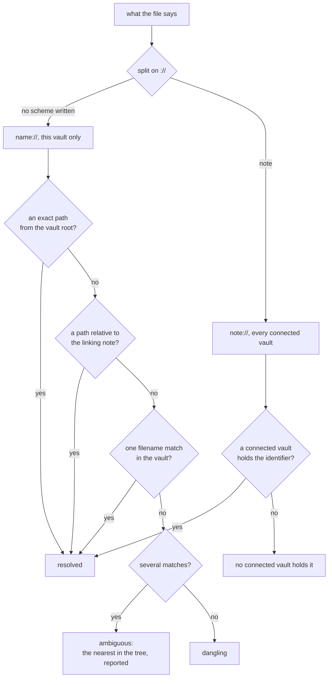

# Links

A link is one relationship as it was written in a file: what it points at, what kind of relationship it is, and what the person called it. Where it goes is resolved by querying the index and is not stored in the file.

## The record

A link that has a role is written in the `links:` block of the frontmatter — see [Note format](note-format.md).

| Field    | Required | What it is                                                                                   |
| -------- | -------- | -------------------------------------------------------------------------------------------- |
| `to`     | yes      | the address it points at                                                                     |
| `role`   | yes      | what kind of relationship it is, from the closed list of five                                |
| `type`   | no       | what the link is for, as a feature reads it                                                  |
| `label`  | no       | the few words the person calls this relationship, drawn along the line between the two notes |
| `marker` | no       | what is drawn at the end of the line that points at `to`, from the closed list below         |
| `note`   | no       | why the link exists, in the person's words                                                   |

`label` and `type` serve different purposes. A type is a category that code reads; a label is the person's own words, which no code reads. A link may have either, both or neither. No field holds a copy of the target's name.

```yaml
---
links:
  - to: '[[Thermodynamics]]'
    role: parent
  - to: '[[Linear algebra]]'
    role: parent
    type: requires
    note: 'only eigenvectors are needed'
  - to: '[[Entropy as disorder]]'
    role: jump
    type: contradicts
    label: 'argues the other way'
---
Ordinary text with an [[ordinary link]], which is a `ref`.
```

An entry with no `to`, an entry with no `role`, an entry with a role or a marker that is not in the closed list, and an entry the application cannot read are each reported as a problem on the note that contains them; the rest of the note is read as usual.

## Markers

`marker` is drawn at the end of the line that points at the record's target. The list is closed, as the list of roles is. A value is introduced together with the code that draws it.

|            |                               |
| ---------- | ----------------------------- |
| _(absent)_ | nothing is drawn at that end. |
| `arrow`    | an arrowhead at the `to` end. |

The marker is part of the record, so each note sets its own end: `marker: arrow` written in A puts an arrowhead at B, and the same key written in B puts one at A. A line whose two records have no marker is a plain line; a line whose records both have `arrow` has an arrowhead at each end. A marker does not change the role: `jump` with an arrow and `jump` without one are the same kind of link, drawn differently, and a record with a marker and no `label` is complete as it is.

## Roles

The list is closed. Navigation and rendering read it, so a role outside the list has no behaviour and is reported.

|              |                                                                                                                                                                              |
| ------------ | ---------------------------------------------------------------------------------------------------------------------------------------------------------------------------- |
| `parent`     | the note above this one in the hierarchy.                                                                                                                                    |
| `child`      | a note below this one in the hierarchy.                                                                                                                                      |
| `jump`       | a shortcut across the hierarchy.                                                                                                                                             |
| `ref`        | a plain mention. It is the body `[[wikilink]]`, produced by the parser, and is never hand-authored in the block. A wikilink inside a code fence is example text, not a link. |
| `attachment` | something that is not a note. It takes no part in the hierarchy.                                                                                                             |

`type` is an open vocabulary, and a value is introduced together with the code that reads it: one feature, one type. `preset` is one of them: written on a deck's link, it names the note that schedules that deck — [Cards](cards.md).

## The hierarchy

`parent: B` written in A and `child: A` written in B are one edge, and either end may be written. A link is returned in both directions — what a note points at, and what points at it — so it shows from whichever end the person wrote.

Multiple parents are ordinary: the hierarchy is a directed acyclic graph, not a tree.

`sibling` is not stored. Siblings are the children of a shared parent, which is a query.

## A connection

A connection is the relationship between two notes as a whole: up to two records, one written in each note, each with its own `label` and `marker`. There is no field for a reverse label; it is the `label` of the record in the other note. The roles of the two records are inverse of each other (`parent` and `child`, `jump` and `jump`), and the hierarchy built from them contains no cycle: a connection that would make a note its own ancestor is refused. Saving a connection writes both notes or neither.

Only `parent`, `child` and `jump` records are part of a connection. A `ref` is the body wikilink and an `attachment` points at no note. The plex draws a `ref` as a reference note, with an arrow to the note it points at, when its References setting shows it; the line to it has no link inspector, because no record joins the two notes.

A record is addressed by its target and its `type`. A note holds one record per target and type, and a record of another type to the same target belongs to a different connection.

## Interactive links in the Plex graph

The Plex graph allows authoring and managing relationships directly on canvas:

- Dragging a connection handle from any node draws an interactive edge.
- Releasing over an existing node establishes the link between them.
- Releasing on open canvas presents an autocomplete search popover to pick a target note or create a new note on the fly.
- Right-clicking an edge opens the link inspector popover to view and modify connections between two notes.
- The link inspector supports:
  - The kind of link between the two notes, and for each of the two ends whether the note writes a record, the label of that record, and whether it has an arrow.
  - Deleting one end or the entire connection.
- Editing a link from the graph updates the frontmatter `links:` block of the note directly.

## The same link written twice

`[[notes/Entropy]]` in the block and `[[Entropy]]` in the prose are one link. Sameness is decided by where the links resolve, so the links are merged after resolution. Two links that resolve to nothing are the same only when they were written the same.

The annotated record is kept: a mention in the prose is dropped in favour of the entry that has a role, a type and a note.

## Addresses

An address is scheme and value, and it is the only part that determines where a link goes.

A name in brackets is the primary written form: `[[Thermodynamics]]`. `note://<id>` is the auxiliary form, and it appears only where the application produces it — the application inserted the link and already knew the identifier, or the name was ambiguous and the priority below did not select a single target. Two forms, and no third.

`name://` is the stored form and never appears in a file: the parser sees `[[Thermodynamics]]` and stores `name://Thermodynamics`, so every stored address has a scheme and reading one is a split on `://`. A scheme is letters, digits, `+`, `-` and `.` written before the `://`, so the colon in a title like `Lecture 3: entropy` does not start a scheme.

A name is stored exactly as written and compared without regard to case: `[[entropy]]` finds `Entropy.md`, and a rename writes back the form the person chose.

A note's extension may be written or left off, and every other dot is part of the name: `[[Lecture 1.2]]` finds `Lecture 1.2.md`.

Inside the brackets, an alias after `|` is how the link is read in the sentence and a fragment after `#` points to a position in the note. Neither is part of the address, and both are kept whatever happens to the target.

A filename containing `#`, `|`, `://` or `]]`, or with a space at either end, cannot be written as an address that resolves to it, because the character is read as link syntax. Such a note is addressed by its identifier or not at all.

An `attachment` points at an address that no note matches — a file in the vault, or a URL — and nothing resolves it as a note.

## How a name resolves

In descending priority:

1. an exact path from the vault root;
2. a path relative to the folder of the note the link is written in;
3. a single filename match anywhere in the vault;
4. several matches — the link is **ambiguous**, not dangling. It resolves to the nearest match in the tree, measured by how much of the path it shares with the note the link was written in, and the ambiguity is reported.

Resolution is a query and is never stored: adding a file resolves a link that was dangling, and removing one breaks a link that worked.

A name resolves only inside the vault it was written in. Two vaults may each hold an `Entropy.md`, and a name in one vault never resolves to the file in the other. An identifier identifies one note globally, so `note://…` resolves in whichever connected vault holds that note, and the result includes the vault that holds it. This is the one query that deliberately searches beyond the vault it was asked about.

An identifier no connected vault holds is a fourth state: not resolved, and not dangling. The application cannot distinguish a deleted note from a note in a vault the person has not added, and it reports this. There is no server, no federation and no fetching: a link into a vault the person has not added is plain text in a known format.



## After a move or a rename

The application does this when the move happens inside it. A rename made outside, with the application closed, is not tracked and leaves names dangling.

What pointed at the note is read before the file moves, and each of those links is resolved again afterwards.

- **`note://` links are untouched.** An identifier is not tied to a name.
- **A link that still resolves to the note is left alone.** A name keeps matching the same note.
- **A link that now resolves to nothing is written again**, set to the name the note has now. Only the target part changes: the brackets, the alias, the fragment, the quoting and the spacing around it are kept, and every other byte of the note is left as it was.
- **A link that now resolves to a different note is reported and not repaired.** The person must decide which note was meant.
- **A note whose frontmatter will not parse is not written.** Its link stays broken and shows as a problem.

Resolution is a query, so every other link in the vault is resolved against the new state of the vault the next time it is resolved. If there was one `Entropy.md` and now there are none, a link that pointed at it may start resolving to a same-named file elsewhere without any notice.

## What is reported

Four checks, each finding is reported on the note a person would open to fix it.

|               |                                                                                                                                                                               |
| ------------- | ----------------------------------------------------------------------------------------------------------------------------------------------------------------------------- |
| `parse`       | what was found while reading one file: a link with no target, a link with no role, an unknown role, an invalid identifier.                                                    |
| `frontmatter` | a block between the delimiters that is not YAML. The note is indexed anyway, and nothing may be written into it.                                                              |
| `ambiguous`   | a link that resolves to more than one note. It resolves to the nearest, which is a fact about where the notes currently sit, so it changes meaning when either of them moves. |
| `dangling`    | a link that resolves to nothing. Creating the note it names fixes it.                                                                                                         |

`dangling` is off by default: it runs only when it is requested by name. The other three run whenever a vault is checked.
