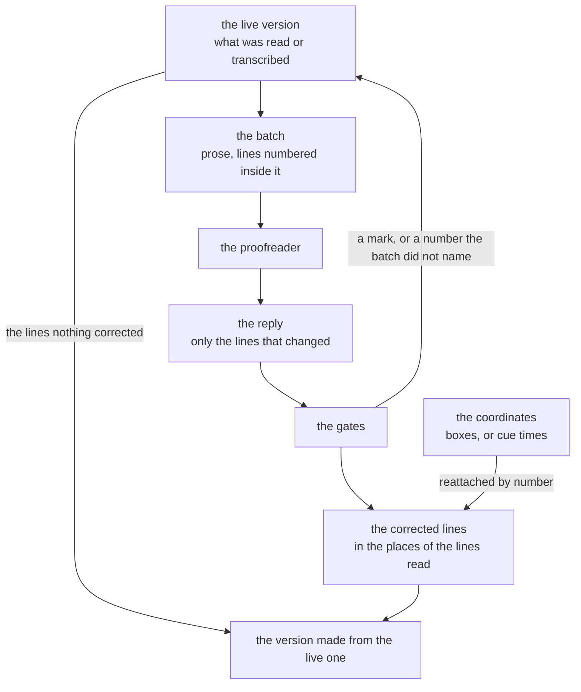

# Correcting a text

What a second model corrects in a text the first one produced, what it is shown, and what is done with its reply. A scan and a recording are proofread by the same mechanism: the model is given numbered lines, and replies with the same numbers. The corrected text is a new text version of the file, made from the version that was read; the version read is never rewritten.

## One mechanism, two texts

A machine that read a page and a machine that transcribed an hour both produce text nobody typed, and both get things wrong. What they got wrong is different — a scan contains letters that were misread, speech contains words that were taken for other words — and everything around that is the same, so one mechanism serves both.

| Proofread                                | The format of the version read              | The unit                            | Asked about                   |
| ---------------------------------------- | ------------------------------------------- | ----------------------------------- | ----------------------------- |
| a recognition, or a PDF's own text layer | positioned: parts in rectangles on pages    | one part, a printed line or a block | a page at a time              |
| a transcript                             | timed: parts between moments of a recording | one cue                             | a window of batches at a time |

A recognition is described in [Recognising a document](recognising.md). A transcript, and how a moment in it is named, are described in [Transcribing](transcribing.md). A text version, and which one is live, are described in the plan's section B in `resources/plans/plugins.md` and `libs/core/kernel/usecase/textversion`.

## The model is never shown a coordinate

A line has a rectangle on a page. A cue has two start and end times. Neither is sent.

The model is given prose with the lines numbered inside it, and it must answer with those numbers. A number identifies a line and gives no position: it identifies the line, and nothing about where that line is. The coordinates are reattached afterwards from what was originally read or transcribed, by the number.

This is what makes a correction safe to apply. Correcting a line's letters keeps its words inside that line, so the rectangle it was read at and the timestamp interval remain unchanged. A reply that renames a line, or that moves a word from one line into another, breaks the assumption the coordinates depend on, and it is rejected entirely.



## What is asked

A batch is the lines joined as prose, each starting with its number:

```
⟦864⟧Kenduvilva is situated about twenty miles ⟦865⟧south of Siuri on the banks
of the Ajay River. ⟦866⟧In the Gaudiya Vaişnava Abhidhāna, it is …
```

`⟦n⟧` starts the line numbered `n`, and that line ends at the next mark. The lines are joined, so a line ending mid-word continues in the next one and the model reads a sentence rather than a column of fragments.

The reply is only the lines that changed. If the proofreader would change nothing in a batch, the reply is empty. A reply row is the line's number followed by the line, separated by a bar, spaces, or both:

```
866|In the Gauḍīya Vaiṣṇava Abhidhāna, it is
```

A row whose number runs into a word is not a row. Where no bar separates them and the line as read starts with the same digits as the row, the row's number is missing and the batch is rejected.

## The digest of a transcript

A batch is forty lines of an hour, and a name or a term that the rest of the recording establishes has no support inside those forty lines. It looks like a mishearing and is returned as an ordinary word, a different one in each batch.

So a transcript's batches include a digest of the whole transcript, placed before the first mark:

```
The speech opens: welcome everyone today we will read a verse that the teacher …

Words recurring through it, as the machine transcribed them: Kenduvilva, Gaudiya, Ajay
```

It is built only from the transcript — the opening words as they were transcribed, and the words that are capitalised somewhere other than at the start of a sentence and occur more than once. A recording of any subject is described in the terms it uses itself, and no coordinate, path or name from the vault is in it. The model is told that the digest is context only and not a line to reply to, and that a word listed there is either corrected or left as it is, the same way every time it occurs.

A recognition has no digest: a page of a book is proofread against the page.

## The gates

None of them checks whether a correction is right.

- **A reply containing one of the application's marks refuses the batch.** No recogniser and no transcriber produces `⟦` or `⟧`, and either of them anywhere in a reply refuses the whole batch.
- **A line number the batch did not name refuses the batch.**
- **A line given in two rows refuses the batch.** A line is in one row, so the words of a line are in that row and in no other.
- **Letters changed by more than `maxEditDistance` drop that one correction.** Spaces, punctuation, symbols, diacritics and case are removed from both sides, and the Levenshtein distance between what is left is taken as a share of the longer. The default is 0.30 where the settings file sets no value.

Two more corrections are dropped without rejecting the batch: one saying what the line already says, and one that only adds non-word characters before what the line already says.

A rejected batch keeps the text as it was read or transcribed. So does a batch for which the reply is empty. That is the ordinary outcome and not a failure.

## The two instructions

The model is told which kind of text it has, because a scan and speech are corrected for different mistakes.

A scan is corrected for what a machine misread off paper: letters, diacritics, words run together or broken apart, marks that are not words. Nothing is translated, rephrased, repunctuated or improved, and a line read correctly is left alone.

A transcript is corrected for what a machine took wrongly: a word for its homophone, a name spelled as it sounded, a sentence ended in the wrong place, the punctuation that a model transcribing speech cannot place. The words a person actually said are not rewritten into better ones, and a stretch transcribed correctly is left alone.

Both instructions contain the same rules about the reply: each line appears in the reply at most once, nothing is added that the page does not print or the recording does not say, the marks are never written back, and a line to leave unchanged is omitted from the reply.

A printed line contains its words: on a page they stay where they were printed. Speech continues past the segment it was split into, so a transcript reply may also give runs, written as the first line of the run and the last: `12-14|the whole sentence, corrected`. The lines of a run become one cue, spanning their recorded time interval. A line where one sentence ends and the next begins is in the run of both, and that run is answered with every sentence it covers.

## Who does it

The proofreading plugin, `md.numen.tools.proofreading`, does all of it, and the core has no proofreading code. The plugin registers the versions it makes with the host. The plugin declares the command `proofreading.create` with the condition `version.isLive && version.kind != ''`, so the file's menu offers **Proofread** over the live version of any kind, and the host passes that version to the command as its argument `version-id`.

The plugin reads the live version through the host, numbers its parts from one, builds the batches, contains the two instructions, applies the gates to each reply, and merges the replies of overlapping batches. The corrected lines replace the parts they correct: a correction keeps its part's page and rectangles or its times, and a run of cues answered as one becomes one part spanning their times. The plugin keeps the corrected text in its folder of the vault's store, `.numen/md.numen.tools.proofreading/proofread-<hash>.json`, one file a version read, rewritten when that version is proofread again, and reports it to the host as a version whose input is the version it read.

The plugin asks for the operation `complete` and has no service, address or key of its own. Its setting `connections` holds up to 5 rows, each a connection from the Connections page with a model and a reasoning level, and the host tries them in order: when a row cannot answer (a rejected key, a payment required, a rate limit, a service that cannot be reached) it asks the next, and when none answers the proofreading fails and names each connection and its reason in the task. A connection is a service such as OpenRouter or OpenAI, a server such as Ollama, or an agent program on this computer; an agent runs with no tools and writes nothing to disk. The plugin never sees a key. With no row the plugin is off: the proofreading fails with a task that says so, and the page of the plugin offers a button to the Connections page, where a connection is added (see [Rows of connections](plugins/connection-rows.md)). The plugin adds no text of its own.

A proofreading waits in the core's shared queue and shows its progress as a task, in lines. A failure stays shown as the task's error until the file is proofread again.

## Which version is shown

The version shown, searched and passed to the next processor is the newest live one. A proofreading made from a recognition is live while the OCR plugin and the proofreading plugin are both enabled and the recognition is unchanged. With the OCR plugin off, both the recognition and the version made from it are dead, and the file falls back to the newest live version left — a PDF's own text layer, or a proofreading made from it. With the OCR plugin on again, the proofreading of the recognition is shown again.

**Delete text** in the file's menu is a command of the application (`app:version.delete`): it lists every text version of the file, a proofread one by its kind `proofreading`, and the core deletes the one picked, its record and its file.

## Settings

The sizes at which a text is split into requests are settings of the plugin: `batchSize`, `overlap`, `inFlight` and `maxEditDistance`, in [Settings](settings.md).

A line that two batches of a transcript both replied to is taken from the batch in which it is further from the end. A transcript is asked about a window of `inFlight` batches at a time; a correction is kept from the window it begins in when it begins before the next window's first line, and the next window starts after the last line such a correction covers.

## From the command line

`numen-cli proofreading.create <vault> <file>` is the plugin's command: it proofreads the file's live text, waits for the version, and prints how many lines it read and corrected.

## Without a model

With `NUMEN_TEST_MOCK_ML=true`, as `-debug-mock-ml` and the end-to-end tests set it, the plugin calls no model. The mock proofreader replies to every numbered line with `[proofread]` after its words, and the gates treat that reply as any other: a short line of a recognition, where the mark changes the letters by more than `maxEditDistance`, stays as it was read.
