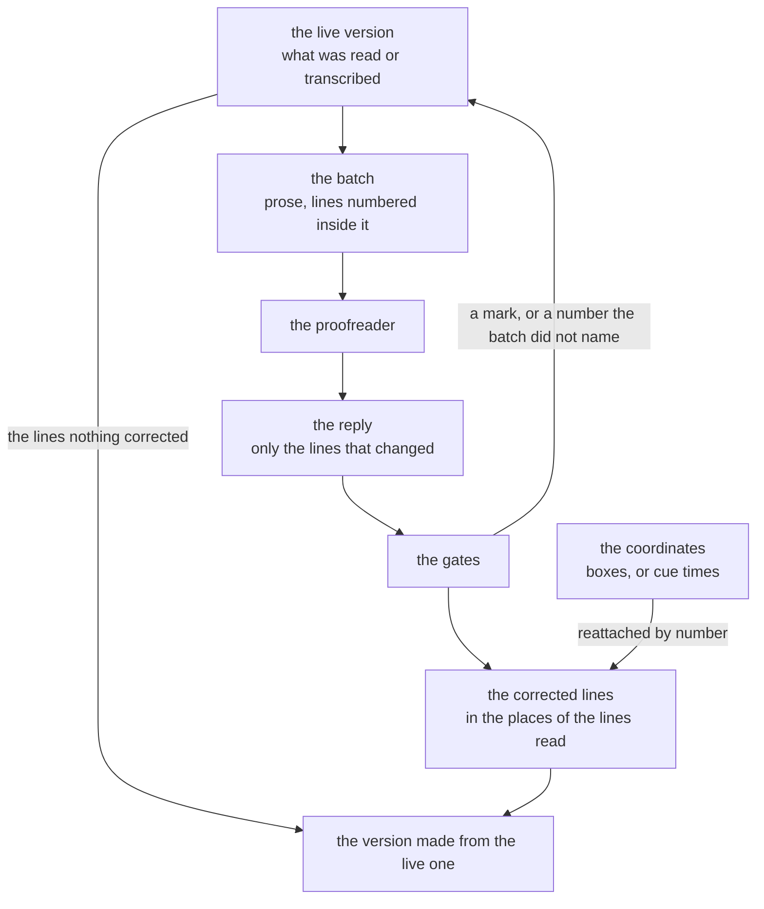

# Putting a text right

What a second model corrects in a text the first one produced, what it is shown, and what is done with its answer. A scan and a recording are proofread by the same mechanism: the model is given numbered lines, and answers with the same numbers. The corrected text is a new text version of the file, made from the version that was read; the version read is never rewritten.

## One mechanism, two texts

A machine that read a page and a machine that transcribed an hour both produce text nobody typed, and both get things wrong. What they got wrong is different — a scan carries letters a machine misread, speech carries words it took for others — and everything around that is the same, so one mechanism serves both.

| Proofread | The format of the version read | The unit | Asked about |
| --- | --- | --- | --- |
| a recognition, or a PDF's own text layer | positioned: parts in rectangles on pages | one part, a printed line or a block | a page at a time |
| a transcript | timed: parts between moments of a recording | one cue | a window of batches at a time |

What a recognition is is [Recognising a document](recognising.md). What a transcript is and how a moment in it is named is [Transcribing](transcribing.md). What a text version is, and which one is live, is the plan's section B in `resources/plans/plugins.md` and `libs/core/usecase/textversion`.

## The model is never shown a coordinate

A line carries a rectangle on a page. A cue carries two times on a clock. Neither is sent.

The model is given prose with the lines numbered inside it, and it must answer with those numbers. A number is a name, not a position: it says which line, and nothing about where that line stands. The coordinates are reattached afterwards from what was originally read or transcribed, by the number.

This is what makes a correction safe to apply. Putting a line's letters right leaves its words inside that line, so the rectangle it was read at and the timestamp interval remain unchanged. A reply that renames a line, or that moves a word from one line into another, has broken the one thing the coordinates depend on, and it is rejected entirely.



## What is asked

A batch is the lines run together as prose, each opened by its number:

```
⟦864⟧Kenduvilva is situated about twenty miles ⟦865⟧south of Siuri on the banks
of the Ajay River. ⟦866⟧In the Gaudiya Vaişnava Abhidhāna, it is …
```

`⟦n⟧` opens the line numbered `n`, and that line runs to the next mark. The lines are run together, so a line ending mid-word is finished by the next one and the model reads a sentence rather than a column of fragments.

The reply is only the lines that changed. A batch the proofreader would leave alone is an empty reply. A reply row is the line's number and, after it, the line, with a bar, spaces, or both standing between them:

```
866|In the Gauḍīya Vaiṣṇava Abhidhāna, it is
```

A row whose number runs into a word is not a row. Where no bar tells the two apart and the line as read opens with the digits the row opens with, the row's number was left out and the batch is rejected.

## What a transcript says it holds

A batch is forty lines of an hour, and a name or a term the rest of the recording establishes is, inside those forty lines, a word with no support. It reads as a mishearing and comes back an ordinary word, differently in each batch.

So a transcript's batches carry a digest of the whole of it, standing before the first mark:

```
The speech opens: welcome everyone today we will read a verse that the teacher …

Words recurring through it, as the machine transcribed them: Kenduvilva, Gaudiya, Ajay
```

It is drawn from the transcript and from nothing else — the opening words as they were transcribed, and the words standing capitalised somewhere other than where a sentence opens, said more than once. A recording of any subject is described in the terms it uses itself, and no coordinate, path or name from the vault is in it. The model is told the digest is read and answered for by nothing, and that a word listed there is put right the same way every time it is said.

A recognition carries no digest: a page of a book is proofread against the page.

## The gates

None of them asks whether a correction is right.

- **A mark of ours coming back refuses the batch.** No recogniser and no transcriber produces `⟦` or `⟧`, and either of them anywhere in a reply refuses the whole batch.
- **A line number the batch did not name refuses the batch.**
- **A line two rows both answer for refuses the batch.** A line stands in one answer, so the words of a line are in that answer and in no other.
- **Letters that moved further than `max_edit_distance` drop that one correction.** Spaces, punctuation, symbols, diacritics and case come off both sides, and the Levenshtein distance between what is left is taken as a share of the longer. 0.30 where the file names nothing.

Two more corrections are dropped without rejecting the batch: one saying what the line already says, and one that only puts something wordless in front of what the line already says.

A rejected batch is left as it was read or transcribed. So is a batch nothing came back about. That is the ordinary outcome and not a failure.

## The two instructions

The model is told which kind of text it has, because a scan and speech are corrected for different mistakes.

A scan is corrected for what a machine misread off paper: letters, diacritics, words run together or broken apart, marks that are not words. Nothing is translated, rephrased, repunctuated or improved, and a line read correctly is left alone.

A transcript is corrected for what a machine took wrongly: a word for its homophone, a name spelled as it sounded, a sentence ended in the wrong place, the punctuation a model transcribing speech has no way to place. The words a person actually said are not rewritten into better ones, and a stretch transcribed correctly is left alone.

Both instructions carry the same rules about the answer: a line is answered for once, nothing is added that the page does not print or the recording does not say, the marks are never written back, and a line to leave alone is a line not answered with.

A printed line holds its words: on a page they stay where they were printed. Speech runs on past the stretch it was cut into, so a transcript is also answered for in runs, written as the first line of the run and the last: `12-14|the whole sentence, put right`. The lines of a run become one cue, spanning their recorded time interval. A line where one sentence ends and the next begins stands in the run of both, and that run is answered with every sentence it covers.

## Who does it

The proofreading plugin, `md.numen.tools.proofreading`, does all of it, and the core knows nothing of proofreading. The plugin declares a text input of timed and positioned text and serves `numen.v1.TextProviderService`. The core offers **Proofread the text with LLM Proofreading** in a file's menu wherever that plugin is enabled and the file's live version is in one of those formats, and asks the plugin for a version made from the live one.

The plugin reads the live version through the host, numbers its parts from one, builds the batches, holds the two instructions, applies the gates to each reply, and gathers the replies of overlapping batches. The corrected lines take the places of the parts they answer for: a correction keeps its part's page and rectangles or its times, and a run of cues answered as one becomes one part spanning their times. The plugin keeps the corrected text in its folder of the vault's store, `.numen/md.numen.tools.proofreading/proofread-<hash>.json`, one file a version read, rewritten when that version is proofread again, and reports it to the host as a version whose input is the version it read.

The plugin names no model: it asks the host for a completion, and the host answers from the plugin's own `agent` setting, else from `ai.default` in [Settings](settings.md). An agent that is not installed or cannot be reached fails the proofreading, and no version is made. Before the person lets the plugin ask a model, the proofreading fails the same way, with "AI access not allowed — allow it in Settings → AI". The plugin invents no text and holds no key.

A proofreading waits for its turn in the core's shared queue and shows its progress as a task, in lines. A failure stays shown as the task's error until the file is proofread again.

## Which version is shown

The version shown, searched and handed to the next processor is the newest live one. A proofreading made from a recognition is live while the OCR plugin and the proofreading plugin are both enabled and the recognition is unchanged. With the OCR plugin off, both the recognition and the version made from it are dead, and the file falls back to the newest live version left — a PDF's own text layer, or a proofreading made from it. With the OCR plugin on again, the proofreading of the recognition is shown again.

**Delete the text LLM Proofreading made** in the file's menu asks the plugin to delete its version.

## Settings

The sizes a text is cut into requests at are the plugin's own settings: `batch_size`, `overlap`, `in_flight` and `max_edit_distance`, in [Settings](settings.md).

A line two batches of a transcript both answered about is taken from the batch in which it stands further from the end. A transcript is asked about a window of `in_flight` batches at a time; a correction is kept from the window it begins in when it begins before the next window's first line, and the next window starts after the last line such a correction answers for.

## From the command line

`numen-cli proofread <vault> <file>` is the plugin's own command: it proofreads the file's live text, waits for the version, and says how many lines it read and put right.

## Without a model

With `NUMEN_MOCK_ML=true`, as `-debug-mock-ml` and the end-to-end tests set it, the plugin asks no model. The mock proofreader answers every numbered line with `[proofread]` after its words, and the gates treat that answer as any other: a short line of a recognition, where the mark moves the letters further than `max_edit_distance`, stays as it was read.
