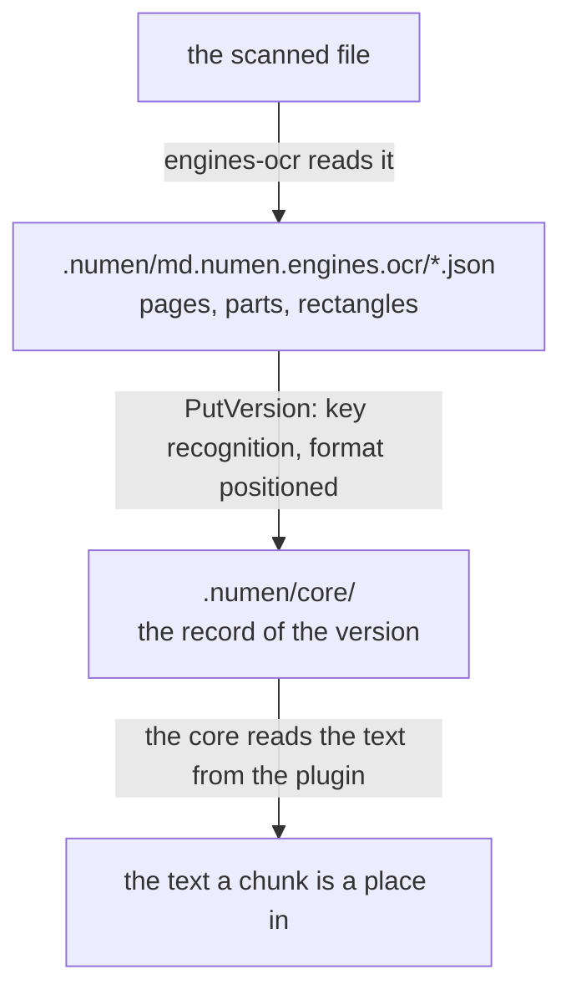

# How a document's pages are read

What a model reads off the pages of a scanned document, where it is kept, and what is done to it afterwards. Recognition is the plugin `engines-ocr` (`md.numen.engines.ocr`): it keeps each recognition in its own folder of the vault's store, `.numen/md.numen.engines.ocr/`, and gives it to the core as a positioned text version of the file, which is what the window shows and the index splits into chunks. The core keeps the record of the version in its own folder, `.numen/core/`; the plugin keeps the text.

## The record of one recognition

A recognition is one file, `<hash>.json`, where the hash is the SHA-256 of the file's path in the vault:

| Field        | What it holds                                                                                                                                   |
| ------------ | ----------------------------------------------------------------------------------------------------------------------------------------------- |
| `path`       | the path of the file read                                                                                                                       |
| `inputHash`  | the content hash of the bytes read                                                                                                              |
| `recipe`     | which layout, line and recognition models read it, and at what resolution                                                                       |
| `pageCount`  | how many pages the file has                                                                                                                     |
| `pages`      | for each page read so far, its parts: a run of text, the rectangles it was read from as fractions of the page, and the section a heading starts |
| `isComplete` | whether every page is read                                                                                                                      |

## What the text holds

The text of a page is its parts in reading order. Each block the layout model found is split at the start of each of its lines, so every part has the rectangle of its line; a block with no lines found is one part with no rectangle. Each block ends with a blank line. The core reads the text a page at a time, and each part has the index of its page and its rectangles, so a chunk split from the text maps to a place on a page.

A record that holds no text once every page is read is deleted, and no version is reported: the file falls back to its own text layer.

## How a page is named

A page is identified by its position in the file, and the pane a person reads it in opens at that number.

The page numbers printed on the paper are not used as page names. The page-label dictionary a born-digital PDF may carry is not read.

An EPUB is the exception. A book made for a screen has no pages of its own, so the page breaks it records from the printed edition it was set from are the only page names it has, and a page of one is identified by its label.

## Sections

A block that the layout model labels a heading starts a section, named by the heading's text. The section is stored on the first part of the block, and is never inferred from the recognised words.

The line boundary found by the detector cuts into the letters, so a found line is widened by eighteen pixels of the image the detector reads before it is read.

## Proofreading

A page was printed before it was scanned, so the recognition can be corrected against the printed original. Proofreading is done by the proofreading plugin: a person requests it from the file's menu, and the corrected text is a version made from the recognition, which stays as it was read. While the OCR plugin is off, that version is dead with the recognition it was made from. How a proofreader is prompted, what format its reply must have and what causes a reply to be rejected is described in [Proofreading](proofreading.md).

## A run

The plugin runs by itself on a file of its types that has no live text version when the setting `recognizeMode` says so (see Settings): under `whenNoTextLayer` a PDF with any page text is left alone, and under `always` every file is recognised. A person can request any such file from its menu, and a request always recognises it, whatever the mode, also a PDF that has text. A run nobody requested skips a file whose record is complete for its current bytes. A run waits in the host's queue, with a person's request before work nobody requested, and shows its progress as a task.

Recognition resumes where it stopped: the record is written after every eight pages, and a run whose record was made from the same bytes with the same recipe continues from the first page that the record does not contain. A record made from other bytes or by other models restarts from the first page. The version is reported once every page is read.

A file being recognised is not started again while its run is in progress.

## Settings

The plugin's settings are specific to it: `recognizeMode`, when text is recognized without a request (`off`, `whenNoTextLayer`, `always`; `off` by default), `dpi`, the resolution a page is drawn at before it is read (300), `language`, the recognition model (`auto`, `cyrillic`, `latin`, `ch`), and `customModelPath` and `customDictPath`, a recognition model and its character dictionary supplied by the person. A change to any of them reopens the recogniser for the next page. The settings of proofreading are in [Proofreading](proofreading.md).
