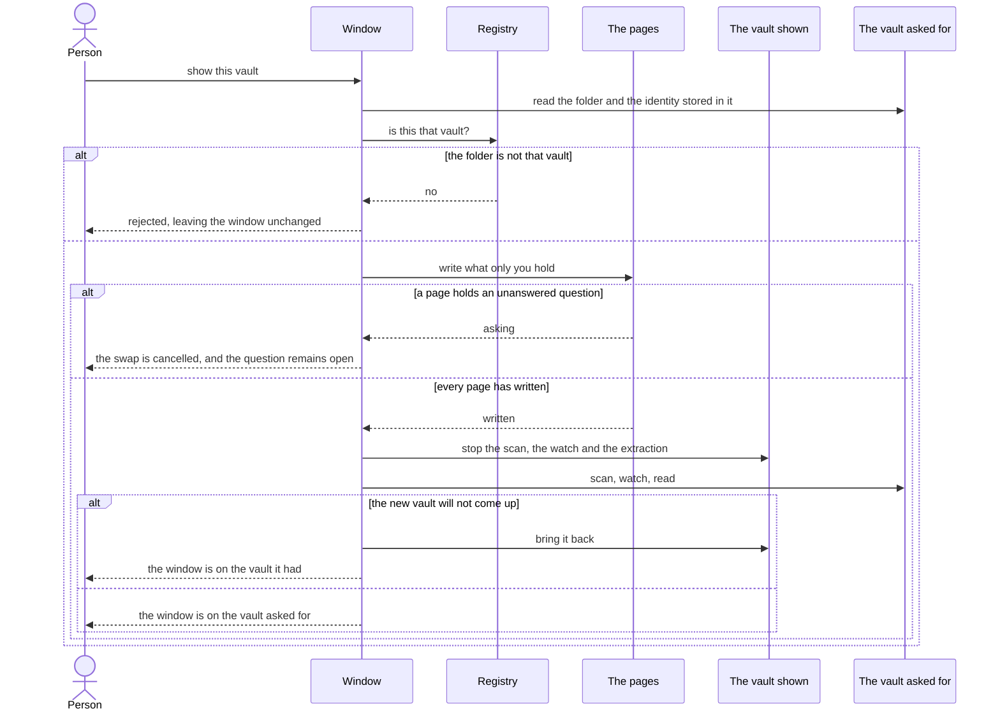

# Several vaults, one window

An installation holds a list of vaults. The window shows one of them at a time, and moving to another happens in the window that is already open. This page is that list — what is on it, what may go on it, what removes something from it — and what happens when one vault is unloaded and another is loaded.

## One installation, one vault at a time

The process has two parts, and they have different lifetimes.

**The installation is made once**: the index, the embedder, the list of what is being done, and everything subscribed to it. **One vault is initialized and torn down**: the scan, the watch, the extraction of documents, open documents, and what each of those has in flight.

Opening another vault tears down the second part and creates it again. One database holds every vault and the embedder belongs to the installation, so neither changes.

## A swap saves page state first

Every page saves the state only it holds before anything is torn down. This is the same step a closing window performs, requested for a second reason.

**A page that holds an unanswered question for the person cancels the swap.** The window stays on the current vault, and the question remains open. A page that does not respond has three seconds to return what it holds.

**One save step runs at a time.** A swap and a close each request one, and the second to arrive is rejected with an error message. A close requested during a swap is rejected and is not retried; the person presses close a second time.

## Nothing is taken down before the new vault is verified

The folder asked for is opened and the identity stored in it is checked against the registry, before the save step and before anything is torn down. A vault that fails that is rejected, leaving the window unchanged.

**A vault that fails to load after the old one is unloaded restores the old one.** Where that also fails, the window operates without an active vault, reports an error, and keeps write operations disabled.

Everything a page was holding was read in a vault that is no longer active, so the pages are instructed to reload.

## The registry is the list

Which vaults exist, where they are and which was opened last is JSON, written by the application, kept where the application keeps its own files and beside `numen.json` — see [Settings](settings.md). It is not derivable from anything and it is not a cache. It is read before the database opens, and especially when the database will not open.

The `vaults` table in the index is what every other row's foreign key points at. It is a copy of the list, which a scan rewrites.

## What may go on the list

**A vault has a unique name.** A folder added under a name another vault has gets the lowest free number appended, and the person renames it afterwards. Renaming a vault to a name another one has is rejected. Two names are one name when they are equal ignoring case and composed the same way.

**Vault roots do not overlap.** A root that lies inside a registered vault, or that contains one, is rejected. A file belongs to exactly one identity.

**A filesystem root is not a vault, and neither is the user's home directory itself.** A non-absolute path is rejected, and so is a folder that cannot be read as a vault.

### An identity already on the list

A vault stores its identity inside its own folder, so it is recognised wherever that folder is moved. An identity already registered at another path is either a move or a copy, and the two are distinguished by checking the old path:

- **the old path still contains that identity** — both folders exist, and this is a copy. It is rejected, reporting both paths and the identity. One index can hold only one of them. The remedy: the person deletes the service folder from the copy and adds it again, and it becomes a separate vault.
- **the old path is gone, or no longer contains that identity** — the folder moved, and the registry is updated. The entry is written at the new path, and the vault keeps the name it had.

## Removing a vault

**Forgetting** removes a vault from the list and the index. The folder and its stored identity are not changed, and adding the folder again restores the same vault.

**Erasing** forgets it and puts the folder in the trash of this machine. The folder is the person's own writing, so it is moved to the trash, where it can be restored. A machine with no trash fails with an error, and a folder that no longer holds this vault's identity stays where it is. A path where nothing exists any more is forgotten and nothing is moved.

**Neither may close the vault currently displayed in the window, and neither may remove the last vault of an installation.** The window always operates on an active vault. The use cases are not informed which vault is active; the window manages that state and handles rejections.

### What forgetting does to the index

Nothing cascades into a virtual table, so the five are emptied by hand before the row that the cascade starts from is deleted: the vector index, and the four full-text indexes over chunks, part names, titles and headings. The vector index has the vault as its own column; the other four are keyed by numbers read from the tables the last statement deletes.

**The vectors stay.** A vector is addressed by the text it was made from, so chunks of several vaults share one vector, and removing a vault deletes none of them.

The index file does not shrink. The space is reused and the file is the size it was.

## What an agent may do

Five tools:

| Tool           | What it does                                                                                                                                                                                                                                                                                                                                                |
| -------------- | ----------------------------------------------------------------------------------------------------------------------------------------------------------------------------------------------------------------------------------------------------------------------------------------------------------------------------------------------------------- |
| `vault_list`   | every vault this installation holds, and which one the person is looking at. A vault whose folder is gone is marked and stays on the list.                                                                                                                                                                                                                  |
| `vault_add`    | put a folder on the list. With no path, this machine's own folder picker is shown to the person and what they choose is added; a person who closes it has chosen nothing, and the response says so. With a path, the folder at that path becomes a vault. Nothing already in the folder is moved or rewritten, and the vault's identity is written into it. |
| `vault_rename` | rename a vault.                                                                                                                                                                                                                                                                                                                                             |
| `vault_remove` | remove a vault from the list and the index.                                                                                                                                                                                                                                                                                                                 |
| `vault_open`   | show another vault to the user, and answer once the window shows it. The agent's session ends with the vault it was serving. A window with unsaved changes keeps its vault, and the answer is an error that asks the user to save them.                                                                                                                     |

Every other tool operates on the vault `vault_list` marks with `isCurrent`, and no other.

**There is no tool that erases a vault from disk.** Deleting a person's folder is done only in the window, by the person.

`vault_add` with a path followed by `vault_open` lets an agent choose the folder it then works in.

## What is not covered

- **On Windows a folder can be deleted outright.** Where the volume has no recycle bin, the shell deletes permanently and reports success, and no flag turns that into an error. "It goes to the trash and comes back" is accurate on Linux and not on Windows.
- **The macOS trash is unverified.** It compiles and has never run: the selectors, the boolean return and the error out-parameter are untested until somebody runs it on a Mac.
- **The registry is not locked between processes.** Each write rewrites the whole file, so a window and a command line writing at once lose one of the two entirely. Inside one process it is locked.
- **A failed task left in the list of what is being done survives a swap.** A cancelled one removes itself; one that failed stays until it is dismissed, and it remains after the vault it refers to is gone.
