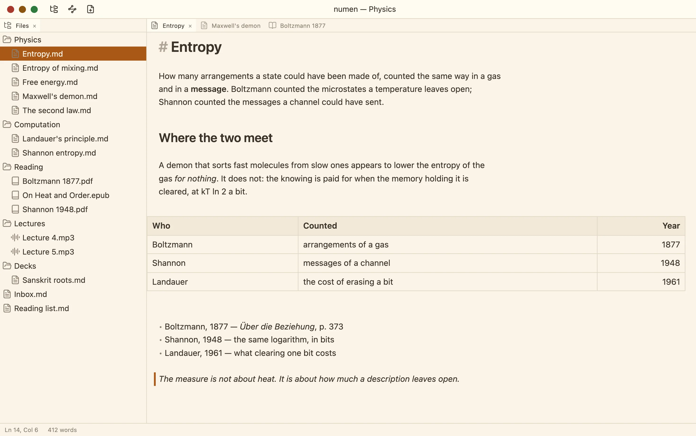

# Notes

Write and organize Markdown notes with live formatting, `[[wikilinks]]`, tables, and instant links to passages in your books and recordings.

<!-- more -->

<picture>
  <source media="(prefers-color-scheme: dark)" srcset="screenshots/editor-dark.webp">
  
</picture>

## What You Can Do

- **Clean live writing**: Headings, lists, tables, quotes, and links are formatted cleanly as you read, while showing the underlying Markdown syntax on the line you are currently editing.
- **Connect your ideas**: Link notes together with `[[Note Title]]` and paste quotes from books, PDFs, or transcripts that open the exact page or timestamp when clicked.
- **Interactive AI review**: When an AI assistant suggests changes to a note, review and accept or reject each edit right inside the note.
- **Create a note from the title bar**: The title bar has a New note button, placed by this plugin, that asks for the name of the note in the command palette.

## Settings

- **Live Preview**: Format Markdown cleanly as you type, or turn off to view raw Markdown everywhere.
