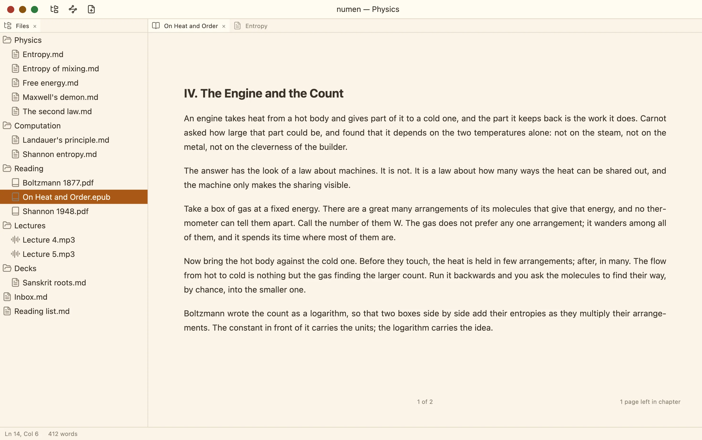

# EPUB Book Reader

Opens EPUB books in a two-column or one-column page reader, extracts their text for search and the agent, and highlights passages opened from links and search results.

<!-- more -->

<picture>
  <source media="(prefers-color-scheme: dark)" srcset="screenshots/book-dark.webp">
  
</picture>

## What You Can Do

- **Read EPUB books page by page**: Opens `.epub` files in a reader tab laid out in one or two columns depending on the pane width. Turn pages with the arrow keys, Page Up and Page Down, the space bar, a drag, or a click near either edge.
- **Browse and filter the table of contents**: Open the contents list from the button in the bottom-left corner, filter sections by title, and jump to any chapter or section.
- **Follow links and keep your place**: Click internal book links to move between sections, and reopen a book at the position where you left off.
- **Index book text for search and the agent**: Automatically extracts the text of each EPUB added to the vault or changed into a `book-text` version, or run **Extract text** from a file's right-click menu in the file tree. It reads the new and changed books from the file change feed of the vault, so a moved book keeps its text and a book that already has one of its content is not read again.
- **Open passages from search and links**: Opening a search result, a `numen:` passage link, or an agent citation jumps to that place in the book and highlights the passage on the page.
