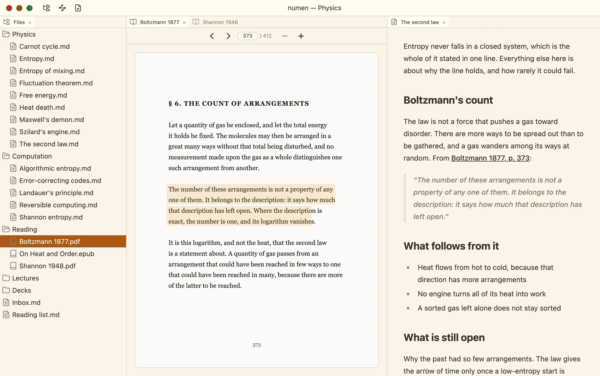

# PDF Reader

Opens PDF documents in a horizontal page reader with zoom controls, extracts their text layer for search and the agent, and highlights passages opened from links and search results.

<!-- more -->

<picture>
  <source media="(prefers-color-scheme: dark)" srcset="screenshots/reader-dark.webp">
  
</picture>

## What You Can Do

- **Read PDF pages**: Opens `.pdf` files in a horizontal strip of pages. Move between pages by dragging, scrolling, pressing the arrow keys, Page Up, Page Down, Home, or End, clicking the previous and next page buttons, or typing a page number in the toolbar.
- **Zoom pages**: Zoom in and out from the toolbar while keeping the current view centered, and reopen a PDF at the page where you left off.
- **Extract the text layer**: Automatically extracts the text layer and outline headings of each PDF added to the vault or changed into a `page-text` version, or run **Extract text layer** from a file's right-click menu in the file tree. It reads the new and changed files from the file change feed of the vault, so a moved PDF keeps its text layer and a PDF that already has one of its content is not read again.
- **Open passages from search and links**: Opening a search result, a `numen:` passage link, or an agent citation jumps to that page and highlights the matched passage boxes, using either the PDF's own text layer or text recognized by **Document OCR**.

## Settings

- **Default Zoom**: Initial zoom level when opening a PDF document (`page`, `width`, or `100%`; `page` by default).
