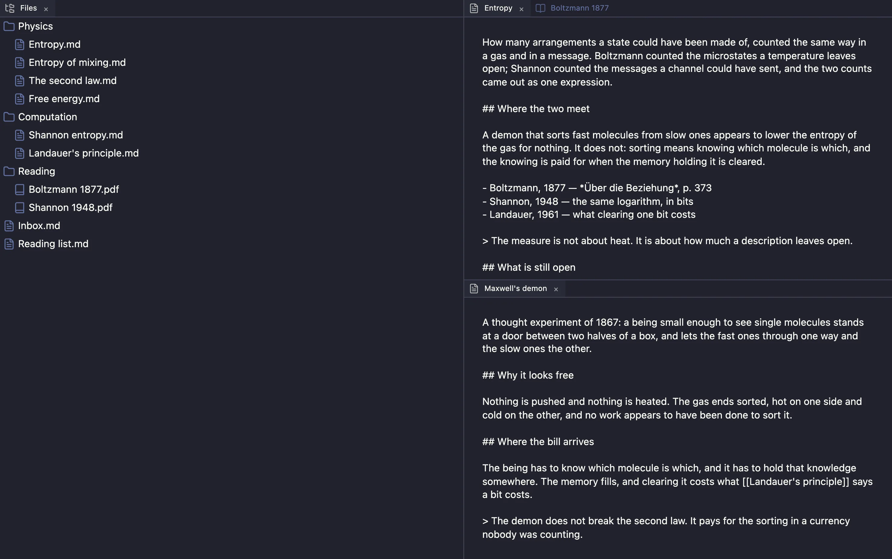
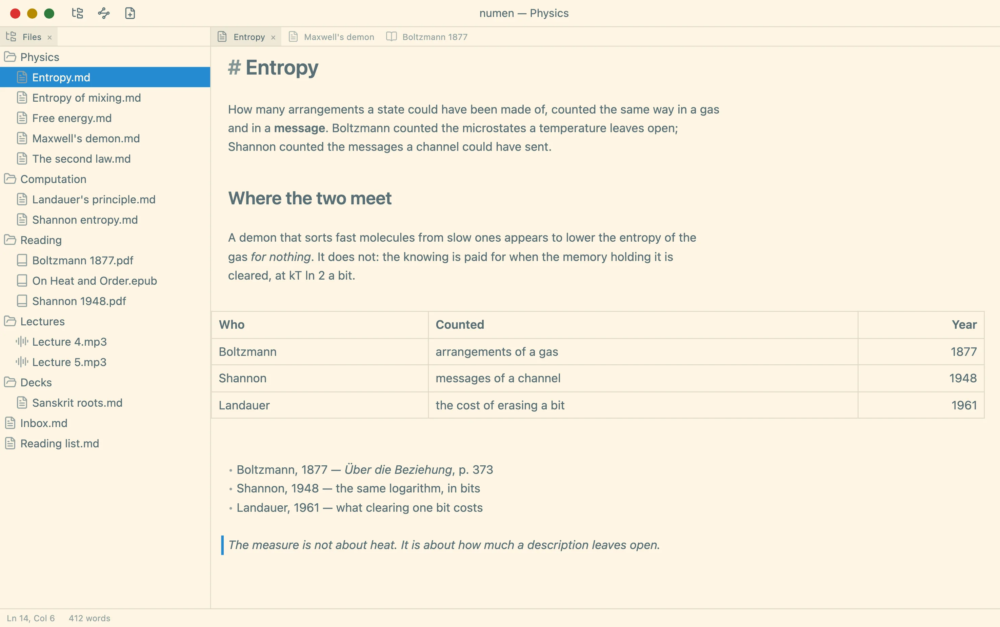

# Preset Themes

Forty-four ready-made color themes for the editor and the flashcards window.

<!-- more -->

<picture>
  <source media="(prefers-color-scheme: dark)" srcset="screenshots/dracula-dark.webp">
  
</picture>

<picture>
  <source media="(prefers-color-scheme: dark)" srcset="screenshots/solarized-dark.webp">
  
</picture>

## What You Can Do

- **Change the look of the window**: Pick any of the forty-four themes, most of them with a light and a dark half, from the appearance settings or the command palette.
- **Keep the default**: The default Numen theme is part of the application and does not depend on this plugin.

## Turning It Off

Disable the plugin in the plugin settings to remove its themes from the list. A window that applies one of them falls back to the default theme.

## For Authors

The plugin has no code. Its `manifest.json` lists each theme under `contributes.themes`, and each theme is one CSS file that redeclares the interface tokens. See the themes guide for the token list and the manifest fields.
