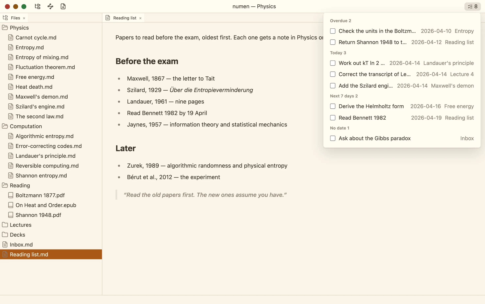

# Todos

Turns the task lists in your notes into one place to look at: write a task anywhere in a note, tick it off, and see what is overdue or due soon in a widget, in search and for your assistants.

<!-- more -->

<picture>
  <source media="(prefers-color-scheme: dark)" srcset="screenshots/tasks-due-dark.webp">
  
</picture>

## Writing a Task

A task is a list item with a checkbox, in any note:

```markdown
- [ ] Call the dentist
- [ ] (A) Send the invoice due:2026-12-01
- [ ] Prepare the talk +conference @laptop #speaking due:2026-12-10
- [x] Book the hotel done:2026-11-20
```

Write `- [ ]` (a space between the brackets) for an open task and `- [x]` for a done one. Numbered lists and `*` or `+` bullets work too, and a task may be indented under another item or sit in a quote.

Besides the text, a task line can carry fields, each a single word:

- **Priority**: `(A)` as the first word, or `pri:A`. One letter, A is the highest.
- **Due date**: `due:2026-12-01`, always `YYYY-MM-DD`.
- **Done date**: `done:2026-11-20`, added for you when you tick the task.
- **Project**: `+conference`. **Context**: `@laptop`. **Tag**: `#speaking`.

The rest of the line is the text of the task. A field with a date that is not `YYYY-MM-DD` is not read as a date. Lines in code blocks, in HTML comments and in the properties at the top of a note are not tasks, and neither is an empty `- [ ]`.

## Ticking a Task

Click the checkbox drawn in the note, or the one in the list of the widget. The task becomes `- [x]` and gets `done:` with today's date; unticking it removes the date again. Nothing else on the line changes.

## The Widget

By default the widget is in the title bar and shows how many tasks need attention. Click it to open a list grouped by **Overdue**, **Today**, **Next 7 days** and **No date**. Click the text of a task to open its note at that line, or its checkbox to tick it. When nothing needs attention the widget is hidden. Which groups appear, and are counted, is set in the settings below. The widget can be moved to another bar.

## Help While You Type

On a task line, the editor draws a real checkbox instead of `- [ ]`, colours the fields, and dims done tasks. It also suggests values as you type:

- `+` and `@`: the projects and contexts already used in your tasks.
- `#`: the tags of your notes.
- `due:` and `done:`: `today`, `tomorrow`, the coming weekdays, `+1w`, `+2w` and `+1m`, each completed to the date.
- `pri:`: the letters A to Z.

## Finding Tasks in Search

The search language gets functions that find notes with tasks in them. They combine with `&&`, `||` and `!`, and the result is the notes that hold such tasks.

| Function                         | Notes with                                       |
| -------------------------------- | ------------------------------------------------ |
| `hasOpenTask()`                  | an open task                                     |
| `hasDoneTask()`                  | a done task                                      |
| `hasTaskOverdue()`               | an open task due before today                    |
| `hasTaskDueToday()`              | an open task due today                           |
| `hasTaskDueWithin(days)`         | an open task due from today to `days` days ahead |
| `hasTaskDueBefore("2026-12-31")` | an open or done task due on or before the date   |
| `hasTaskWithoutDue()`            | an open task with no due date                    |
| `hasTaskProject("name")`         | an open task of the project `+name`              |
| `hasTaskContext("name")`         | an open task of the context `@name`              |
| `hasTaskPriority("A")`           | an open task of that priority                    |
| `hasTaskText("text")`            | an open task containing the text                 |

Examples for a saved search:

- `hasTaskOverdue()`: notes with late tasks.
- `hasTaskDueWithin(7) && path("Projects/")`: what is due this week in your projects.
- `hasTaskWithoutDue() && !hasTaskOverdue()`: notes with tasks that have no date yet.

## Working with an Agent

Assistants connected to your vault can list, add, tick, edit and remove tasks (`task_list`, `task_add`, `task_set_done`, `task_edit`, `task_remove`), always in the vault shown in the window. An edit, tick or removal is refused when the line no longer matches what the assistant saw, so it never changes the wrong task.

## Settings

The settings page shows them in three groups.

**Tasks**

- **Ignored folders**: Folders whose notes are not searched for tasks. Empty by default.

**Editor**

- **Hide task markers until the line is edited**: Shows `due:`, `done:`, `pri:`, `+project`, `@context` and `#tag` only while the cursor is on the line. Off by default.

**Widget**

- **Overdue**: List and count open tasks due before today in the widget. On by default.
- **Today**: List and count open tasks due today. On by default.
- **Next 7 days**: List and count open tasks due in the six days after today. On by default.
- **No date**: List and count open tasks with no due date. On by default.

For contributors: see [docs/DEVELOPMENT.md](docs/DEVELOPMENT.md).
