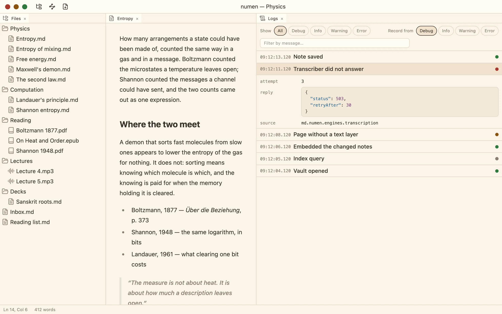

# Logs (`md.numen.tools.logs`)

Structured application log viewer for Numen. Open it to see what the application, its database, its handlers and its plugins have written to the log, and to find the entry behind a problem.

<!-- more -->

<picture>
  <source media="(prefers-color-scheme: dark)" srcset="screenshots/logs-dark.webp">
  
</picture>

## What You Can Do

- **Follow the live stream and recent history**: Follows `host.work.logs.watch`, displaying recent entries from today's daily JSONL log file (`logs/numen-YYYY-MM-DD.jsonl`) and incoming entries from the core, SQLite pools (`sql`), ConnectRPC handlers (`rpc`), windows (`window`), and plugins.
- **Filter and search**: The top filter bar narrows entries by severity level (`All`, `Debug`, `Info`, `Warning`, `Error`) and searches by message text.
- **Scan the summary row**: Each entry shows the timestamp, level badge, source, required `message`, and property key chips (`keys`).
- **Inspect the details**: Clicking an entry expands its properties inline. SQL queries (`sql`) are formatted across clauses, and JSON values (`request`, `response`, `args`, and structured objects) are formatted as indented JSON.
- **Choose what is recorded**: The Record from control sets the lowest level the log keeps.

The plugin is disabled by default. Enable it, then run **Open logs** to open the tab. Typical use is tracing a failure or a slow query, or checking what a plugin did.
