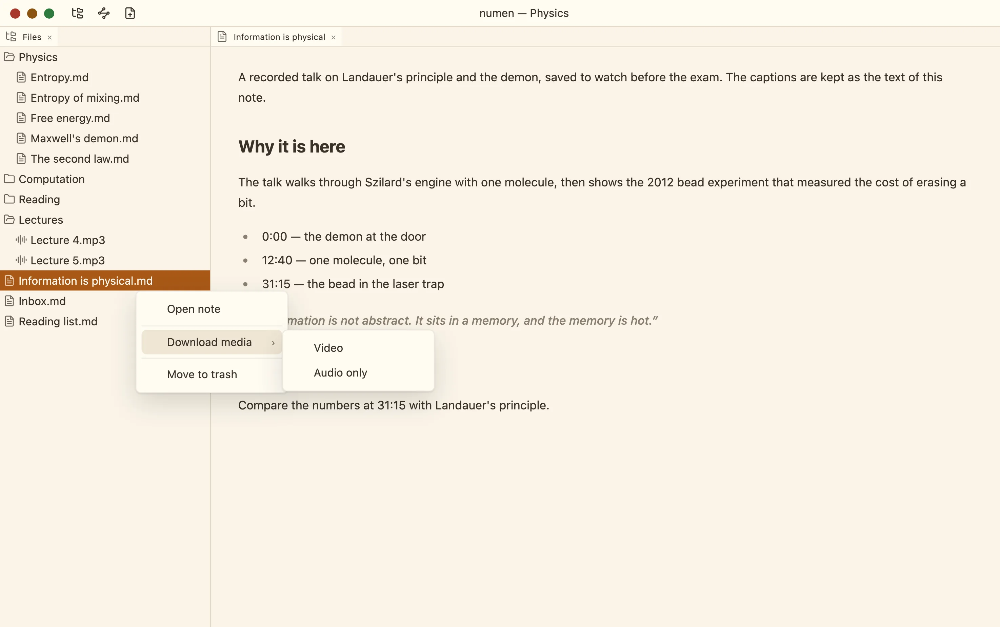

# Media Importer

Save web articles and online videos (such as YouTube lectures) into your vault for offline reading, watching, and searching.

<!-- more -->

<picture>
  <source media="(prefers-color-scheme: dark)" srcset="screenshots/download-media-dark.webp">
  
</picture>

## What You Can Do

- **Import a link**: Run **Import link** with a web address to make a link note for it. An address that already has a link note in the vault opens that note instead of making a second one.
- **Save the text of a link**: Run **Download captions** on a link note to save a clean copy of an article, or the captions of a video, as the note's text. It can be read and searched from then on.
- **Download the media of a link**: Run **Download media** on a link note and pick **Video** or **Audio** (the sound alone) to watch or listen offline in the Media Viewer. Link notes of the same address share one download. **Delete media** takes the download off that note, and the file is deleted once no link note refers to it.
- **Ask the agent to import a link**: The agent in the chat panel can save an address with the tool `url_import`, which makes the link note, or finds the one the address has, fetches its text and, when requested, downloads the video.

## Settings

- **yt-dlp**: Location of the `yt-dlp` program used to download online videos (detected automatically when installed on your system; otherwise a checked copy is downloaded into the application folder on first use).
- **ffmpeg**: Location of the `ffmpeg` program used to process downloaded audio and video (detected automatically when installed on your system; otherwise a checked copy is downloaded into the application folder on first use).
- **Caption languages**: Caption languages in order of preference, comma-separated.
- **Automatic captions**: Use auto-generated captions when a site has no others.
- **Download captions automatically**: Download the captions or the article of every link note added to the vault that has no text yet.
- **Maximum download size**: The largest download in megabytes; 0 for no limit.

## Certificate errors

The plugin does not ship or pin yt-dlp: it runs the program from the **yt-dlp** setting, or the first `yt-dlp` on `PATH`. The program runs with the environment of the plugin and no certificate option, so which certificates it trusts is decided by that program and by the machine, and a variable such as `SSL_CERT_FILE` or `REQUESTS_CA_BUNDLE` set for the application reaches it. The plugin never passes `--no-check-certificates`, and verification stays on.

When yt-dlp answers `CERTIFICATE_VERIFY_FAILED`, the failure shown names the untrusted certificate and the two usual causes: an authority that is missing from the certificate store yt-dlp reads, or a stale store.

| System | What decides trust | What to do |
| --- | --- | --- |
| Linux | A yt-dlp from the distribution or pip reads the system store through Python; the standalone `yt-dlp` binary carries its own bundle. | Update `ca-certificates` and yt-dlp; for a network that inspects HTTPS, add its authority to the system store, or point `SSL_CERT_FILE` at a bundle that holds it. |
| macOS | A yt-dlp run by a python.org Python has no store until its `Install Certificates` command has run; the standalone binary carries its own bundle. | Use the Homebrew or standalone yt-dlp, or run `Install Certificates.command` of that Python. |
| Windows | `yt-dlp.exe` carries its own bundle, so an authority added to the Windows store by an antivirus or a company proxy is not seen. | Update yt-dlp; ask for the authority in a bundle, or use a yt-dlp that reads the system store. |

These rows come from how yt-dlp and Python are documented to behave and from reading the plugin's code. They have not been reproduced on macOS or Windows.
