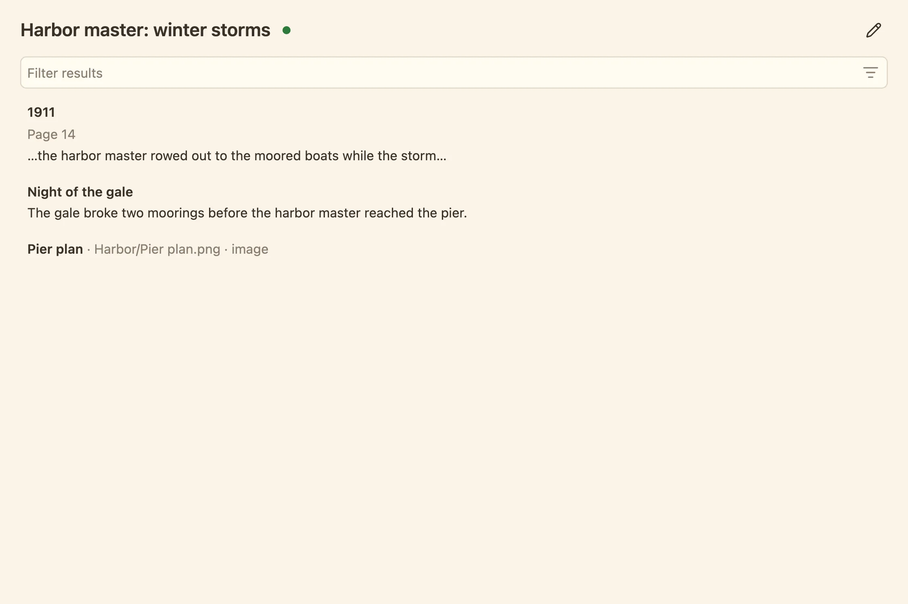

# Saved Search

Keeps queries of the search language as notes of the vault, and shows their results in a tab that stays up to date as the vault changes. The core runs the queries; the plugin saves them, keeps their last good results and shows them.

<!-- more -->

<picture>
  <source media="(prefers-color-scheme: dark)" srcset="screenshots/results-dark.webp">
  
</picture>

## What It Enables

- **Saved searches as notes**: A saved search is a note of type `search`. Its body holds the query in a fenced block `numen-query`; prose outside the block is free. Reranking and the number of results are part of the query, as `.rerank("…")` and `.top(N)`.
- **A tab of results**: A note of type `search` opens in the Saved Search tab. It shows when the results were computed, a failed last run with its time and reason, and the results in the order of the core: each passage with its file, its place (page, time or chapter) and its text, and each whole file, found by `kind` or `path` alone, as a row with its title, path and kind. A click, Enter or Space opens the file at that place, a whole file at its start. A field above the results filters them by their text, titles, places and file names, and the **Sources** list beside it hides or shows the results of each file. The edit button at the top right shows or hides, below the header, the query in a code editor set as code is in a note. It highlights the search language, completes the names of its functions, variables and stages with their description and example from the catalog of the core (functions other plugins add included), and underlines each problem of the query at its line and column. Once typing pauses for a second the query is written into the note and run, unless the core reports a problem, which is underlined instead.
- **Results that follow the vault**: When the index changes, a saved search whose tab is open runs again about 2 seconds later, so that a burst of changes gives one run. A saved search whose tab is closed runs again once its last run is at least the refresh delay old; earlier, it is marked stale and runs when the delay ends while the plugin runs, else at the next index change or when its tab opens. A change of its query runs it at once. These runs show one task, **Refreshing saved searches**; the core shows no task of its own for them.
- **Problems that keep the last results**: A run whose query has a syntax error, names an unknown function, or needs a provider that is missing or fails (no reranking connection, no embedding model, a reranking service that does not answer) stops. The tab keeps the last good results, underlines each problem of the query text at its line and column in the query editor, turns the dot after the title red with the error of the run in its tooltip, and tells of the failure in a notice. Warnings of a run turn the dot yellow and show in its tooltip. The run is tried again after the refresh delay.

## Tools

- `saved_search_create`: saves a query as a note in the folder the assistant names, else in the folder of the setting, runs it at once and returns the path of the note, its link and how many results the run found. The assistant tries the query with `library_query` first. A query the core reports problems of writes nothing.
- `saved_search_update`: changes the query of a saved search note and runs it again at once.

## Commands

- **Create saved search** (`search.create`): asks for a title only, saves a note with an empty query and opens it; the query is written in the note. It is in the command palette, which files the note in the folder of the setting, and in the **New** menu of a folder of the file tree, which files it in that folder.

Both run their search as an interactive search, which the core shows as its own task.

## The Cache

The plugin keeps the last good results of each saved search in a file of its own folder of the vault store, `.numen/md.numen.tools.saved.search/`, named by the id of the note (`<id>.json`), or by a hash of its path for a note without an id. The file holds the hash of the query, the floor, the order, the reranking connection and the index generation the core reported, the results, the time of the last good run, the time the index changed after it, and the time and reason of a failed run with the problems of its query. A file of another shape counts as no cache. Losing the folder costs one run of each search.

## Settings

- **Refresh delay**: Minutes a saved search whose tab is closed waits after its last run before an index change runs it again (`10` by default); `0` runs it at once. A saved search whose tab is open does not wait.
- **Folder of new saved searches**: Folder `saved_search_create` puts a note in when the assistant names none; empty is the vault folder.

The reranking connections and the limits of a search are settings of the core.
