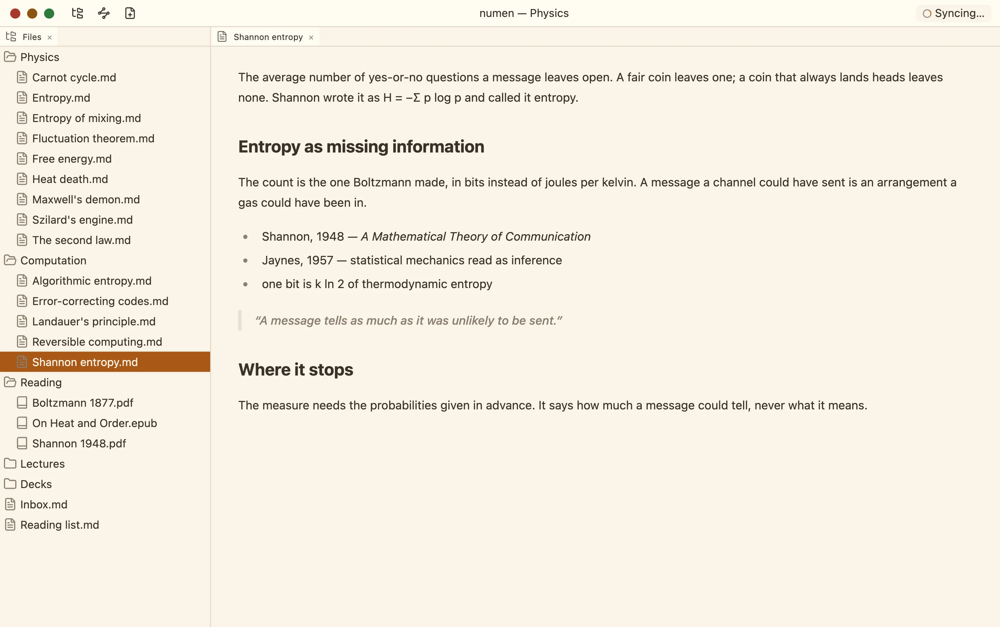

# Numen Sync

Synchronizes your vaults across devices when the **Numen Sync** license is active on this machine. The plugin shows the state of synchronization at the top-right of the editor window, so you can see at a glance whether your vault is up to date.

<!-- more -->

<picture>
  <source media="(prefers-color-scheme: dark)" srcset="screenshots/sync-dark.webp">
  
</picture>

## What You Can Do

- **Turn sync on with a license**: Activate the **Numen Sync** license for this machine and the plugin starts. It watches the license, so activating or removing it takes effect without a restart.
- **See the state of your vault**: The status shows whether the vault is still synchronizing or already synchronized.

## Title Bar Status

Numen Sync renders its status in the `titleBar.status` slot at the top-right of the editor window:

- While synchronizing after activation or startup, it displays **Syncing…** with a progress indicator.
- Once synchronized, it displays **Synced**.
- When the `sync` license is inactive, the indicator is hidden.
