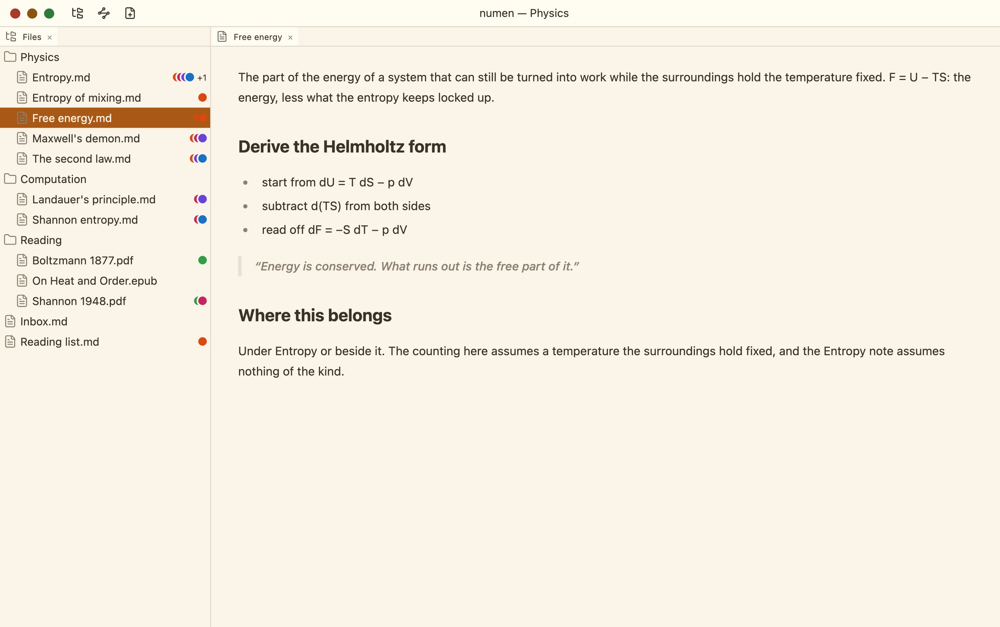

# Taxonomy

Reads the tags of your notes from their frontmatter, finds notes by tag in search queries, and lists the tags for agents with the number of notes under each tag.

<!-- more -->

<picture>
  <source media="(prefers-color-scheme: dark)" srcset="screenshots/file-tags-dark.webp">
  
</picture>

## What You Can Do

- **Tag a note**: Write the tags of a note under the key `tags` of its frontmatter, as a list (`tags: [Projects/Web, River]`) or as one tag (`tags: River`).
- **Nest tags**: A slash puts a tag under another: `Projects/Web` is under `Projects`, and a note tagged `Projects/Web` counts for both.
- **See the tags of a file in the file tree**: A file that has tags shows them as up to four colored dots at the end of its row, and the count of the rest as `+3` when there are more. Hovering the dots shows every tag. A tag has the same color in every file.
- **Delete a tag**: **Delete tag** in the command palette lists the tags the notes have, each with the number of notes, and, once you pick one, asks "Delete the tag X" with "Removed from N notes" under it ("Keep the tag" is the first answer, and leaves every note as it is); on yes it removes the tag from every note that has it, in one write. The question is the `answers` of the command in the manifest. The tags nested under it and the rest of the note stay as they are, and a note left with no tag loses the key `tags`. A note that cannot be written keeps the tag and the command reports it.
- **Ask an agent about your tags**: An agent lists the tags of the vault with the tool `tag_list`, the whole tree or the tags under one tag.
- **Find notes by tag in a query**: A query of the search language takes `hasTag("Projects")` for the notes tagged `Projects` or a tag nested under it, `hasTagExactly("Projects")` for the notes tagged `Projects` itself, and `hasAnyTag()` for the notes with any tag, as in `hasTag("Projects") && meaning("deadline")` or `!hasAnyTag() && kind == "note"`.

## How Tags Are Read

- A tag is the same tag in any case: `River`, `river` and `RIVER` are one tag. The list shows the spelling of the first note in path order.
- A leading `#` is not part of the tag, so `#River` is `River`.
- Spaces around a tag and around each level are dropped, and an empty level is left out: `Projects / Web` is `Projects/Web`.
- A number is read as its text. Any other value of `tags`, such as a map, gives no tags.
- A note counts once for a tag, however many of its tags are that tag or nested under it.

The plugin reads every note's tags the first time it is used, and after that only the notes whose frontmatter changed, also those changed while Numen was not running. A moved or renamed note keeps its tags.

## For Plugin Authors

The plugin has the permissions `vault:read` and `vault:write`. Its frontend draws the view `file-tags` in the slot `fileTree.rowEnd` and the view `plex-tags` in the slot `plexGraph.nodeBelow` from one map of paths to tags, read from `GetTagMap` of its service `md.numen.tools.taxonomy` when a view or `tags.set` needs it, updated from `SetTags` and refreshed on `onVaultChange` while a view is mounted. The colors are the tokens `--numen-tag-1` to `--numen-tag-8` of `@numen/ui`. It keeps the tags of each note, by the note's `source_id`, in `tags.json` in its folder of the vault's store, and its cursor of the file change feed in `tags.cursor.json` there, through `changes.Follow` of the Go SDK. It declares the activation event `onFilesChanged:text/markdown`, so only a change of a note wakes it. At each use and on each `onFilesChanged:<vault id>` event it reads `ListFileChanges` of `note.frontmatterChanged`, `file.removed` and `file.moved` from its cursor: a removed note is dropped, a moved note keeps its tags under its new path, and the notes whose frontmatter changed are read again in one `ReadFrontmatter`. Only a feed that resets, or no `tags.json`, reads the frontmatter key `tags` of every note, in pages. The tool `tag_list` (capability `tools`) returns the tree depth first, each tag with its depth and the number of notes that have it or a tag nested under it; `under` lists one tag and the tags nested under it. The backend serves `SearchFunctionService` for the functions `hasTag(tag)`, `hasTagExactly(tag)` and `hasAnyTag()` its manifest declares in `contributes.searchFunctions`: `FindDocuments` lists the notes in path order with their exact count, `MatchDocuments` keeps the paths asked about that hold (`hasTagExactly` holds for a note with the tag itself, compared without case, not for one with only a tag nested under it), and both bring the tags up to date first. When that fails, they answer from the tags kept with the warning `the tags may be out of date (index generation …)`. A `hasTag` or `hasTagExactly` call whose tag cleans to nothing is `InvalidArgument`.
