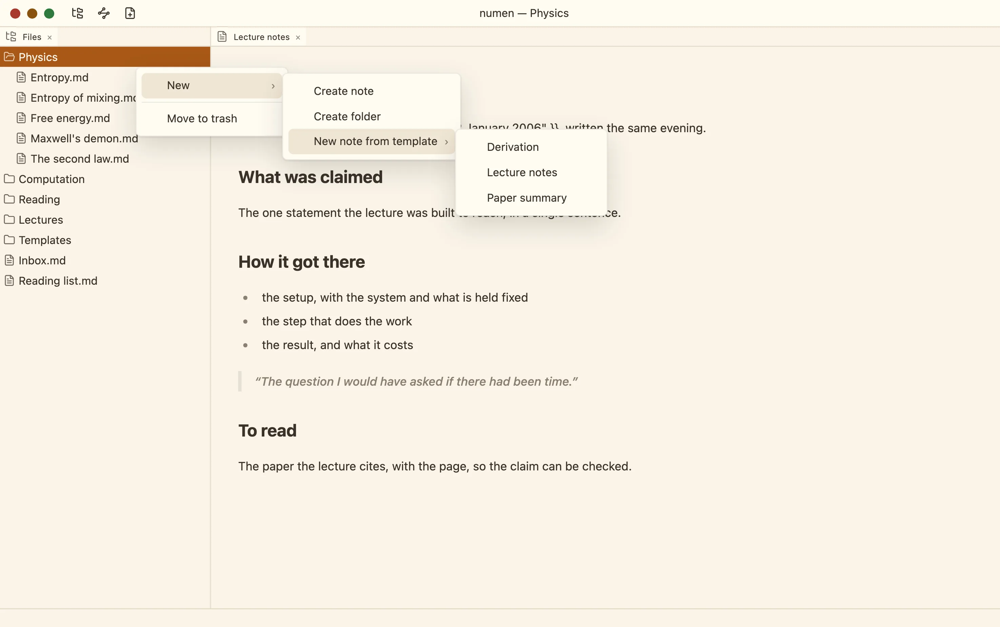

# Templates

Makes a new note from a template: a note that a mask of the setting names, with its variables filled in. The user guide is [docs/templates.md](../../docs/templates.md).

<!-- more -->

<picture>
  <source media="(prefers-color-scheme: dark)" srcset="screenshots/new-from-template-dark.webp">
  
</picture>

The frontend lists the templates, asks the name of the note and the questions a template has in the palette (`ListFields` suggests the name, then `CreateNote` with the `name` and the `values`), and runs the command `note.createFromTemplate`. The backend reads the template through the host, runs it with Go `text/template` (the engine in `backend/engine`, with one seam for more functions), and creates the note with its own `id`. The setting `templates` holds the masks of the paths that are templates (`Templates/**, **/*.template.md`).
