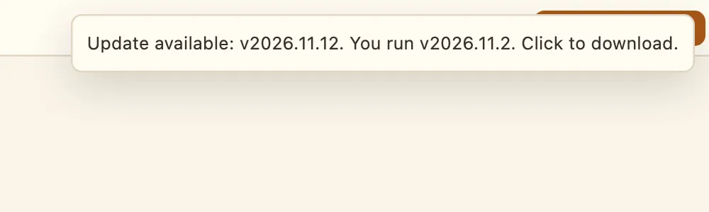

# Update Notifier

Shows a notice when a newer build of Numen is published, with a link to its download.

<!-- more -->

<picture>
  <source media="(prefers-color-scheme: dark)" srcset="screenshots/update-dark.webp">
  
</picture>

## What You Can Do

- **See that an update exists**: A version badge appears in the title bar, after its title, while a newer build is published. Click it for the release date, the way to install on your system and a link to the release notes.
- **Dismiss an announcement**: **Dismiss** hides the badge for that version until you restart the window. A newer version shows it again.

The plugin checks without showing messages. A machine without a network connection, or a feed that does not respond, shows nothing, and the feed is requested again later.

## Settings

- **Channel**: **Stable** notifies about releases; **Nightly** notifies about the build made every night; **Custom** asks the release feed address below. Until a channel is chosen, a nightly build uses Nightly and any other build uses Stable.
- **Release feed address**: Shown only for the **Custom** channel, which requires it: the address of the `latest.json` file to request the newest build. The Stable and Nightly channels ask their own published feeds, and the stored address is kept while it is hidden.
- **Check interval**: Hours between two checks (`4` by default).

## How It Works

The plugin's backend requests the release feed and compares its build number with the running build; where the running build has no number, versions are compared. The window shows the result in the title bar. Its service `md.numen.tools.updater` has the methods `Check` and `GetStatus`; a check runs only after the application has configured the plugin with its settings.
