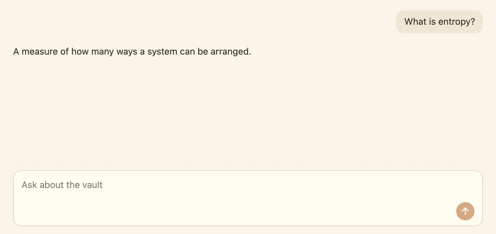

# Agent Chat

Open a conversation tab to ask AI assistants questions about your vault, find passages across your books and notes, and collaborate on writing.

<!-- more -->

<picture>
  <source media="(prefers-color-scheme: dark)" srcset="screenshots/agent-dark.webp">
  
</picture>

## What You Can Do

- **Chat with no setup**: The chat uses every agent connection on the Connections page, in their order, until you choose agents on the plugin page.
- **Choose the agents on the plugin page**: Add the agents as connection rows under Agents; the chat asks them in order and uses the next one when one cannot answer.
- **Switch agents and models in the chat**: The picker under the field names the agent and model that answer. Choose another agent, model or depth of reasoning there, and the next questions of that conversation go to it alone; when it fails, the chat shows its error. Each tab remembers its chosen connection and model across restarts. A new conversation starts with the last choice when available.
- **Click citations to verify sources**: Answers include clickable links to your notes, book passages, PDF pages, and transcript timestamps so you can jump straight to the source.
- **See what the assistant is doing**: Watch each search and note lookup step as the assistant works on your request.
- **Open the chat from the title bar**: The plugin places its Open agent chat command in the title bar as a button.

## Settings

- **Agents**: The connections that answer in the chat, up to five, tried in order. The model and the depth of reasoning are set on each connection row. With "Discover automatically" on and no row chosen, every agent connection answers, with the default model of its agent.
