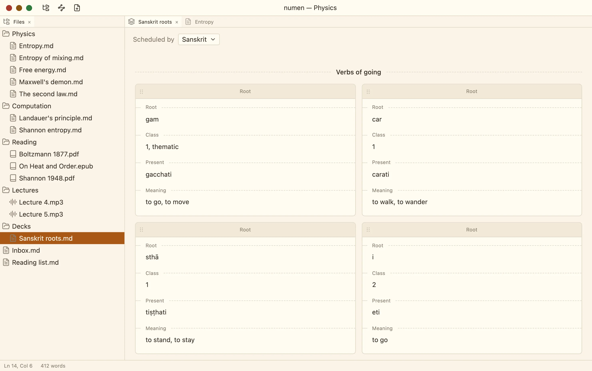
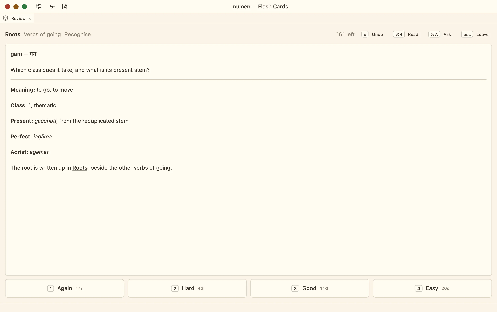

# Flashcards Studio

Create flashcard decks, design custom card layouts, and review cards with spaced repetition to remember what you read.

<!-- more -->

<picture>
  <source media="(prefers-color-scheme: dark)" srcset="screenshots/deck-dark.webp">
  
</picture>

<picture>
  <source media="(prefers-color-scheme: dark)" srcset="screenshots/review-dark.webp">
  
</picture>

## What You Can Do

- **Build and manage decks**: Browse, search, and edit flashcards in a clean table view.
- **Design custom card templates**: Define your own fields and front/back card layouts for languages, definitions, or quotes.
- **Spaced-repetition review**: Study due cards in the dedicated review window, scheduled automatically so you review each card right before you would forget it.

## Settings

- **Day starts at**: The time of day (`04:00` by default) when a new daily review session begins, so late-night reviews still count toward the current day.
