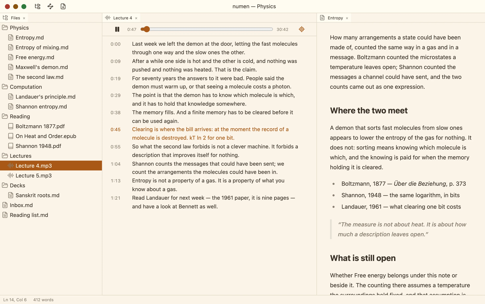

# Media Viewer & Recorder

Play audio and video recordings and the media of link notes alongside their text, or record new voice notes directly from your microphone.

<!-- more -->

<picture>
  <source media="(prefers-color-scheme: dark)" srcset="screenshots/recording-dark.webp">
  
</picture>

## What You Can Do

- **Listen and follow along**: Play recordings while the active line in the transcript or captions highlights and scrolls with the playback. Scrolling away from the active line turns **Follow** off; turn it on again to return to it.
- **Watch link notes**: A link note plays its downloaded video or audio, or shows the site's player while nothing is downloaded, above its captions or article.
- **Jump to any moment**: Click any timestamp in the transcript to jump playback to that exact second.
- **Transcribe, proofread, and edit by hand**: Start **Transcribe** or **Proofread** with one click in the toolbar, or click **Edit** to fix any line of the transcript yourself.
- **Record voice notes**: Start **Record audio** in a vault folder or alongside a note. **Stop** saves the recording in that folder and opens the player.
