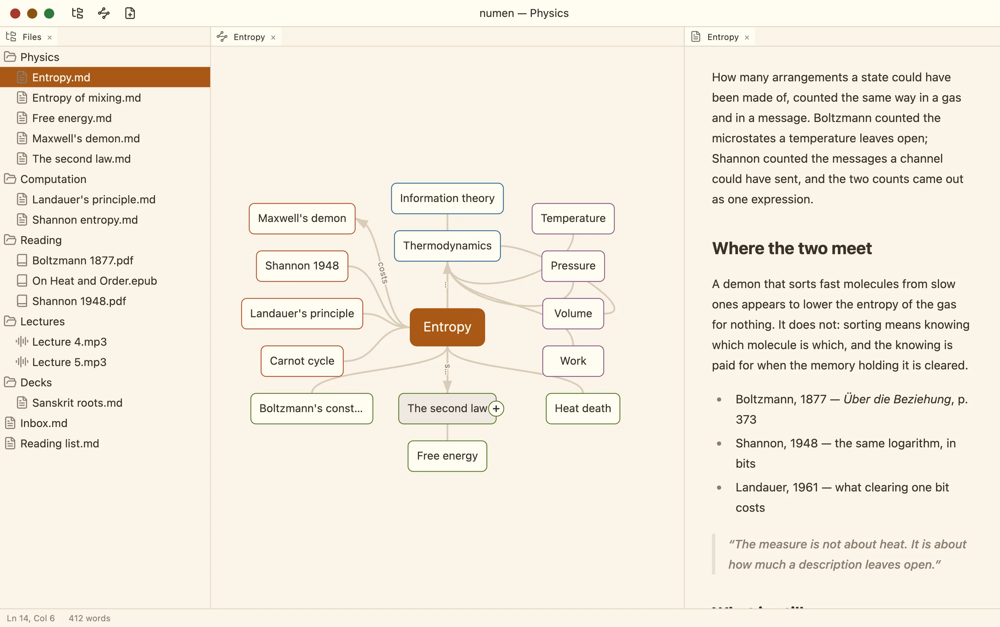

# Plex Graph

Explore your notes as an interactive visual map showing how ideas connect as parent topics, subtopics, related jumps, and siblings.

<!-- more -->

<picture>
  <source media="(prefers-color-scheme: dark)" srcset="screenshots/map-dark.webp">
  
</picture>

## What You Can Do

- **See the context around any note**: Shows your current note at the center with its parent topics above, subtopics below, and related notes to the side.
- **Connect and create notes visually**: Drag a connection line from one note to another to link them, or drag onto empty space to create and link a brand-new note in that direction.
- **See the notes linked in the text**: With the References setting, the plex also draws a note that the text of the note links to, or that links to it in its text, as a reference note, to the left: the references go up from the row of the note, the jumps go down from the row under it. When the window is too small for that, they share one block, the references over the jumps. Choose outgoing, incoming, both or none.
- **Navigate the map**: Click any connected note to move the focus there and follow the links from note to note.
- **Open the plex from the title bar**: The plugin places its Open plex graph command in the title bar as a button.
- **Change how the plex looks**: In the plugin settings, turn off the pill behind titles, change the padding of pills, the size of the note in the middle, how long moving to another note takes, the thickness and curvature of lines, highlight all lines of a note while the pointer is over it, the room around each note, and whether notes with views of different heights are kept aligned to a grid.
