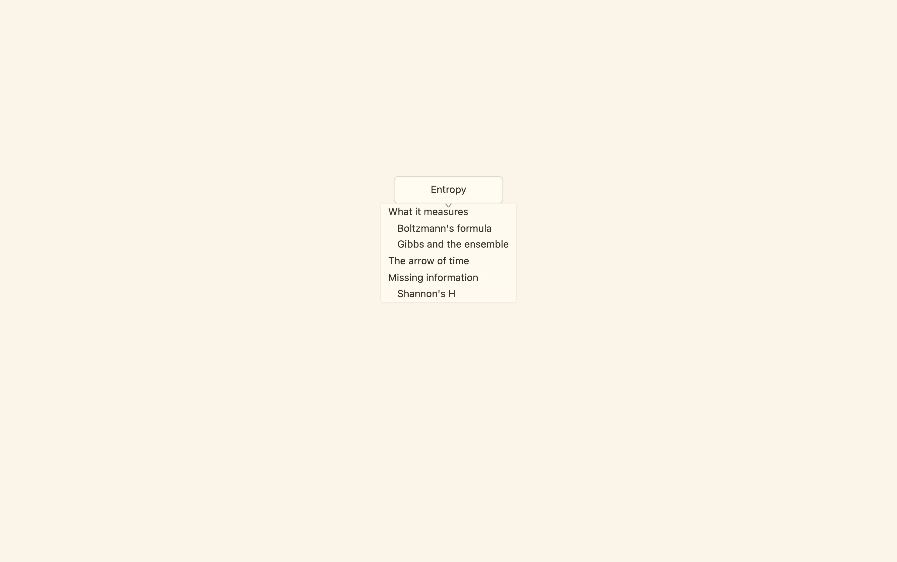

# Plex Headings Dropdown

Leave the pointer on a note in the plex and the headings of that note appear under its box, each indented by its depth. Click a heading to open the note at that line.

<!-- more -->

<picture>
  <source media="(prefers-color-scheme: dark)" srcset="screenshots/headings-dark.webp">
  
</picture>

## What You Can Do

- **See what is inside a note**: The headings of the note under the pointer come out under its node, indented by depth. They are read for that note alone, when the pointer rests on it.
- **Open a note at a heading**: Click a heading to open the note with the caret on its line. The plex does not move.
- **Scroll through many headings**: A note with more headings than fit shows a small mark at the edge of the list; the mouse wheel scrolls through the rest a heading at a time. A node near the bottom of the window shows fewer, because there is less space below it.
- **Choose how many show**: Turn the headings off or set how many a note shows in the plugin settings.
