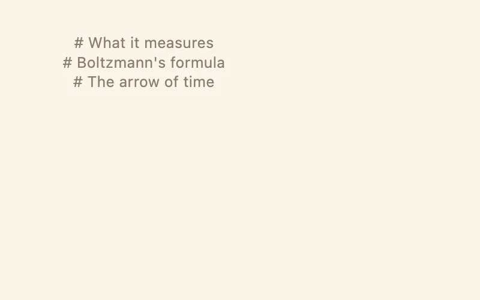

# Plex Headings Inline

Under each note of the plex, small grey lines write the headings of that note, each as `# Heading`. Click a heading to open the note at that line.

<!-- more -->

<picture>
  <source media="(prefers-color-scheme: dark)" srcset="screenshots/headings-dark.webp">
  
</picture>

## What You Can Do

- **See what is inside a note**: The headings of every note in the plex stand under its node, in the order they come in the note.
- **Open a note at a heading**: Click a heading to open the note with the caret on its line. The plex does not move.
- **Choose how many show**: Set how many headings a note shows in the plugin settings. Disable the plugin to hide them.

The plugin is independent of Plex Headings Dropdown, which lists the headings of the note under the pointer; each is enabled and set on its own.
