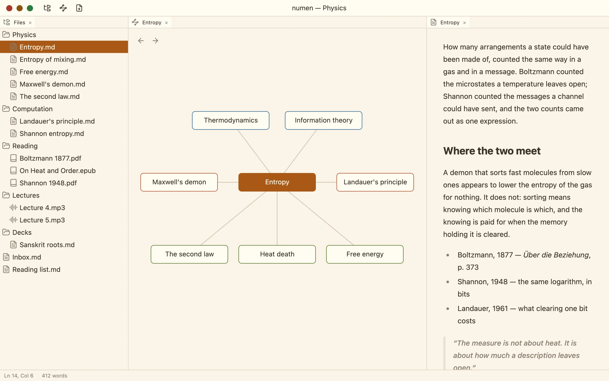

# Plex Navigation

Back and Forward buttons at the top of a Plex board retrace the nodes you visited and move forward again, so you do not search for them by hand. Each Plex board keeps its own history.

<!-- more -->

<picture>
  <source media="(prefers-color-scheme: dark)" srcset="screenshots/navigation-dark.webp">
  
</picture>

## What You Can Do

- **Go back**: Back shows the node visited before the one in front.
- **Go forward**: After going back, Forward shows the node you left.
- **Branch**: Moving to a new node after going back discards the nodes that were ahead.
- **See what is possible**: A button is dimmed and does nothing when there is no node in that direction.
