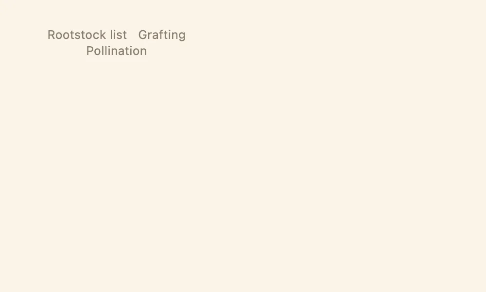

# Plex Related Names

Under and over each note of the plex, small grey names show the notes it is related to: its parents over it, its children and other related notes under it. Click a name to move the focus there.

<!-- more -->

<picture>
  <source media="(prefers-color-scheme: dark)" srcset="screenshots/names-dark.webp">
  
</picture>

## What You Can Do

- **Move the focus**: Click a name to show that note in the plex.
- **Wait for the names**: The plex lays its notes out once the names of all its notes have been read, so they do not jump when the names arrive.
- **Choose how many names show**: Set how many names a note shows in the plugin settings. Disable the plugin to hide the names.
